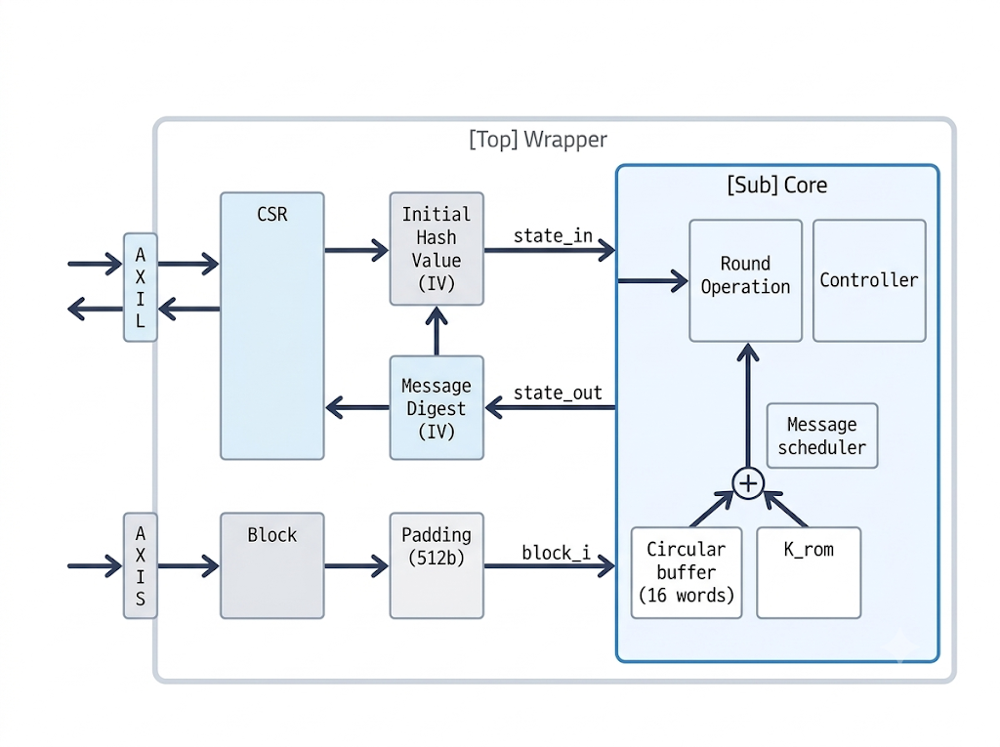
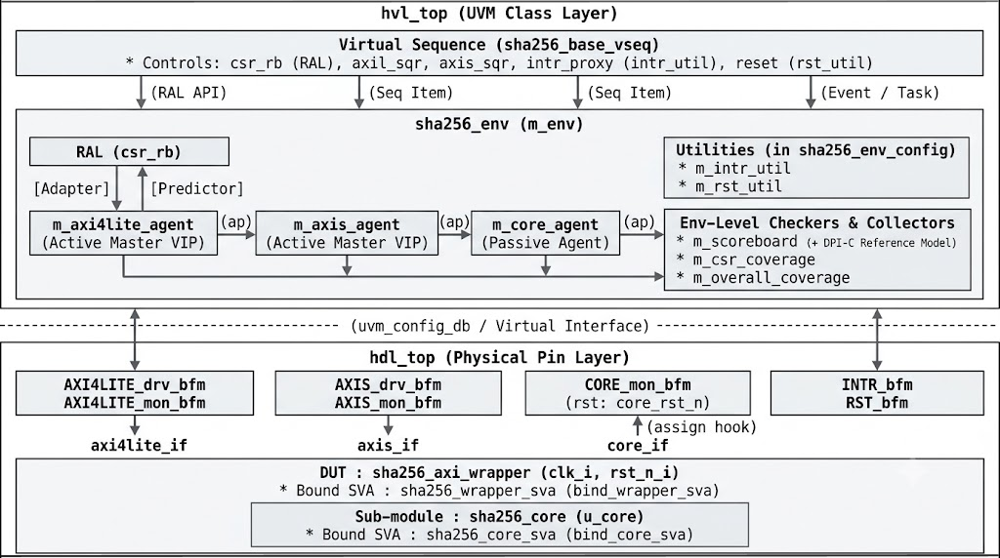
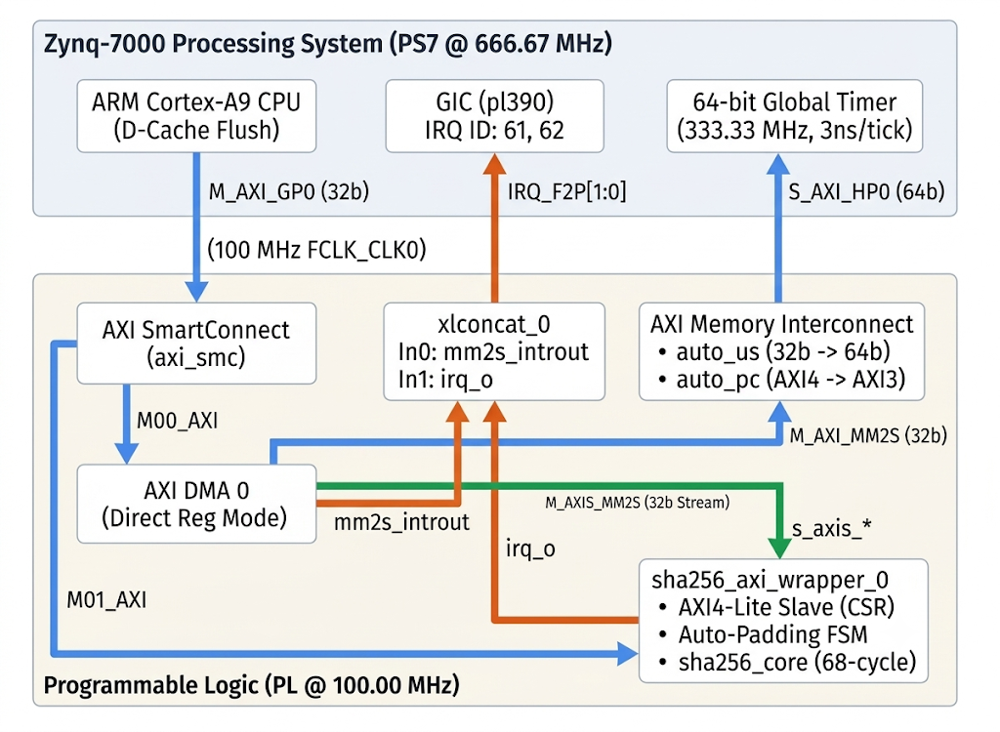

# AXI4-Based SHA-256 Hardware Accelerator IP: RTL Design, UVM 1.2 Verification & Zynq-7000 Sign-off

본 프로젝트는 **NIST FIPS 180-4 표준 기반 SHA-256 암호화 하드웨어 가속기 IP**의 마이크로아키텍처 사양서(MAS) 정의부터 PPA 최적화 RTL 설계, 5대 도메인 기반 UVM 1.2 블록 레벨 검증, 핀 레벨 정적 테스트벤치 및 Zynq-7000 FPGA 베어메탈 시스템 통합 검증을 거쳐 최종 **100% Sign-off**를 달성한 프로젝트입니다.

* **Hardware Design (`design/`)**: 프로토콜 제어·4중 보안 방화벽·하드웨어 자동 패딩 FSM을 전담하는 `sha256_axi_wrapper`와 68사이클 고정 지연 압축 연산을 수행하는 `sha256_core`를 계층 분리하여 재사용성을 확보했습니다. 16-Word 원형 큐(Sliding Window) 스케줄러로 플립플롭 면적을 75% 절감하고, $W_t + K_t$ 파이프라인 분할 및 프리패치(Prefetch)를 결합해 100 MHz 타이밍(WNS +0.128 ns)을 달성했습니다.
* **UVM 1.2 Verification (`dv/bl_tb/`, `dv/agents/`)**: 자체 개발한 Dual-Top(HDL BFM + HVL Class) 구조의 AXI4-Lite / AXI4-Stream Master VIP, 내부 코어 관측용 White-box Passive Agent(`core_agent`), PeakRDL 기반 Explicit Prediction RAL, DPI-C C++ Golden Reference Model, 그리고 64개 활성 SVA를 결합한 검증 환경을 구축하여 5대 도메인 107개 UVM Test Plan 항목을 검증했습니다.
* **3-Tier Cross-Verification & Sign-off (`fpga/`, `dv/static_tb/`)**: UVM VIP 제약 및 시뮬레이션 시간 한계로 발생한 Waiver 항목을 종결하기 위해, 핀 레벨 정적 테스트벤치(`tb_sha256_tkeep.sv`, 비정상 `TKEEP` 27종 전수 스윕)와 Zynq-7000 보드(AXI DMA 연동 NIST CAVP 표준 벡터 128종 스트리밍 및 방화벽 예외 주입)의 3단계 교차 검증을 수행하여 전체 119개 Test Plan 항목을 100% Sign-off했습니다.

---

## 1. Documentation & Deliverable Hub

프로젝트의 전체 요약 포트폴리오와 현업 표준에 맞춰 작성된 5종의 설계·검증 문서(PDF 및 원본 파일), 그리고 `xcrg` 커버리지 리포트 바로가기 링크입니다.

| Document Category | Document Link | Primary Scope & Engineering Role |
| :--- | :--- | :--- |
| **0. Portfolio Summary** | [**portfolio_김영진.pdf**](./portfolio_김영진.pdf) | **프로젝트 전체 요약 포트폴리오**<br>(아키텍처, PPA, UVM 환경, FPGA 검증, 트러블슈팅 및 버그 리포트 종합) |
| **1. Micro-Architecture Spec (MAS)** | [**Micro_Architecture_Specification.pdf**](./docs/Micro_Architecture_Specification.pdf) | 시스템 핀 맵, CSR 메모리 맵, 4-Layer 보안/예외 방화벽, 하드웨어 자동 패딩 FSM, Core 데이터패스 최적화 및 FPGA PPA 명세 |
| **2. Verification Plan** | [**Verification_Plan.pdf**](./docs/Verification_Plan.pdf) | 5대 UVM 도메인(107개 항목), Directed/FPGA 보완 검증(`direct` 시트 12개 항목), 33개 Waiver 사유서 및 64개 SVA 매핑 매트릭스 |
| **3. Verification Specification** | [**SHA256_Verification_Specification.pdf**](./docs/SHA256_Verification_Specification.pdf) | UVM 1.2 Dual-Top 테스트벤치 구조, Custom AXIL/AXIS VIP, Core Passive Agent, PeakRDL Explicit Predictor, DPI-C Scoreboard 명세 |
| **4. FPGA Verification Report** | [**SHA256_FPGA_Verification_Report.pdf**](./docs/SHA256_FPGA_Verification_Report.pdf) | Zynq-7000 SoC 통합, NIST CAVP 표준 벡터(128종) 검증, 펌웨어 방화벽 예외 검증(Data Abort), PS vs. PL 성능 및 병목 분석 |
| **5. Verification Sign-off Report** | [**SHA256_Verification_Report.pdf**](./docs/SHA256_Verification_Report.pdf) | 6종 UVM Regression 로그 집계, 기능/코드 커버리지 상세 분석, 3-Tier Waiver Closure 증빙, 5대 RTL 버그 디버깅 리포트 |
| **6. Coverage & Log Reports (`xcrg`)** | [**docs/Coverage_rpt/**](./docs/Coverage_rpt/) | 6종 UVM 회귀 테스트 병합 Functional Coverage(100%) 및 Code Coverage 리포트 원본과 시뮬레이션 로그(`xsim_*.log`) |
| **7. Custom VIP Documentation** | [AXI4-Lite VIP Docs](./docs/vip/axil_vip/)<br>[AXI4-Stream VIP Docs](./docs/vip/axis_vip/) | 자체 개발한 AXI4-Lite / AXI4-Stream Master VIP의 아키텍처 명세서, User Guide 및 프로토콜 Verification Plan |

---

## 2. Hardware PPA & Verification Sign-off Summary

### 2.1 Hardware Implementation (PPA) & FPGA Performance (`xc7z020-clg400-1`)

| Category | Metric | Measured Achievement |
| :--- | :--- | :--- |
| **Timing ($F_{max}$)** | Target Clock / Worst Negative Slack | **100.00 MHz** (Timing MET, WNS: **+0.128 ns**) |
| **Area (Resource)** | Total Wrapper / Core-Only Utilization | **Total**: 1,063 Slices (3,420 LUTs, 2,308 FFs)<br>**Core**: 620 Slices (1,753 LUTs, 1,097 FFs, **0 BRAM / 0 DSP**) |
| **Dynamic Power** | PL IP Core Dynamic Power | **0.037 W** (전체 보드 전력 1.441 W 중 PS 영역 1.404 W) |
| **Throughput** | Theoretical Peak (Core / Wrapper)<br>Zynq-7000 Measured (`LONG_TV.BIN`) | **Core Peak**: 752.94 Mbps (68 cyc) / **Wrapper Peak**: 595.35 Mbps (86 cyc)<br>**Measured**: **495.32 Mbps** (스트리밍 이론 한계 대비 83.2%, Cortex-A9 PS 대비 **16.61x 가속**) |

### 2.2 Verification Sign-off Achievement Summary

| Verification Stage | Sign-off Metric | Final Result | Status |
| :--- | :--- | :--- | :---: |
| **UVM Regression** | 6 Test Suites (`UVM_WARNING` / `ERROR` / `FATAL`) | **0 Warnings / 0 Errors / 0 Fatals** (6 / 6 Tests PASS, 159 `UVM_INFO`) | **PASS** |
| **Scoreboard & RAL** | DPI-C Hash Match & Built-in RAL Sequence Check | **100% Match** (40 Fixed/Random DPI-C Matches + 1 Custom IV Match / 21 Reset + 9 Bit-Bash Checks) | **PASS** |
| **Assertion (SVA)** | Active Protocol & White-Box SVA Violations | **0 Violations** (64 Active SVA Properties + 1 EOS Check Passed) | **PASS** |
| **Coverage (`xcrg`)** | Functional Coverage (19 Active Covergroups)<br>RTL Code Coverage (15 Modules, 29 Instances) | **Functional**: **100.00%** (19 / 19 Instantiated Groups)<br>**Condition**: **100.00%** (76 / 76), **Branch**: **99.09%** (218 / 220, Reachable 100%) | **PASS** |
| **Directed & FPGA** | Exhaustive Invalid `TKEEP` Sweep (`tb_sha256_tkeep`)<br>NIST CAVP Golden Vector Suite (`SHORT` / `LONG`) | **31 / 31 Cases PASS** (0 SVA Fail, Null Beat & 27 Invalid `(TLAST, TKEEP)` Patterns)<br>**128 / 128 Vectors PASS** (100% Golden Digest Match on Zybo Z7-20 FPGA) | **PASS** |

---

## 3. Hardware Micro-Architecture (`design/`)



* **Wrapper-Core 계층 분리 설계** ([`sha256_axi_wrapper.sv`](./design/sha256_axi_wrapper.sv) / [`sha256_core.sv`](./design/sha256_core/sha256_core.sv)):
  * AMBA AXI4 프로토콜 제어, Little-to-Big Endian 변환, 하드웨어 자동 패딩, 보안 방화벽은 Wrapper에 집중시키고, Core는 512-bit 블록과 256-bit 초기 해시값(`state_in_i`)을 받아 단일 블록 압축 연산만 수행하도록 분리하여 상위 SoC 버스 변경이나 HMAC 통합 시 수정 없이 재사용할 수 있도록 설계했습니다.
* **하드웨어 자동 패딩 FSM (`Auto-Padding FSM`)**:
  * AXI4-Stream 수신 중 `TLAST = 1` 감지 시 마지막 유효 바이트 직후에 `0x80`을 자동 삽입하고 하위 64-bit 공간에 누적 비트 길이(`msg_len`)를 기록합니다.
  * 마지막 블록 수신 바이트가 55B 이하이면 1블록 연산으로 종료하고, 56B~64B 구간이면 길이 필드(8B) 공간 부족 조건(`byte_cnt > 56`)을 감지하여 추가 패딩 전용 블록을 자동 생성해 2회 연속 코어 연산을 수행합니다.
* **4-Layer 하드웨어 보안 및 예외 방화벽 (`Security Firewall`)**:
  1. **PROT Firewall**: 비보안 접근(`AxPROT[1] == 1`) 감지 시 쓰기를 차단하고 읽기 데이터를 `0x00000000`으로 마스킹하며 즉시 `SLVERR` 및 `STATUS.ERR_PRT = 1`을 발생시킵니다.
  2. **Atomicity Guard**: 연산 진행 중(`STATUS.BUSY == 1`) 제어(`CTRL`) 및 초기 해시값(`STATE_IN_0~7`) 변경 시도를 차단하고 `SLVERR`를 반환합니다. 단, 교착(Hang) 복구를 위한 `CTRL.SOFT_RESET` 비트는 Busy 상태에서도 예외적으로 쓰기를 허용합니다.
  3. **Address Decode Guard**: 읽기 전용(RO) 레지스터 쓰기 시 `SLVERR` 및 `ERR_PRT = 1`을 반환하고, 쓰기 전용(`INTCLEAR`) 읽기나 미할당 주소 접근 시 `DECERR`를 반환합니다.
  4. **AXI4-Stream TKEEP Guard**: 패킷 중간의 부분 스트로브(`!TLAST && TKEEP != 4'b1111`), 비연속 스트로브, 또는 Null Beat(`TKEEP = 4'b0000`) 주입 시 즉시 수신을 중단하고 내부 512-bit 버퍼를 `0x00`으로 초기화한 뒤 `ERR_PRT = 1`과 함께 `S_IDLE`로 복귀합니다.
* **Core 데이터패스 면적 및 타이밍 최적화** ([`sha256_message_schedule.sv`](./design/sha256_core/sha256_message_schedule.sv) / [`sha256_datapath.sv`](./design/sha256_core/sha256_datapath.sv)):
  * **16-Word 원형 큐 스케줄러**: 64라운드 확장 워드($W_0 \sim W_{63}$, 2,048 bits) 전체를 저장하지 않고 직전 16개 워드만 유지하는 Sliding Window 구조를 적용해 스케줄러 플립플롭 사용량을 **75% (2,048 $\rightarrow$ 512 FFs)** 절감했습니다.
  * **$W_t + K_t$ 파이프라인 분할 및 프리패치**: 가장 긴 조합 경로를 형성하는 32-bit 연쇄 가산기 중 $W_t + K_t$ 가산 직후에 파이프라인 레지스터(`wk_r`)를 삽입하고, `PRE_ROUND`(1사이클) 구간에서 첫 라운드용 $W_0 + K_0$ 값을 미리 읽어오는 프리패치 동작을 결합해 라운드당 1사이클(블록당 68사이클) 지연을 유지하면서 100 MHz 타이밍을 확보했습니다.

---

## 4. UVM 1.2 Block-Level Verification Environment (`dv/`)



### 4.1 5-Domain Verification Strategy (`119 Total Items`)

| Domain | Target Scope | Plan Items | Key Verification Focus & Reference Code |
| :--- | :--- | :---: | :--- |
| **1. AXI4-Lite (`axil`)** | `s_axi_*` Control Bus | 38 Items<br>(`[AXIL-01~38]`) | 5채널 핸드셰이크 딜레이 교차(`CROSS_AW_W_DELAY`), `WSTRB`, `AxPROT` 8종, 비정렬 주소 에러 주입 및 동적 SVA 마스킹 ([`sha256_axil_vseq.svh`](./dv/bl_tb/sequences/sha256_axil_vseq.svh)) |
| **2. AXI4-Stream (`axis`)** | `s_axis_*` Data Bus | 26 Items<br>(`[AXIS-01~26]`) | `tvalid`/`tready` 딜레이, 코어 연산 장기 Back-Pressure(69클록), 데이터 패턴, 스트림 전송 중 리셋 플러시 ([`sha256_axis_vseq.svh`](./dv/bl_tb/sequences/sha256_axis_vseq.svh)) |
| **3. Core (`core`)** | `sha256_core` Engine | 19 Items<br>(`[CORE-01~19]`) | 68사이클 고정 레이턴시 SVA, 512-bit 스트레스 패턴(All-0/1, Walking-1/0), `0~68` 전 사이클 및 `0~63` 전 라운드 비동기 리셋 복구 ([`sha256_core_vseq.svh`](./dv/bl_tb/sequences/sha256_core_vseq.svh)) |
| **4. CSR (`csr`)** | Wrapper Control/Status Regs | 9 Items<br>(`[CSR-01~09]`) | 리셋 초기값(`hw_reset_seq`), RW `bit_bash_seq`, W1P/W1C 펄스 자동 소멸, Busy 충돌 및 방화벽 에러(`SLVERR`/`DECERR`) 검증 ([`sha256_csr_vseq.svh`](./dv/bl_tb/sequences/sha256_csr_vseq.svh)) |
| **5. Overall (`overall`)** | Top-Level End-to-End Flow | 15 Items<br>(`[OA-01~15]`) | 패딩 경계(55/56/64B), 블록 모드×정렬 교차(`cr_block_align`), Auto/Manual Chaining, `TKEEP` 에러/기아/Busy Soft-Reset 복구 ([`sha256_overall_vseq.svh`](./dv/bl_tb/sequences/sha256_overall_vseq.svh)) |
| **6. Directed (`direct`)** | Static TB & Zynq-7000 SoC | 12 Items<br>(`[DIR-01~03]`,<br>`[FPGA-01~09]`) | 핀 레벨 정적 TB `TKEEP` 27종 비정상 조합 스윕([`tb_sha256_tkeep.sv`](./dv/static_tb/tb_sha256_tkeep.sv)) 및 Zynq-7000 NIST CAVP 128종 벡터·방화벽 실증([`main.c`](./fpga/firmware/src/main.c)) |

### 4.2 Key Verification Components

* **Custom Dual-Top VIPs** ([`axi4lite_agent`](./dv/agents/axi4lite_agent/) / [`axis_agent`](./dv/agents/axis_agent/)):
  * Siemens Verification Academy 가이드라인을 기반으로 핀 레벨 신호를 제어하는 HDL BFM(`*_drv_bfm.sv`, `*_mon_bfm.sv`)과 트랜잭션 객체를 처리하는 HVL 클래스를 분리 설계했습니다.
  * `axis_agent`는 스트림 전송 도중 리셋이나 강제 중단 발생 시 미완성 패킷을 `INCOMPLETE` 상태로 태깅해 브로드캐스트하여 Scoreboard가 잔류 큐를 즉시 폐기하도록 동기화합니다.
* **White-Box Core Passive Agent** ([`core_agent`](./dv/agents/core_agent/)):
  * 계층적 참조(`assign`)를 통해 내부 Core의 입출력 및 컨트롤러 상태 신호를 샘플링합니다. 특히 `CTRL.SOFT_RESET` 인가에 의한 코어 강제 중단까지 감지하기 위해 모니터 BFM에 통합 리셋(`DUT.core_rst_n`)을 연결하고 입력 캡처와 완료/리셋 감시를 병렬 수행하는 Split-Phase 샘플링 구조를 구현했습니다.
* **PeakRDL 기반 Explicit Prediction RAL** ([`sha256_csr.rdl`](./rdl/sha256_csr.rdl) / [`sha256_reg_pkg.sv`](./dv/bl_tb/register_model/sha256_reg_pkg.sv)):
  * 하드웨어 방화벽이 비정상 쓰기 시도를 차단하고 `SLVERR`를 반환할 때 RAL 미러 값이 오염되는 것을 방지하기 위해 Auto-Prediction을 끄고, 버스 모니터가 `OKAY` 응답을 확인한 트랜잭션만 `uvm_reg_predictor`를 통해 미러에 반영하는 Explicit Prediction 방식을 적용했습니다.
* **DPI-C C++ Reference Model 연동 Grey-Box Scoreboard** ([`sha256_scoreboard.svh`](./dv/bl_tb/env/sha256_scoreboard.svh) / [`sha256_ref_model.cpp`](./dv/bl_tb/ref_model/sha256_ref_model.cpp)):
  * AXI4-Stream 모니터에서 추출한 유효 바이트를 큐에 적재하고, AXI4-Lite 모니터에서 `DIGEST_0~7` 8워드 읽기가 완료되는 시점에 DPI-C 함수(`c_sha256_digest`)를 호출해 기댓값과 하드웨어 출력값을 자동 대조합니다. 코어 연산 중 리셋 발생 시에는 `core_agent`의 `is_aborted` 플래그를 참조해 이전 데이터를 폐기합니다.

---

## 5. System-Level Verification & Sign-off Closure (`fpga/` & `dv/static_tb/`)



### 5.1 3-Tier Cross-Verification Waiver Closure

블록 레벨 UVM 환경의 구조적 제약이나 시뮬레이션 시간 한계로 인해 발생한 Waiver 항목들을 상위 아키텍처 방어 증명, 정적 테스트벤치, FPGA 보드 테스트의 3단계 교차 검증으로 전수 종결했습니다.

| Waiver ID & Target | Limitation in Block-Level UVM | Cross-Verification Closure Method & Result |
| :--- | :--- | :--- |
| **`[WV-AXIS-09, 11]`**<br>Null Beat (`TKEEP=0`) & Mid-Packet Partial Strobe | VIP 기본 제약상 0-Byte Null Beat 미구동 및 Xilinx AXI DMA 하드웨어상 비정상 스트로브 생성 불가 | **Static TB (`[DIR-01~03]`, [`tb_sha256_tkeep.sv`](./dv/static_tb/tb_sha256_tkeep.sv))**: 핀 레벨 직접 구동으로 Null Beat 및 27종 비정상 `(TLAST, TKEEP)` 조합 전수 스윕과 복구 검증 완료 (**31 / 31 PASS**) |
| **`[WV-CORE-01]`**<br>Redundant `start_i` in Busy | `core_agent`는 관찰 전용 Passive 구조이므로 하위 Core 핀 직접 구동 불가 | **Architectural Prevention (`[CSR-07]`, `[FPGA-05]`)**: 상위 Wrapper FSM과 CSR Busy 방화벽이 연산 중 재시작 요청을 `SLVERR`(Data Abort)로 원천 차단하여 하위 Core 유입 불가 입증 (**PASS**) |
| **`[WV-CORE-02, 03]`**<br>Standard & Large Vectors | RTL 시뮬레이션 시간 제약으로 인해 UVM에서는 소량의 벡터(최대 372B)만 구동 가능 | **FPGA SoC (`[FPGA-04]`, [`main.c`](./fpga/firmware/src/main.c))**: Zynq-7000 환경에서 SD 카드 기반 NIST CAVP 표준 데이터셋(단문 64종 및 최대 6.2KB 장문 64종, 총 128종) DMA 스트리밍 100% 일치 확인 (**PASS**) |

### 5.2 Critical RTL Bugs Found & Fixed (`sha256_axi_wrapper.sv`)

UVM 검증 및 커버리지 클로저 과정에서 발견하여 수정 완료한 5건의 RTL 설계 결함 요약입니다 (상세 분석은 [`SHA256_Verification_Report.pdf`](./docs/SHA256_Verification_Report.pdf) 4.1절 참조).

| Bug ID | Severity & Target | Defect & Fix Summary |
| :--- | :--- | :--- |
| **`[RTL-BUG-01]`** | **Critical** / Reset Domain | 코어 연산 중 `SOFT_RESET` 인가 시 Wrapper만 초기화되고 하위 Core는 연산을 계속하는 '좀비 코어' 데드락 현상 $\rightarrow$ 합성 리셋(`core_rst_n = rst_n_i & ~ctrl_soft_reset`) 도메인 생성 및 연결로 해결 |
| **`[RTL-BUG-02]`** | **High** / CSR Atomicity | `STATUS.BUSY == 1` 상태에서 `CTRL` 일반 제어 비트 차단과 `SOFT_RESET` 예외 허용 분리 누락 $\rightarrow$ Busy 중 `SOFT_RESET`만 허용하고 하위 비트 쓰기는 `SLVERR` 및 `ERR_PRT = 1`로 차단하도록 수정 |
| **`[RTL-BUG-03]`** | **High** / Security Firewall | Non-secure(`AxPROT[1] == 1`) 트랜잭션을 차단하는 포트 래치 및 방화벽 분기 누락 $\rightarrow$ `awprot_reg`/`arprot_reg` 추가 및 비보안 접근 시 쓰기 차단·읽기 `0` 마스킹·`SLVERR` 반환 로직 구현 |
| **`[RTL-BUG-04]`** | **High** / Stream FSM | 비연속 `TKEEP` 및 패킷 중간 부분 스트로브 주입 시 버퍼 정렬이 깨지는 결함 $\rightarrow$ `axis_tkeep_err` 실시간 검출 회로를 추가하여 위반 시 버퍼 `0x00` 소거, `ERR_PRT = 1` 설정 및 `S_IDLE` 즉시 복귀 구현 |
| **`[RTL-BUG-05]`** | **High** / CSR Read Path | `uvm_reg_bit_bash_seq` 수행 중 발견된 `CTRL` 레지스터 읽기 비트맵 순서 오류 $\rightarrow$ `{28'd0, ctrl_soft_reset, 1'b0, ctrl_irq_en, ctrl_en}`으로 사양서와 일치하도록 수정 |

---

## 6. Repository Directory Structure

```text
axi_sha256_ip/
├── Makefile                           # 최상위 빌드/시뮬레이션 실행 래퍼 Makefile
├── portfolio_김영진.pdf                # 프로젝트 전체 요약 포트폴리오 (PDF)
├── design/                            # SHA-256 가속기 RTL 설계 소스 (SystemVerilog)
│   ├── sha256_axi_wrapper.sv          # Top Wrapper (AXI4-Lite CSR, AXI4-Stream, Auto-Padding, Firewall)
│   └── sha256_core/                   # 68-Cycle 압축 연산 코어 및 서브모듈 (14개 파일)
├── docs/                              # 설계/검증 문서 (PDF, Markdown, Excel) 및 커버리지 리포트
│   ├── Micro_Architecture_Specification.pdf
│   ├── Verification_Plan.pdf
│   ├── SHA256_Verification_Specification.pdf
│   ├── SHA256_FPGA_Verification_Report.pdf
│   ├── SHA256_Verification_Report.pdf
│   ├── Coverage_rpt/                  # xcrg 병합 Functional/Code Coverage HTML 리포트 및 시뮬레이션 로그
│   ├── MAS/                           # MAS 마크다운 원본, 타이밍/블록 다이어그램 및 WaveDrom JSON
│   ├── Verif_plan/                    # Verification_Plan.xlsx 원본
│   ├── Verif_Spec/                    # Verification Spec 마크다운 원본 및 UVM 구조도 이미지
│   ├── FPGA_report/                   # FPGA 검증 보고서 마크다운 원본 및 시스템 블록도 이미지
│   ├── Verif_report/                  # Verification Sign-off 보고서 마크다운 원본
│   └── vip/                           # AXI4-Lite / AXI4-Stream Custom VIP 아키텍처 명세서 및 User Guide
├── dv/                                # 블록 레벨 검증 환경 (UVM 1.2 & Directed Static TB)
│   ├── agents/                        # axi4lite_agent, axis_agent (Custom VIPs), core_agent (Passive)
│   ├── bl_tb/                         # SHA-256 UVM 블록 레벨 통합 테스트벤치
│   │   ├── env/                       # sha256_env, env_config, scoreboard, overall_coverage
│   │   ├── ref_model/                 # DPI-C 연동 C++ Golden Reference Model (sha256_ref_model.cpp)
│   │   ├── register_model/            # PeakRDL 생성 RAL 패키지 (sha256_reg_pkg.sv) 및 csr_coverage
│   │   ├── sequences/                 # 도메인별 Virtual Sequence Library (6종)
│   │   ├── sim/                       # UVM 컴파일/시뮬레이션/커버리지 병합용 Makefile
│   │   ├── tb/                        # Dual-Top (hdl_top, hvl_top) 및 White-box SVA (Wrapper/Core)
│   │   └── test/                      # UVM Test 클래스 패키지 (6종)
│   ├── static_tb/                     # 핀 레벨 정적 테스트벤치 (tb_sha256_tkeep.sv) 및 전용 Makefile
│   └── utils/                         # 비동기 이벤트 제어 유틸리티 (interrupt/, reset/ BFM 및 Util)
├── fpga/                              # Zynq-7000 (Zybo Z7-20) FPGA 통합 및 베어메탈 검증 환경
│   ├── Makefile                       # Vivado IP 패키징, 프로젝트/Block Design 생성 자동화 Makefile
│   ├── bd/                            # Zynq-7000 Block Design (zybo.bd)
│   ├── firmware/                      # Cortex-A9 베어메탈 검증 펌웨어 (HAL, DMA, FatFs SD 파서, SW Ref)
│   ├── script/                        # Vivado Tcl 스크립트 3종 및 NIST .rsp 이진 변환 스크립트 (preprocess_rsp.py)
│   ├── synth/                         # 타이밍 제약 파일 (constraint.xdc, 100 MHz)
│   └── test_vector/                   # NIST CAVP 원본 (.rsp) 및 SD 카드 탑재용 이진 파일 (SHORT/LONG_TV.BIN)
└── rdl/                               # PeakRDL 기반 RAL 생성용 SystemRDL 소스 (sha256_csr.rdl) 및 Makefile
```

## 7. Toolchain & How to Run (Quick Start)

### 7.1 Required Toolchain

* **OS**: Ubuntu 24.04 LTS (WSL2 / Linux)
* **Simulator & Synthesis**: AMD Xilinx Vivado / Vitis / xsim `v2025.2` (64-bit) (`xvlog`, `xelab`, `xsc`, `xsim`, `xcrg`)
* **RAL Code Generator**: `PeakRDL` (SystemRDL to UVM RAL 생성 시에만 필요)

### 7.2 Root-Level Makefile Commands

최상위 디렉토리의 `Makefile`은 하위의 4개 서브 디렉토리(`dv/bl_tb/sim/`, `dv/static_tb/sim/`, `rdl/`, `fpga/`)에 위치한 전용 `Makefile`을 계층적으로 원격 호출하도록 구성되어 있습니다.

```bash
# 1. UVM 블록 레벨 전체 회귀 테스트 실행 (clean -> build -> elab -> 6종 테스트 run_all -> covreport -> rpt_log)
make bl_tb

# 2. 핀 레벨 정적 테스트벤치 (tb_sha256_tkeep.sv, 비정상 TKEEP 31케이스 전수 스윕) 실행
make static_tb

# 3. SystemRDL (rdl/sha256_csr.rdl) 기반 UVM RAL 패키지 재생성 (rdl/output/ 경로 생성)
make peakrdl

# 4. 전체 빌드, 시뮬레이션, FPGA 생성 산출물 일괄 정리
make clean

```

### 7.3 Detailed UVM Simulation Commands (`dv/bl_tb/sim/`)

개별 UVM 테스트를 단독 실행하거나 커버리지 리포트만 별도로 확인할 때는 `dv/bl_tb/sim` 경로에서 아래 명령어를 사용합니다.

```bash
cd dv/bl_tb/sim

# 1. 빠른 환경 무결성 확인용 (Sanity Test 컴파일 및 구동)
make sanity

# 2. DPI-C (C++) 및 SystemVerilog/UVM 소스 컴파일과 Elaboration 수행
make build
make elab

# 3. 특정 UVM 테스트 단독 실행
# 지원 TEST_NAME: sha256_sanity_test | sha256_axil_test | sha256_axis_test | sha256_csr_test | sha256_core_test | sha256_overall_test
make run TEST_NAME=sha256_sanity_test VERBOSITY=UVM_LOW

# 4. 6종 테스트 전체 회귀 실행 및 xcrg 통합 커버리지 리포트(./cov_report) 생성
make run_all
make covreport

# 5. 터미널에 6종 테스트의 UVM_INFO / WARNING / ERROR / SVA / FATAL 집계표 출력
make rpt_log

```

### 7.4 Directed Static TB Commands (`dv/static_tb/sim/`)

AXI4-Stream 프로토콜 위반(`TKEEP` Null Beat 및 부분 스트로브) 주입에 대한 핀 레벨 검증을 수행합니다.

```bash
cd dv/static_tb/sim

# 정적 테스트벤치 컴파일, Elaboration, 시뮬레이션 일괄 실행
make all

```

### 7.5 SystemRDL RAL Generation Commands (`rdl/`)

```bash
cd rdl

# sha256_csr.rdl 파싱 및 uvm_reg_block 패키지(sha256_reg_pkg.sv) 생성
make uvm

# HTML 레지스터 명세 문서 자동 생성
make html

```

### 7.6 FPGA Project & Block Design Build Commands (`fpga/`)

```bash
cd fpga

# 1. SHA-256 IP 패키징(package_ip.tcl) 및 Zynq-7000 Block Design 자동 배치
make bd

# 2. 생성된 Block Design 프로젝트를 Vivado GUI로 열기
make open_bd

# 3. IP 단독 합성/구현 결과 확인용 Vivado 프로젝트 생성 및 GUI 열기
make create
make open

```