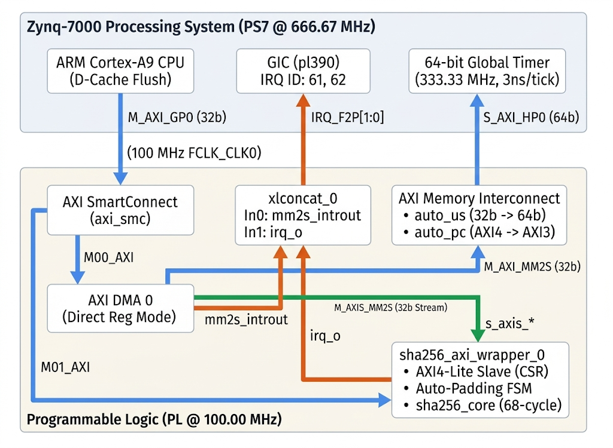

# FPGA Verification Report
# Zynq-7000 SoC Integration & Bare-Metal Verification for SHA-256 IP Core

### Table of Contents

- **1. Test Environment and Objective**
  - 1.1 System Block Diagram & IP Packaging Specification
  - 1.2 Memory Map and Interrupt Routing
  - 1.3 Firmware Architecture & Test Vector Preprocessing
- **2. Test Scenarios (NIST CAVP Verification)**
  - 2.1 Standard Hash & Padding Boundary Verification
  - 2.2 Chaining Test (Auto-Chaining & Manual Chaining)
  - 2.3 Large Dataset Verification (UVM Waiver Closure)
- **3. Exception and Security Testing (Negative Tests)**
  - 3.1 Atomicity Test
  - 3.2 Soft-Reset and Hang Recovery Sequence
  - 3.3 Address Decode & Access Permission Violation Test
  - 3.4 AXI4-Lite PROT Firewall & Zynq Interconnect Security Test
  - 3.5 AXI4-Stream `TKEEP` Alignment Violation Analysis
- **4. Performance Analysis**
  - 4.1 Hardware (PL) vs. Software (PS7 CPU) Execution Time Comparison
  - 4.2 Latency Measurement and Throughput (Mbps) Calculation
  - 4.3 System Bottleneck Analysis (AXI Bus Overhead vs. Core Computation)

# 1. Test Environment and Objective

## 1.1 System Block Diagram & IP Packaging Specification
본 문서는 UVM 1.2 블록 레벨 검증을 마친 SHA-256 하드웨어 가속기(`sha256_axi_wrapper` 및 `sha256_core`)를 **Xilinx Zynq-7000 SoC (`xc7z020-clg400-1`, Zybo Z7-20)** 타겟에 합성 및 구현하고, ARM Cortex-A9 프로세서(PS)와 AXI DMA를 연동하여 수행한 시스템 레벨 검증 결과를 기록한 보고서입니다.

### 1.1.1 SoC Interconnect & DMA Configuration (`zybo.bd`)
* **Control Path (`M_AXI_GP0` $\rightarrow$ `axi_smc`):**
  * Cortex-A9 CPU는 `M_AXI_GP0` 마스터 포트를 통해 AXI SmartConnect(`axi_smc`)에 연결된 `axi_dma_0`(`M00_AXI`)와 `sha256_axi_wrapper_0`(`M01_AXI`)의 제어 및 상태 레지스터(CSR)에 접근합니다.
* **Data Path (`DDR` $\rightarrow$ `S_AXI_HP0` $\rightarrow$ `axi_dma_0` $\rightarrow$ `sha256_axi_wrapper_0`):**
  * IP의 특성을 고려하여 `axi_dma_0`는 Scatter-Gather와 S2MM 채널을 비활성화한 Direct Register (MM2S Only) 모드로 구성했습니다.
  * 연산이 완료된 256-bit 해시 다이제스트(32 Bytes)는 소량 고정 크기 데이터이므로 별도의 S2MM DMA 채널을 두지 않고 CPU가 `DIGEST_0~7` CSR을 통해 직접 읽어들입니다.

### 1.1.2 Custom IP Packaging Specification (`package_ip.tcl`)
Vivado IP Packager(`ipx`)를 통해 `sha256_axi_wrapper`를 Zynq Block Design에 통합할 때 설정한 버스 인터페이스 파라미터는 다음과 같습니다.

| Interface / Port | Parameter Name | Value | Technical Purpose |
| :--- | :--- | :---: | :--- |
| **`clk_i`** | `ASSOCIATED_BUSIF` `ASSOCIATED_RESET` | `s_axi:s_axis` `rst_n_i` | 단일 클록 도메인(`100 MHz`)에 AXI4-Lite, AXI4-Stream 및 리셋 신호 동기화 |
| **`irq_o`** | `SENSITIVITY` | `LEVEL_HIGH` | Zynq GIC의 Active-High 레벨 트리거(`0x01`) 규격과 인터럽트 속성 일치화 |
| **`s_axi`** | `NUM_READ_OUTSTANDING` `NUM_WRITE_OUTSTANDING` | `1` `1` | 단일 트랜잭션 기반 CSR 슬레이브 특성에 맞춰 SmartConnect의 Outstanding 발행을 1로 제한 |

## 1.2 Memory Map and Interrupt Routing
`zybo.bd`에 할당된 시스템 주소 맵과 인터럽트 라우팅 구조는 다음과 같습니다.

| Instance Name | Interface | Base Address | High Address | Range | GIC Interrupt ID | Connection Path |
| :--- | :--- | :---: | :---: | :---: | :---: | :--- |
| **`sha256_axi_wrapper_0`** | `s_axi` | `0x4000_0000` | `0x4000_0FFF` | `4 KB` | **`62`** (`IRQ_F2P[1]`) | `irq_o` $\rightarrow$ `xlconcat_0/In1` |
| **`axi_dma_0`** | `S_AXI_LITE` | `0x4040_0000` | `0x4040_FFFF` | `64 KB` | **`61`** (`IRQ_F2P[0]`) | `mm2s_introut` $\rightarrow$ `xlconcat_0/In0` |
| **`processing_system7_0`** | `S_AXI_HP0` | `0x0000_0000` | `0x3FFF_FFFF` | `1 GB` | - | `axi_mem_intercon` $\rightarrow$ `DDR` |
| **`Cortex-A9 Global Timer`** | `Private` | `0xF8F0_0200` | `0xF8F0_021F` | `32 B` | - | APU Internal (`333.33 MHz`) |

## 1.3 Firmware Architecture & Test Vector Preprocessing

### 1.3.1 Layered Firmware Architecture

| Layer / File | Primary Responsibility & Key Implementation Details |
| :--- | :--- |
| **HAL Driver** (`sha256_hal.c/.h`) | • `0x00`~`0x9C` 오프셋 CSR 메모리 맵을 `SHA256_RegMap` 구조체로 추상화 (`RO` 레지스터에 `volatile const` 적용) • `sha256_init()`, `sha256_start()`(2단계 `EN` $\rightarrow$ `START` 시퀀스), `sha256_soft_reset()`, `sha256_read_digest()` 캡슐화 |
| **DMA** (`dma_utils.c/.h`) | • `xaxidma` API(`XAxiDma_SimpleTransfer`) 기반 MM2S 스트림 전송 및 D-Cache Flush 제어 |
| **SD Binary Loader** (`sd_parser.c/.h`) | • Vitis `xilffs`(`ff.h`) 라이브러리 기반 SD 카드 마운트 및 전처리 이진 벡터(`SHORT_TV.BIN`, `LONG_TV.BIN`) 고속 로드 |
| **SW Reference Model** (`sha256_ref_model.c/.h`) | • UVM 검증에 사용한 DPI-C 모델(`sha256_ref_model.cpp`)을 Cortex-A9 베어메탈 C 환경으로 이식 • PS 단독 연산 시간 측정(비교군)에 활용 |
| **Test Orchestrator** (`main.c`) | • 4대 검증 스위트(Basic, Padding/Chaining, Negative Exceptions, SD Card CAVP Benchmark) 실행 및 성능 지표 산출 |

### 1.3.2 NIST CAVP Test Vector Selection & Binary Preprocessing (`preprocess_rsp.py`)
* **표준 테스트 벡터 출처:** NIST CAVP(Cryptographic Algorithm Validation Program)의 **SHAVS(Secure Hash Algorithm Validation System)** 공식 배포본을 사용했습니다 (출처: [NIST CAVP Secure Hashing](https://csrc.nist.gov/projects/cryptographic-algorithm-validation-program/secure-hashing#shavs)).
  * `SHA Test Vectors for Hashing Bit-Oriented Messages`는 바이트 단위 스트로브(`s_axis_tkeep`)만 지원하는 AXI4-Stream 규격 특성상 제외하고, **Byte-Oriented Messages** 중 `SHA256ShortMsg.rsp`(`0`~`512 bits`, 원본 65개 벡터 중 DMA 0-Byte 전송이 불가한 `Len = 0` 제외 **64개 유효 벡터**, 총 `16,640 bits`)와 `SHA256LongMsg.rsp`(`1,304`~`49,616 bits`, **64개 벡터**, 총 `1,680,128 bits`) 총 **128개 하드웨어 스트리밍 벡터(원본 129개)**를 검증 대상으로 선정했습니다.
* **이진 전처리(Binary Preprocessing) 파이프라인:**
  * Python 스크립트(`preprocess_rsp.py`)를 통해 `.rsp` 텍스트 파일을 고정 40-Byte 헤더 기반 이진 파일(`SHORT_TV.BIN`, `LONG_TV.BIN`)로 사전 변환했습니다.

# 2. Test Scenarios (NIST CAVP Verification)

본 장에서는 기본 벡터, 패딩 경계, 다중 블록 체이닝, 그리고 NIST CAVP 대용량 데이터셋에 대한 검증을 수행합니다. `Verification_Plan.xlsx`(`direct` 시트)에 매핑된 전체 테스트 항목 및 결과 요약은 다음과 같습니다.

| Plan ID (`direct`) | Test name | 검증 시나리오 요약 | Status |
| :---: | --- | --- | :---: |
| **`[FPGA-01]`** | **`Standard Hash`** | 기본 해시 연산(3B, 43B, 56B) 및 Little-to-Big Endian 변환 검증 | **PASS** |
| **`[FPGA-02]`** | **`Padding Boundary`** | 최소 길이(1B) 및 패딩 경계(55/56/64B) 블록 분할 검증 | **PASS** |
| **`[FPGA-03]`** | **`Chaining Test`** | 다중 블록(128/192B) Auto-Chaining 및 Manual Chaining(`STATE_IN`) 검증 | **PASS** |
| **`[FPGA-04]`** | **`Large Dataset`** | NIST CAVP 대용량 전처리 데이터셋 전수 검증 (`[WV-CORE-02, 03]` Closure) | **PASS** |

## 2.1 Standard Hash & Padding Boundary Verification

인터럽트 구동 환경에서 기본 벡터 3종과 하드웨어 자동 패딩 FSM의 블록 분할 경계 조건(`MAS 4.4.2절`)을 검증했습니다.

**기본 해시 연산 및 Endian 변환**
* **검증 조건:** 3 Bytes, 43 Bytes, 56 Bytes 기본 벡터 주입
* **결과 및 판정:** Little-to-Big Endian 변환 및 64-bit 메시지 길이 삽입 동작이 SW 모델과 100% 일치함 (**PASS**)

**최소 길이 및 패딩 경계 검증**
* **검증 조건:** 1B, 55B, 56B, 64B 경계 조건 페이로드 주입
* **결과 및 판정:** 55B 이하는 1블록 정상 수납, 56B 이상은 한계 초과로 패딩 전용 두 번째 블록이 자동 생성됨을 확인 (**PASS**)

## 2.2 Chaining Test (Auto-Chaining & Manual Chaining)

다중 블록 연속 스트리밍에 따른 하드웨어 자동 피드백과 `STATE_IN_0~7` CSR을 통한 수동 체이닝을 검증했습니다.

**Auto-Chaining 검증**
* **검증 조건:** 128B (3 Blocks), 192B (4 Blocks) 연속 페이로드 주입
* **결과 및 판정:** 64바이트(1블록) 도달 시마다 코어 연산이 수행되며, 결과 다이제스트가 다음 블록의 IV로 자동 피드백되어 최종 해시가 도출됨을 확인 (**PASS**)

**Manual Chaining(Custom IV) 검증**
* **검증 조건:** `STATE_IN_0~7` 레지스터에 비표준(Custom) IV 적재 후 64B 페이로드 주입
* **결과 및 판정:** 수동으로 갱신된 IV 기반의 연산 결과가 동일한 조건의 SW 모델과 일치하며, 이후 FIPS 표준 IV로 정상 복원됨을 확인 (**PASS**)

## 2.3 Large Dataset Verification (UVM Waiver Closure)

SD 카드에 탑재된 전처리 이진 벡터(`SHORT_TV.BIN`, `LONG_TV.BIN`)를 전수 구동하여, UVM 블록 레벨 시뮬레이션 당시 시뮬레이션 시간 제약으로 인해 이관(Waiver)되었던 항목들의 검증을 Sign-off했습니다.

**대용량 벡터 검증 및 UVM Waiver Closure (`[WV-CORE-02, 03]`)**
* **검증 조건:** UVM에서 시뮬레이션 시간 제약으로 생략했던 대규모 FIPS 표준 벡터(`SHORT_TV.BIN` 64종, `LONG_TV.BIN` 64종)를 SD 카드에서 로드하여 연속 주입
* **결과 및 판정:** 전 벡터 해시 결과가 Golden Digest와 100% 일치함을 증명하여 이관 항목 검증을 완료했으며, UVM에서 하위 비트(`msg_len[11:3]`, 최대 372B)만 토글되었던 메시지 비트 길이 카운터의 상위 비트(`msg_len[15:12]`, 최대 6,202B = `49,616 bits`) 물리적 토글을 FPGA에서 검증함 (**PASS**)

# 3. Exception and Security Testing (Negative Tests)

MAS 4.3절에 정의된 하드웨어 방화벽 및 보호 회로가 실제 Zynq SoC 버스 환경에서 정상 동작하는지 증명하기 위해 의도적인 예외 트랜잭션을 주입했습니다. 별도의 ILA 프로브 없이 AXI4-Lite CSR 읽기 값과 Cortex-A9 Data Abort 예외 핸들러(`g_data_abort_cnt`) 로그만으로 결과를 판정했습니다.

| Plan ID (`direct`) | Test name | 예외 및 보안 시나리오 요약 (MAS 4.3) | Status |
| :---: | --- | --- | :---: |
| **`[FPGA-05]`** | **`Atomicity Test`** | `STATUS.BUSY == 1` 상태에서 CSR 변경 차단 (`[WV-CORE-01]` Closure) | **PASS** |
| **`[FPGA-06]`** | **`Soft-Reset`** | `BUSY`/`Hang` 상태에서 강제 복구 | **PASS** |
| **`[FPGA-07]`** | **`Decode & Permission`** | RO/WO 권한 위반 및 미할당 영역 접근 차단 | **PASS** |
| **`[FPGA-08]`** | **`PROT Firewall`** | Non-secure `AxPROT[1] == 1` 접근 차단 | **PASS** |
| **`[DIR-01~03]`** | **`TKEEP Violation`** | 비연속/부분/Null `TKEEP` 패턴 주입 시 하드웨어 차단 (`tb_sha256_tkeep.sv` 대체 검증) | **WAIVER (Closed by TB)** |

## 3.1 Atomicity Test

**Busy 상태 내 원자성(Atomicity) 위반 주입 (`[WV-CORE-01]` Closure)**
* **검증 조건:** `sha256_start(0)`을 인가하여 IP 트랜잭션을 활성화(`STATUS.BUSY == 1`, 스트림 대기)한 상태에서 `STATE_IN_0`(`0x80`) 레지스터에 `0xDEADBEEF` 쓰기 시도
* **하드웨어 응답:** 쓰기 요청이 하드웨어적으로 차단되고 `SLVERR`가 반환되어 Cortex-A9 Asynchronous Data Abort가 1회 발생함(`Aborts = 1`)
* **결과 및 판정:** AXI4-Lite 버스를 통해 읽은 `STATUS`(`0x08`) 레지스터 값이 `0x00000005`로 확인되어, `BUSY`(Bit 0) 유지와 함께 하드웨어 보호 플래그 `STATUS.ERR_PRT`(Bit 2)가 `1`로 세팅됨을 확인 (**PASS**)

## 3.2 Soft-Reset and Hang Recovery Sequence

**Busy/Hang 상태에서 강제 복구**
* **검증 조건:** 3.1절에 의해 예외 플래그(`STATUS.ERR_PRT == 1`)가 켜져 있고 `STATUS.BUSY == 1`로 홀드된 IP에 `CTRL.SOFT_RESET` 인가
* **하드웨어 응답:** Busy 상태임에도 Data Abort 발생 없이 쓰기(`OKAY`)가 정상 허용됨(`Aborts = 1` 유지)
* **결과 및 판정:** AXI4-Lite Read를 통해 `STATUS.BUSY` 비트가 즉시 `0`으로 해제되고, `STATE_IN_0`(`0x80`) 레지스터가 3.1절의 비정상 쓰기 값(`0xDEADBEEF`)으로 오염되지 않고 표준 IV 초기값(`0x6A09E667`)을 유지함을 확인 (**PASS**)

## 3.3 Address Decode & Access Permission Violation Test

**RO/WO 권한 위반 및 미할당 영역 접근 차단**
* **검증 조건:** 읽기 전용(RO)인 `ID`(`0x00`)에 쓰기 시도(1회), 쓰기 전용(WO)인 `INTCLEAR`(`0x0C`)에 읽기 시도(1회), 미할당 영역(`0x40`)에 읽기 시도(1회) 등 총 3회의 위반 트랜잭션 주입
* **하드웨어 응답:** 3회의 시도마다 `SLVERR` 또는 `DECERR`가 즉시 반환되어 3회의 추가 Data Abort가 발생함(3.1절 포함 누적 `Aborts = 4`)
* **결과 및 판정:** AXI4-Lite Read를 통해 `ID` 레지스터 원본 값(`0x41749591`)이 오염되지 않고 유지됨을 확인 (**PASS**)

## 3.4 AXI4-Lite PROT Firewall & Zynq Interconnect Security Test

**Non-secure (`AxPROT[1] == 1`) 접근 차단**
* **검증 조건:** `INTCLEAR.CLR_ERR`로 에러 플래그를 소거한 뒤, CPU MMU TLB 제어를 통해 CSR 영역 속성을 `Non-Secure`(`AxPROT[1] = 1`)로 변경하고 `ID` 읽기(1회) 및 `STATE_IN_0` 쓰기(1회) 시도
* **하드웨어 응답:** Non-Secure 접근 2회에 대해 즉시 2회의 추가 Data Abort가 발생함(누적 `Aborts = 6`)
* **결과 및 판정:** MMU 속성을 `Secure`로 복원한 후 읽은 IP 내부 `STATUS` 레지스터가 `0x00000000`(`ERR_PRT == 0`)으로 유지되고 `STATE_IN_0`가 `0x6A09E667`로 보존됨을 확인함. 이를 통해 Non-Secure 트랜잭션이 PL IP에 도달하기 전에 Zynq PS Interconnect의 TrustZone 방화벽에서 선제적으로 차단됨을 입증함 (**PASS**)

## 3.5 AXI4-Stream `TKEEP` Alignment Violation Analysis

**비정상 TKEEP 패턴 주입 (`[WV-AXIS-09, 11]` & `[OA-14]` Cross-Closure)**
* **검증 조건:** 패킷 중간(`TLAST=0`)의 부분 스트로브, 비연속 `TKEEP` 패턴, 그리고 유효 바이트가 없는 Null Beat(`TKEEP=4'b0000`) 주입 시도
* **하드웨어 응답:** Xilinx AXI DMA IP의 MM2S 채널 하드웨어 구조적 제약으로 인해 비정상 스트로브 및 0-Byte Null Beat 패턴의 물리적 생성 및 주입이 원천적으로 불가능(Untestable)함
* **결과 및 판정:** FPGA 보드 레벨 테스트는 Waiver 처리하고, 핀 레벨 직접 구동 기반의 정적 테스트벤치(`dv/static_tb/tb_sha256_tkeep.sv`)에서 27종 비정상 `(TLAST, TKEEP)` 전 조합 인가 시 `STATUS.ERR_PRT = 1` 설정, 내부 512-bit 버퍼(`block_b`) 제로화 및 `S_IDLE` 즉시 복귀 동작을 전수 검증(31/31 PASS)하여 Sign-off함 (**WAIVER / Closed by TB**)

# 4. Performance Analysis

## 4.1 Hardware (PL) vs. Software (PS7 CPU) Execution Time Comparison
`Verification_Plan.xlsx`(`direct` 시트 `[FPGA-09]`)에 따라 Cortex-A9 64-bit Global Timer(`333.33 MHz`)를 사용하여 순수 연산 지연(DMA 트리거 ~ 완료 인터럽트 수신)을 계측했습니다.

| Benchmark Target | Payload Size | PL Time | PS Time | PL Throughput | PS Throughput | Speed-up |
| :--- | :---: | :---: | :---: | :---: | :---: | :---: |
| **FIPS Vector 1** | `24 bits` (3B) | `5.26 us` | `18.32 us` | `4.56 Mbps` | `1.31 Mbps` | **`3.48x`** |
| **Custom Vector 3** | `344 bits` (43B) | `4.03 us` | `16.94 us` | `85.38 Mbps` | `20.31 Mbps` | **`4.20x`** |
| **FIPS Vector 2** | `448 bits` (56B) | `4.68 us` | `31.76 us` | `95.79 Mbps` | `14.11 Mbps` | **`6.79x`** |
| **`SHORT_TV.BIN`** | `16,640 bits` | `255.0 us` | `1,187.0 us` | **`65.25 Mbps`** | `14.01 Mbps` | **`4.65x`** |
| **`LONG_TV.BIN`** | `1,680,128 bits` | `3,392.0 us` | `56,376.0 us`| **`495.32 Mbps`** | `29.80 Mbps` | **`16.61x`** |

## 4.2 Latency Measurement and Throughput (Mbps) Calculation
설계 사양서(`MAS 6.3절`)의 이론적 처리량과 실제 Zynq SoC 환경에서 계측된 실효 처리량(Effective Throughput)의 관계는 다음과 같습니다.

| Throughput Metric | Cycle Latency per 512-bit Block | Operating Clock | Calculated / Measured Throughput | Ratio to Streaming Limit |
| :--- | :---: | :---: | :---: | :---: |
| **1. Core-Only Peak (`sha256_core`)** | `68 cycles` (`INIT` 1 + `PRE` 1 + `RND` 64 + `UPD` 1 + `DONE` 1) | `100 MHz` | **`752.94 Mbps`** | `126.5%` |
| **2. IP Streaming Peak (`sha256_axi_wrapper`)** | `86 cycles` (`S_RCV` 16 + `S_START` 1 + `S_WAIT` 68 + State 1) | `100 MHz` | **`595.35 Mbps`** | `100.0%` (Reference) |
| **3. Measured Effective (`LONG_TV.BIN`)** | `~103.4 cycles` (Includes DMA / Cache / ISR Overhead) | `100 MHz` | **`495.32 Mbps`** | **`83.2%`** |
| **4. Measured Effective (`SHORT_TV.BIN`)** | `~784.6 cycles` (Dominated by Per-Transfer Setup Overhead) | `100 MHz` | **`65.25 Mbps`** | `11.0%` |

* **수식 검증:**
  * $\text{Core Peak Throughput} = \frac{512\text{ bits}}{68\text{ cycles}} \times 100\text{ MHz} = 752.94\text{ Mbps}$
  * $\text{IP Streaming Peak Throughput} = \frac{512\text{ bits}}{(16 + 1 + 68 + 1)\text{ cycles}} \times 100\text{ MHz} = 595.35\text{ Mbps}$
  * $\text{Measured LongMsg Throughput} = \frac{1,680,128\text{ bits}}{3,392\text{ }\mu\text{s}} = 495.32\text{ Mbps}$

## 4.3 System Bottleneck Analysis (AXI Bus Overhead vs. Core Computation)

1. **소형 패킷 소프트웨어 제어 오버헤드 (`SHORT_TV.BIN`, `65.25 Mbps`):**
   * `[Test 1]`의 3B 단문 벡터 측정 결과, 1개 블록 연산(86 클록 = `0.86 us`)에 전체 소요 시간은 약 `4.0`~`5.2 us`로, 순수 하드웨어 연산 외에 **PS 오버헤드, AXI4-Lite `CTRL` 쓰기, AXI DMA MM2S 레지스터 설정에 약 `3.1`~`4.3 us`의 고정 오버헤드**가 발생합니다. 따라서 평균 32.5B 길이인 `SHORT_TV.BIN`에서는 고정 오버헤드 비중이 약 85%를 차지합니다.
2. **대형 패킷 오버헤드 상쇄 (`LONG_TV.BIN`, `495.32 Mbps`):**
   * 평균 3.28KB(약 52개 블록) 크기인 `LONG_TV.BIN`에서는 트랜잭션당 1회만 발생하는 소프트웨어/DMA 설정 오버헤드(`~3.5 us`)가 다중 블록 연속 스트리밍 구간(`~50 us`)에 희석되어, IP 스트리밍 이론 한계치(`595.35 Mbps`) 대비 **83.2%의 높은 버스 활용률**과 Cortex-A9 소프트웨어 대비 **16.61배의 연산 가속**을 달성했습니다.
