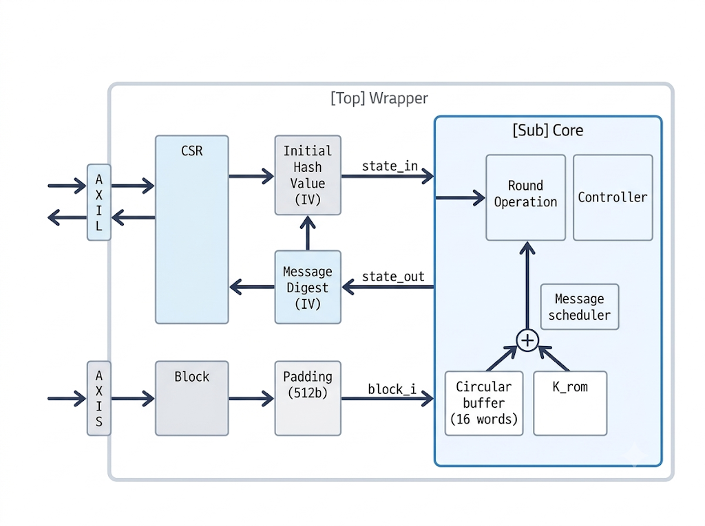
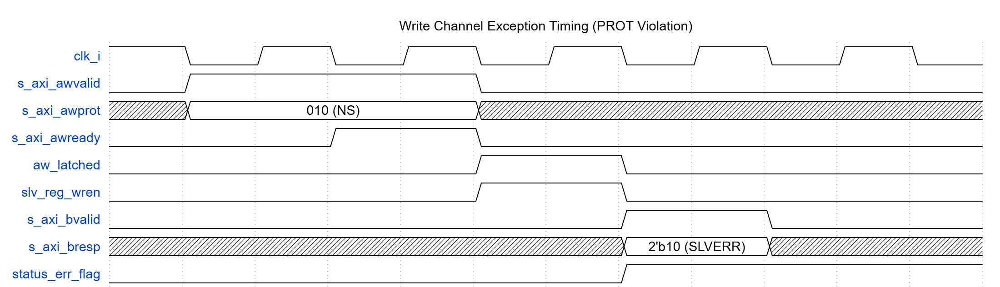
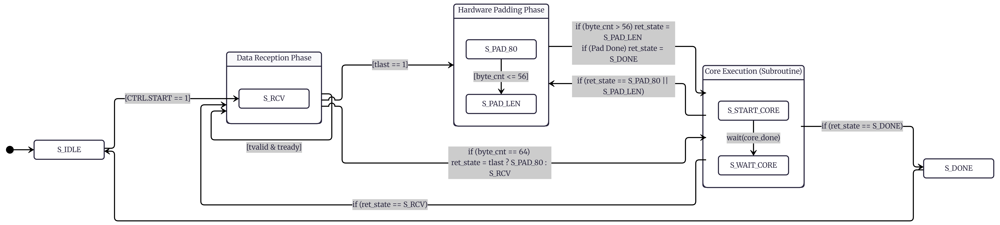
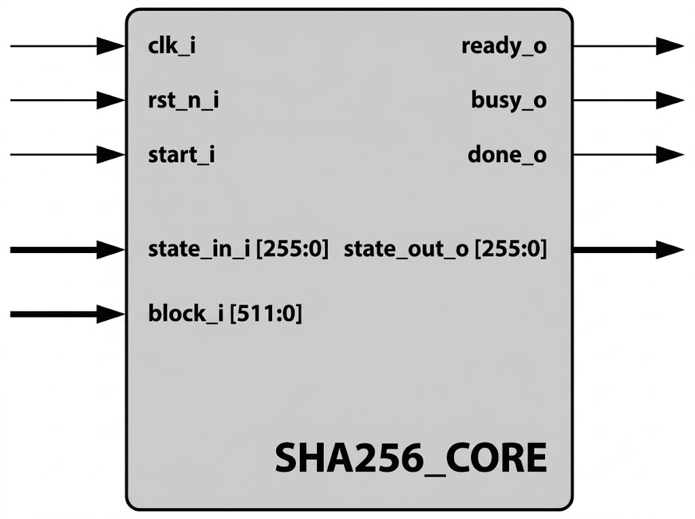
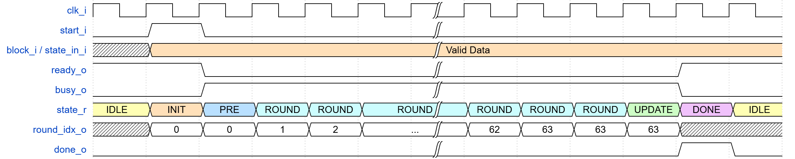

<!-- p1: 표지, Micro Architecture Specification -->
# Micro Architecture Specification
#### Youngjin Kim, 2026-09-01
## SHA256 IP Core for AXI4-Lite & AXI4-Stream Interface

### Table of Contents

* **1. Introduction and Features**
    * 1.1 Introduction
    * 1.2 Features

* **2. Terminology and Symbol Conventions**
    * 2.1 Terms Defined
    * 2.2 Symbols and Operations

* **3. References**
* **4. Architectural Specification**
    * 4.1 Symbol and Pin Description
        * 4.1.1 System Block Diagram
        * 4.1.2 Pin Description
    * 4.2 CSR Map (Control and Status Registers)
        * 4.2.1 Memory Map Overview
        * 4.2.2 Register Descriptions
    * 4.3 Security and Exception Handling
        * 4.3.1 PROT Firewall (Non-secure Access Blocking)
        * 4.3.2 Atomicity Violation (Status Collision Protection)
        * 4.3.3 Address Decode Error
        * 4.3.4 AXI4-Stream TKEEP Protocol Violation
        * 4.3.5 Error Response Timing (Waveform)
    * 4.4 Data Flow and Padding Mechanism
        * 4.4.1 Phase_Recv: Data Reception (`S_RCV`)
        * 4.4.2 Phase_Pad: Hardware Auto-Padding (`S_PAD_80`, `S_PAD_LEN`)
        * 4.4.3 Phase_Exec: Core Execution Subroutine (`S_START_CORE`, `S_WAIT_CORE`)
        * 4.4.4 Completion and Endianness Conversion

* **5. Hardware Specification (Core Architecture)**
    * 5.1 Core Architecture Overview & I/O Interface
    * 5.2 Controller FSM and Timing
    * 5.3 Datapath and Pipeline Optimization
    * 5.4 Algorithm to RTL Mapping

* **6. Technology Specification (Implementation & PPA)**
    * 6.1 Target Device Environment
    * 6.2 Resource Utilization (Area)
    * 6.3 Performance and Power (PPA)
    * 6.4 Critical Path and Bottleneck Analysis

* **7. Appendix**
    * 7.1 Message Schedule ($W_t$)
    * 7.2 Compression Function
    * 7.3 Intermediate Hash Update

<!-- p2: Introduction and Features -->
# 1. Introduction and Features
## 1.1 Introduction
본 IP는 NIST FIPS 180-4 표준을 준수하여 임의 길이의 메시지에서 256bit 해시값을 산출하는 SHA-256 하드웨어 가속기입니다. 최대 $2^{64}-1$ bit 길이의 입력 메시지를 지원합니다. 전체 구조는 시스템 인터페이스와 데이터 패딩을 담당하는 Wrapper와 해시 연산을 수행하는 Core로 분리되어 있습니다. 시스템 연동에는 AMBA AXI4 프로토콜을 사용합니다. 제어 레지스터 설정 및 상태 모니터링은 AXI4-Lite를, 데이터 입력은 AXI4-Stream을 통해 처리하며, tkeep 신호를 통해 byte 단위로 메시지를 구성합니다. AXI4-Lite 인터페이스에는 명시적인 에러 반환 및 접근 권한 검증 로직을 적용하여 보안성을 높였습니다. 인터페이스와 보호 회로를 Wrapper에 독립적으로 구성했기 때문에, 요구사항에 맞춰 Wrapper만 교체하면 자원 사용량을 줄이거나 다른 시스템 환경에 맞게 IP를 재설계할 수 있습니다. 순수 연산을 담당하는 Core 역시 HMAC과 같은 다른 암호화 IP 설계에 단독으로 적용하여 활용할 수 있습니다.

## 1.2 Features

**Overall**

* **Standard:** FIPS 180-4 규격 호환
* **Architecture:** 단일 클록 도메인 기반의 Wrapper와 Core 분리 구조

**AXI4 Wrapper**

* **Data Input:** 32-bit AXI4-Stream 적용 및 tkeep 신호를 통한 byte 제어
* **Flow Control:** 시스템 인터페이스에 따른 Back-pressure 처리 지원
* **Control/Status:** 32-bit AXI4-Lite 적용
* **Hardware Padding:** CPU 개입 없는 하드웨어 자동 패딩 및 byte 스와핑 지원
* **Chaining Loop:** 초기화 벡터 및 이전 해시 결과 자동 피드백 지원
* **Security:** AXI PROT 신호 기반 비인가 접근 차단 및 연산 중 상태 충돌 방지 로직 적용
* **Exception Handling:** 잘못된 주소 접근에 대한 SLVERR/DECERR 반환, 비정상 AXI4-Stream TKEEP 패턴 하드웨어 차단(`ERR_PRT`) 및 Soft Reset 지원

**SHA-256 Core**

* **Processing Unit:** 512bit 블록 단위 고정 지연 압축 엔진
* **Performance:** 블록당 68 사이클 소요
* **Flexibility:** 중간 해시값을 외부에 보관하는 단일 블록 압축 엔진 구조로 단독 재사용 지원

**Verification & Implementation**

* **Verification:** UVM 환경 구축 및 Sign-off 완료
* **Implementation:** Xilinx Zybo Z7-20 FPGA 타겟 합성 및 하드웨어 동작 검증 완료


<!-- p3: Terminology and Symbol Conventions -->

# 2. Terminology and Symbol Conventions

본 사양서에서 사용되는 주요 용어 및 기호는 NIST FIPS 180-4 표준(Section 2)의 정의를 따릅니다.

## 2.1 Terms Defined


| Term | Definition |
| --- | --- |
| **Message** | 해시 알고리즘의 입력으로 제공되는 임의 길이의 데이터 bit열입니다. |
| **Message Digest** | 해시 알고리즘을 거쳐 생성된 고정된 길이의 최종 출력값입니다. SHA-256의 경우 항상 256bit(8word)의 digest를 생성합니다. |
| **Word** | 32bit(bit) 길이의 데이터 단위입니다. SHA-256 내부의 논리 연산 및 가산기는 모두 32bit word 단위로 동작합니다. |
| **Block** | 해시 연산을 수행하기 위해 메시지를 일정한 크기로 나눈 단위입니다. SHA-256에서는 1개 블록이 512bit(16word)로 구성됩니다. |
| **Bit Padding** | 원본 메시지 길이가 블록 크기(512bit)의 정수배가 되도록 끝에 특정 bit(`1`, `0`들, 그리고 메시지 길이)를 추가하는 전처리 과정입니다. |
| **Initial Hash Value (IV)** | 첫 번째 메시지 블록 연산을 시작하기 전, 내부 256bit 상태 레지스터에 로드되는 규격화된 초기 상수입니다. |
| **Message Schedule** | 16word(512bit)의 입력 블록을 바탕으로, 64번의 라운드 연산에 각각 투입될 64개의 확장된 word($W_0 \sim W_{63}$)를 생성하는 알고리즘 및 하드웨어 블록을 의미합니다. |

## 2.2 Symbols and Operations

| Symbol (FIPS 180-4) | Description | SystemVerilog Equivalent |
| --- | --- | --- |
| $+$ | Addition modulo $2^{32}$ | `A + B` (Carry ignored) |
| $\oplus$ | Bitwise exclusive-OR (XOR) | `A ^ B` |
| $\wedge$ | Bitwise AND | `A & B` |
| $\neg$ | Bitwise complement (NOT) | `~A` |
| $ROTR^n(x)$ | Circular right shift (rotate) of 32-bit word $x$ by $n$ bits | `{x[n-1:0], x[31:n]}` |
| $SHR^n(x)$ | Logical right shift of 32-bit word $x$ by $n$ bits | `x >> n` |
| $x \vert \vert y$ | Concatenation of two bit strings $x$ and $y$ | `{x, y}` |

# 3. References

[1] [NIST FIPS 180-4: Secure Hash Standard (SHS)](https://nvlpubs.nist.gov/nistpubs/FIPS/NIST.FIPS.180-4.pdf), National Institute of Standards and Technology.

[2] [AMBA AXI and ACE Protocol Specification (ARM IHI 0022)](https://support.arm.com/documentation/ihi0022/latest), ARM Limited.

[3] [NIST Cryptographic Algorithm Validation Program (CAVP) - Secure Hashing (SHAVS)](https://csrc.nist.gov/projects/cryptographic-algorithm-validation-program/secure-hashing#shavs), National Institute of Standards and Technology.

[4] [AMBA 4 AXI4, AXI4-Lite, and AXI4-Stream Protocol Assertions User Guide (ARM DUI 0022)](https://support.arm.com/documentation/dui0534/b), ARM Limited.

# 4. Architectural Specification

## 4.1 Symbol and Pin Description

### 4.1.1 System Block Diagram
전체 시스템의 아키텍처는 다음과 같습니다.




시스템 인터페이스는 제어(AXI4-Lite)와 데이터(AXI4-Stream) 채널로 분리되어 Wrapper로 주입됩니다. Wrapper는 패딩된 512bit 블록(`block_i`)과 256bit 초기 해시값(`state_in`)을 생성하여 Core로 전달합니다. Core 엔진은 외부 버스 프로토콜과 독립적으로 동작하며, 연산이 완료된 256bit 해시 결과(`state_out`)를 Wrapper의 메시지 digest 레지스터로 반환하여 다음 라운드의 Initial Hash Value(IV)로 자동 체이닝되도록 설계되었습니다.


### 4.1.2 Pin Description
모든 신호는 단일 클럭 도메인(`clk_i`)에 동기화되어 동작합니다. AXI 신호는 AMBA AXI4 표준을 준수합니다.

| Signal Name | Direction | Width | Description |
| --- | --- | --- | --- |
| **System** |  |  |  |
| `clk_i` | Input | 1 | System main clock |
| `rst_n_i` | Input | 1 | Asynchronous system reset (Active-Low) |
| **AXI4-Lite (Write Channel)** |  |  |  |
| `s_axi_awaddr` | Input | 8 | Write address (up to `0xFF` offset) |
| `s_axi_awprot` | Input | 3 | Write protection type **(See Section 4.3 for PROT firewall)** |
| `s_axi_awvalid` | Input | 1 | Write address valid |
| `s_axi_awready` | Output | 1 | Write address ready |
| `s_axi_wdata` | Input | 32 | Write data |
| `s_axi_wstrb` | Input | 4 | Write byte strobe (Byte Enable) |
| `s_axi_wvalid` | Input | 1 | Write data valid |
| `s_axi_wready` | Output | 1 | Write data ready |
| `s_axi_bresp` | Output | 2 | Write response. Returns `OKAY (0b00)`, `SLVERR (0b10)`, or `DECERR (0b11)` **(See Section 4.3)** |
| `s_axi_bvalid` | Output | 1 | Write response valid |
| `s_axi_bready` | Input | 1 | Write response ready |
| **AXI4-Lite (Read Channel)** |  |  |  |
| `s_axi_araddr` | Input | 8 | Read address (up to `0xFF` offset) |
| `s_axi_arprot` | Input | 3 | Read protection type **(See Section 4.3 for PROT firewall)** |
| `s_axi_arvalid` | Input | 1 | Read address valid |
| `s_axi_arready` | Output | 1 | Read address ready |
| `s_axi_rdata` | Output | 32 | Read data |
| `s_axi_rresp` | Output | 2 | Read response. Returns `OKAY (0b00)`, `SLVERR (0b10)`, or `DECERR (0b11)` **(See Section 4.3)** |
| `s_axi_rvalid` | Output | 1 | Read data valid |
| `s_axi_rready` | Input | 1 | Read data ready |
| **AXI4-Stream (Message Input)** |  |  |  |
| `s_axis_tdata` | Input | 32 | Streaming message data |
| `s_axis_tkeep` | Input | 4 | Byte qualifier (Must be continuous from LSB). Used for internal MSG_LEN calculation |
| `s_axis_tlast` | Input | 1 | End of message stream indicator |
| `s_axis_tvalid` | Input | 1 | Stream data valid |
| `s_axis_tready` | Output | 1 | Stream data ready (Active only in `S_RCV` state) |
| **Interrupt** |  |  |  |
| `irq_o` | Output | 1 | Hash operation done interrupt (Active-High) |

---

## 4.2 CSR Map (Control and Status Registers)

### 4.2.1 Memory Map Overview

모든 레지스터는 32bit word 단위의 접근만 허용됩니다. 정의되지 않은 주소 영역 접근 및 PROT 방화벽 차단 시 `SLVERR` 또는 `DECERR` 에러가 반환됩니다 (상세 예외 조건 4.3절 참조).

| Offset | Register Name | Access | Reset Value | Description |
| --- | --- | --- | --- | --- |
| `0x00` | `ID` | RO | `0x41749591` | Hardware identifier and version information |
| `0x04` | `CTRL` | R/W (Mixed) | `0x00000000` | Module enable, transaction start, and soft reset control |
| `0x08` | `STATUS` | RO | `0x00000000` | Core execution status, error, and completion flag monitoring |
| `0x0C` | `INTCLEAR` | WO (W1C) | `0x00000000` | Status flags and interrupt clear |
| `0x10` | `MSG_LEN_LO` | RO | `0x00000000` | Received stream message bit length (Lower 32 bits) |
| `0x14` | `MSG_LEN_HI` | RO | `0x00000000` | Received stream message bit length (Upper 32 bits) |
| `0x20` ~ `0x3C` | `DIGEST_0~7` | RO | `0x00000000` | 256-bit (32-bit x 8) final hash computation result |
| `0x80` ~ `0x9C` | `STATE_IN_0~7` | R/W | (SHA-256 IV) | Initial computation constants (Initialization Vector) |


### 4.2.2 Register Descriptions

**(1) ID (Offset `0x00`)**
하드웨어 고유 식별자 및 버전 정보를 담고 있는 읽기 전용 레지스터입니다.


| Bits | Name | Access | Reset | Description |
| --- | --- | --- | --- | --- |
| 31:0 | `ID_VAL` | RO | `0x41749591` | ID |

**(2) CTRL (Offset `0x04`)**
IP의 동작을 제어합니다. `STATUS.BUSY == 1`인 트랜잭션 진행 상태에서는 `SOFT_RESET`을 제외한 모든 bit의 쓰기 시도가 하드웨어적으로 차단되며 `SLVERR`를 반환합니다.


| Bits | Name | Access | Reset | Description |
| --- | --- | --- | --- | --- |
| 31:4 | `RESERVED` | RO | `0x0` | Reserved. Read as zero. |
| 3 | `SOFT_RESET` | W1P | `0x0` | Force core and wrapper to idle state. Self-clearing. |
| 2 | `START` | W1P | `0x0` | Trigger hash transaction. Self-clearing. |
| 1 | `IRQ_EN` | R/W | `0x0` | Enable completion interrupt (`irq_o`). |
| 0 | `EN` | R/W | `0x0` | Enable AXI-Stream data reception. |

**(3) STATUS (Offset `0x08`)**
내부 연산 상태 및 예외 발생 여부를 모니터링합니다.


| Bits | Name | Access | Reset | Description |
| --- | --- | --- | --- | --- |
| 31:3 | `RESERVED` | RO | `0x0` | Reserved. Read as zero. |
| 2 | `ERR_PRT` | RO | `0x0` | AXI protection, atomicity, RO write violation, or AXI4-Stream TKEEP protocol violation detected. |
| 1 | `DONE` | RO | `0x0` | Hash computation completed. Valid data in `DIGEST`. |
| 0 | `BUSY` | RO | `0x0` | Transaction active or core engine running. |

**(4) INTCLEAR (Offset `0x0C`)**
`STATUS` 레지스터의 상태 플래그 및 외부 인터럽트를 해제하는 쓰기 전용(Write-Only) 레지스터입니다. Read 시도 시 `DECERR`가 발생합니다.


| Bits | Name | Access | Reset | Description |
| --- | --- | --- | --- | --- |
| 31:3 | `RESERVED` | WO | `0x0` | Reserved. |
| 2 | `CLR_ERR` | W1C | `0x0` | Clear `STATUS.ERR_PRT` flag. |
| 1 | `CLR_DONE` | W1C | `0x0` | Clear `STATUS.DONE` flag and deassert interrupt. |
| 0 | `RESERVED` | WO | `0x0` | Reserved. |

**(5) MSG_LEN_LO / HI (Offset `0x10`, `0x14`)**
수신된 전체 AXI-Stream 메시지의 누적 비트(Bit) 수를 나타냅니다. (64bit 표현)


| Offset | Bits | Name | Access | Reset | Description |
| --- | --- | --- | --- | --- | --- |
| `0x10` | 31:0 | `LEN_LO` | RO | `0x0` | Total message bit length (Lower 32 bits). |
| `0x14` | 31:0 | `LEN_HI` | RO | `0x0` | Total message bit length (Upper 32 bits). |

**(6) DIGEST_0 ~ 7 (Offset `0x20` ~ `0x3C`)**
256bit의 최종 해시 결과가 32bit 단위로 저장되는 읽기 전용 영역입니다.


| Offset | Bits | Name | Access | Reset | Description |
| --- | --- | --- | --- | --- | --- |
| `0x20`~`0x3C` | 31:0 | `HASH_W` | RO | `0x0` | 256-bit hash digest chunk (Assigned sequentially). |

**(7) STATE_IN_0 ~ 7 (Offset `0x80` ~ `0x9C`)**
첫 번째 블록 연산에 투입되는 256bit Initial Hash Value(IV)입니다. 시스템 리셋 시 펌웨어 개입 없이 FIPS 180-4 규격의 SHA-256 표준 IV 상수들로 자동 초기화됩니다. Chaining 기능을 사용할 때만 펌웨어가 중간 해시 결과값으로 덮어씁니다.


| Offset | Bits | Name | Access | Reset | Description |
| --- | --- | --- | --- | --- | --- |
| `0x80` | 31:0 | `IV_W0` | R/W | `0x6A09E667` | Initialization vector 0. |
| `0x84` | 31:0 | `IV_W1` | R/W | `0xBB67AE85` | Initialization vector 1. |
| `0x88` | 31:0 | `IV_W2` | R/W | `0x3C6EF372` | Initialization vector 2. |
| `0x8C` | 31:0 | `IV_W3` | R/W | `0xA54FF53A` | Initialization vector 3. |
| `0x90` | 31:0 | `IV_W4` | R/W | `0x510E527F` | Initialization vector 4. |
| `0x94` | 31:0 | `IV_W5` | R/W | `0x9B05688C` | Initialization vector 5. |
| `0x98` | 31:0 | `IV_W6` | R/W | `0x1F83D9AB` | Initialization vector 6. |
| `0x9C` | 31:0 | `IV_W7` | R/W | `0x5BE0CD19` | Initialization vector 7. |


## 4.3 Security and Exception Handling

본 IP는 잘못된 AXI 트랜잭션이나 비인가 접근으로부터 시스템을 보호하기 위해 엄격한 예외 처리 및 방화벽 로직을 포함합니다. AXI4-Lite 제어 버스에서 권한 위반이나 상태 충돌이 감지될 경우 해당 입력만 차단하고 즉시 에러 응답(`SLVERR`/`DECERR`)을 반환하며 진행 중인 내부 FSM 및 연산 상태는 그대로 유지합니다. 반면 AXI4-Stream 데이터 버스에서 `TKEEP` 프로토콜 위반이 감지될 경우 데이터 오염 및 데드락 방지를 위해 내부 버퍼를 `0x00`으로 즉시 소거하고 `S_IDLE` 상태로 복귀합니다.

### 4.3.1 PROT Firewall (Non-secure Access Blocking)

AXI4-Lite의 보호 제어 신호(`s_axi_awprot`, `s_axi_arprot`)를 검사하여 Non-secure 권한의 마스터가 접근할 경우 동작을 전면 차단합니다.

| `AxPROT[2:0]` | Access State | Hardware Action |
| :--- | :--- | :--- |
| `3'bX0X` | Secure (Valid) | 정상 접근 허용 |
| `3'bX1X` | Non-secure (Invalid) | 접근 차단 및 `SLVERR (2'b10)` 응답 반환<br>• **Read:** `0x00000000` 마스킹 반환<br>• **Write:** 쓰기 무시 및 `STATUS.ERR_PRT` 에러 플래그 1 설정 |


### 4.3.2 Atomicity Violation (Status Collision Protection)

해시 코어가 메시지를 처리 중인 상태(`STATUS.BUSY == 1`)에서는 주요 제어 레지스터의 무결성을 보호하기 위해 변경 시도를 하드웨어적으로 마스킹합니다.

* **상태 입력 영역(`STATE_IN_0~7`):** Busy 상태에서 이 영역에 Write를 시도하면 요청이 무시되고 `SLVERR (2'b10)`를 반환하며 `ERR_PRT` 플래그가 발생합니다.
* **제어 레지스터(`CTRL`):** Busy 상태에서 `START`, `IRQ_EN`, `EN` 비트의 상태를 변경하려 시도할 경우 위와 동일하게 차단되며 에러를 반환합니다.
* **복구 예외(Hang Recovery):** 단, Deadlock 복구를 위해 `CTRL` 레지스터의 `SOFT_RESET` bit(3번 bit)는 Busy 상태에서도 예외적으로 Write가 허용됩니다.


### 4.3.3 Address Decode Error

정의되지 않은 범위나 잘못된 권한의 주소로 트랜잭션이 주입될 경우의 처리 방식입니다.

* **Read-Only 주소에 Write 시도 (SLVERR):** `ID`, `STATUS`, `MSG_LEN`, `DIGEST` 등의 읽기 전용 오프셋 영역에 Write를 시도하면 요청을 무시하고 `SLVERR (2'b10)` 에러 응답을 반환하며 `STATUS.ERR_PRT` 에러 플래그를 `1`로 설정합니다.
* **Write-Only 주소에 Read 시도 (DECERR):** 쓰기 전용인 `INTCLEAR` 레지스터(Offset `0x0C`)에 Read를 시도할 경우, 데이터 버스에 `0x00000000`을 싣고 `DECERR (2'b11)` 버스 에러를 반환합니다.
* **미할당 주소 접근 (DECERR):** 디코더에 매핑되지 않은 주소 영역(예: `0x40~0x7F`, `0xA0~0xFF`)에 Read 또는 Write 접근을 시도할 경우, 펌웨어의 Silent Failure를 방지하기 위해 즉각 `DECERR (2'b11)` 응답을 반환합니다.

### 4.3.4 AXI4-Stream TKEEP Protocol Violation

스트림 데이터 수신(`S_RCV`) 중 허용되지 않은 `s_axis_tkeep` 패턴이 주입될 경우, 하드웨어 보호 로직(`axis_tkeep_err`)이 동작합니다.

* **패킷 중간 부분 스트로브 차단 (`s_axis_tlast == 0`):** 마지막 Beat가 아닌 중간 전송에서 `s_axis_tkeep != 4'b1111`(부분 byte 또는 Null Beat)이 인가되면 프로토콜 위반으로 판정합니다.
* **마지막 Beat 비연속 및 Null 스트로브 차단 (`s_axis_tlast == 1`):** 패킷의 마지막 전송에서 LSB부터 연속으로 채워진 패턴(`4'b0001`, `4'b0011`, `4'b0111`, `4'b1111`) 외의 값(예: 비연속 `4'b1010` 또는 Null Beat `4'b0000`)이 인가되면 프로토콜 위반으로 판정합니다.
* **차단 및 복구 동작:** 위반 감지 즉시 해당 데이터의 버퍼 적재를 차단하고 내부 512bit 버퍼(`block_b`)를 `0x00`으로 초기화한 뒤, `STATUS.ERR_PRT` 플래그를 `1`로 설정하고 `S_IDLE` 상태(`STATUS.BUSY = 0`)로 즉시 복귀합니다.

### 4.3.5 Error Response Timing (Waveform)

다음은 `PROT` 방화벽 로직에 의해 Non-secure Write 접근이 감지되었을 때 에러 응답(`SLVERR`)이 반환되는 하드웨어 타이밍 다이어그램입니다. AXI 핸드셰이크가 완료(`aw_latched`, `w_latched`)된 직후 1사이클 만에 에러 응답이 발생합니다.



## 4.4 Data Flow and Padding Mechanism

Wrapper 내부의 FSM은 펌웨어의 개입 없이 AXI4-Stream 데이터를 수신하여 512bit 블록으로 조립하고, FIPS 180-4 규격에 따른 패딩 처리 및 Core 구동 타이밍을 전담합니다.
본 Wrapper의 FSM는 총 7개의 State로 구성되며, Phase에 따라 다음과 같이 분류됩니다.

| Phase | State Name | Description |
| --- | --- | --- |
| **Idle** | `S_IDLE` | Idle state. Waits for the `CTRL.START` signal and initializes variables for a new transaction. |
| **Reception** | `S_RCV` | Receives the stream message from the AXI4-Stream bus and loads it into the 512-bit buffer. |
| **Padding** | `S_PAD_80` | Appends a `0x80` byte immediately after the last valid data byte upon completion of data reception. |
|  | `S_PAD_LEN` | Inserts the accumulated bit length of the total message (`msg_len`) into the lower 64 bits of the 512-bit buffer. |
| **Execution**<br>*(Subroutine)* | `S_START_CORE` | Generates a single-cycle start pulse (`core_start`) to trigger the Core compression engine and transitions to `S_WAIT_CORE`. |
|  | `S_WAIT_CORE` | Waits for the Core's compression operation to complete (`core_done`), then returns to the pre-assigned `ret_state`. |
| **Completion** | `S_DONE` | Transaction completion state. Asserts the completion interrupt and returns to `S_IDLE`. |

아래는 설계된 전체 FSM의 State Diagram입니다.


### 4.4.1 Phase_Recv: Data Reception (`S_RCV`)

트랜잭션이 시작(`CTRL.START == 1`)되면 1 사이클 후 `S_RCV`로 전환되어 AXI-Stream 버스로부터 데이터를 수신합니다.

* **동작:** `tvalid`와 `tready`가 모두 High이고 `tkeep` 패턴이 유효할 때 byte 데이터를 버퍼(`block_b`)에 적재하며, 실시간으로 전체 메시지 bit 길이(`msg_len`)와 버퍼 byte 카운트(`byte_cnt`)를 누적합니다.
* **TKEEP 유효성 검사 및 예외 보호 (Hardware TKEEP Protection):** 마스터 모듈은 패킷 중간(`tlast == 0`)에는 `4'b1111`를, 마지막 Beat(`tlast == 1`)에는 LSB부터 연속 패턴(`4'b0001`, `4'b0011`, `4'b0111`, `4'b1111`)만을 인가해야 합니다. 비연속 패턴(예: `4'b1010`), Null Beat(`4'b0000`), 또는 패킷 중간 부분 스트로브가 인가될 경우, 하드웨어 보호 로직(`axis_tkeep_err`)이 이를 즉시 감지하여 `STATUS.ERR_PRT` 플래그를 `1`로 설정하고 내부 버퍼(`block_b`)를 `0x00`으로 초기화한 뒤 `S_IDLE` 상태로 복귀합니다 (4.3.4절 참조).
* **Buffer Full 조건:** `byte_cnt`가 64(512bit)에 도달하면 즉시 수신을 멈추고 코어 연산을 위해 `Phase_Exec`로 진입합니다. 이때 현재 스트림이 마지막 데이터(`tlast == 1`)라면 `ret_state`를 `S_PAD_80`으로, 아니라면 데이터를 마저 받기 위해 `S_RCV`로 저장합니다.
* **소요 클록:** AXIS 채널의 수신 상태에 따라 다르며, 32Bit(4Byte)가 매 사이클 연속으로 주입될 경우 1개 블록(64byte)을 채우는 데 최소 16 사이클이 소요됩니다.


### 4.4.2 Phase_Pad: Hardware Auto-Padding (`S_PAD_80`, `S_PAD_LEN`)

마지막 스트림 데이터(`tlast == 1`) 수신 후 진입하여 FIPS 180-4 규격 패딩을 하드웨어로 자동 수행합니다.

* **`S_PAD_80` (1 사이클 소요):** 마지막 유효 데이터 직후 byte에 `0x80`을 삽입합니다. 만약 `0x80`을 넣고 난 후 `byte_cnt`가 56을 초과하면, 현재 블록을 코어로 보내기 위해 `ret_state`를 `S_PAD_LEN`으로 설정하고 `Phase_Exec`로 예외 진입합니다. 여유가 있다면 바로 `S_PAD_LEN`으로 넘어갑니다.
* **`S_PAD_LEN` (1 사이클 소요):** 블록의 맨 마지막 64bit 공간에 누적된 총 길이 `msg_len`을 기록합니다. 패딩이 완성되었으므로 최종 코어 연산을 위해 `ret_state`를 `S_DONE`으로 설정하고 `Phase_Exec`로 진입합니다.
* **Padding Boundary Conditions**

| 원본 메시지 길이 | 패딩 블록 처리 예상 동작 (Expected FSM Behavior) |
| --- | --- |
| **55 bytes** | 단일 블록 내에 `0x80`과 64bit Length를 모두 수용 가능하므로, 1개의 블록 연산만 수행합니다. |
| **56 bytes** | `0x80` 삽입 후 Length 공간이 부족하므로, 현재 블록 연산 후 Length만 포함된 두 번째 패딩 블록을 추가로 생성합니다. |
| **64 bytes** | 블록이 정확히 가득 찼으므로 원본 데이터 블록 연산 후, `0x80`과 Length가 포함된 두 번째 패딩 블록을 추가로 생성합니다. |

### 4.4.3 Phase_Exec: Core Execution Subroutine (`S_START_CORE`, `S_WAIT_CORE`)

버퍼가 가득 차거나 패딩이 완료되어 실제 SHA-256 연산이 필요할 때마다 서브루틴처럼 호출되는 공용 상태 구간입니다.

* **`S_START_CORE` (1 사이클 소요):** 내부 Core에 `core_start` 펄스를 1 사이클 동안 발생시켜 해시 연산을 시작합니다.
* **`S_WAIT_CORE` (68 사이클 소요):** 블록당 68 사이클이 소요되는 순수 압축 엔진의 연산이 끝날 때까지 대기합니다. Core로부터 `core_done` 응답이 도착하면, 256bit 연산 결과를 내부 래치(`core_state_out_reg`)에 저장하고 버퍼를 비운 뒤 사전에 설정된 값에 따라 `S_RCV`, `S_PAD_80`, `S_PAD_LEN`, 혹은 `S_DONE`로 분기합니다.


### 4.4.4 Completion and Endianness Conversion

* **Completion and Interrupt (`S_DONE`):** `ret_state`가 `S_DONE`일 때 도달하며 1 사이클이 소요됩니다. `STATUS.DONE` bit를 1로 셋업하여 외부 인터럽트를 발생시키고 `S_IDLE`로 복귀합니다.


* **Auto-Chaining:** 첫 연산 시에는 `STATE_IN` 레지스터 값을 IV로 사용하며, 이어지는 다음 블록 연산부터는 이전 라운드의 해시 결과를 다음 연산의 입력으로 자동 피드백(Chaining)합니다.


* **Endian Conversion:** Wrapper의 AXI 인터페이스는 Little-Endian으로 동작하는 반면, Core 엔진은 SHA-256 규격에 따라 Big-Endian 포맷을 요구하므로, `block_b`에서 `core_block`으로 데이터를 넘기는 과정에서 byte 순서가 하드웨어적으로 자동 변환됩니다.


# 5. Hardware Specification (Core Architecture)

본 장에서는 512bit 단위의 압축 연산을 수행하는 `sha256_core` 엔진의 내부 아키텍처를 기술합니다. *(참고: 512bit 블록의 생성 및 패딩 과정은 4.4절을, 상세 알고리즘 수식은 Appendix를 참조하십시오.)*

## 5.1 Core Architecture Overview & I/O Interface

`sha256_core`는 AXI 버스 인터페이스 및 패딩 로직과 완전히 분리되어, chaining 동작과 무관하게 단일 블록 압축 연산만을 수행하는 순수 연산 엔진입니다. Core는 512bit 입력 블록과 256bit 초기 상태를 받아, 256bit 해시 결과를 반환합니다. 

아래는 코어 모듈의 입출력 신호 다이어그램입니다.



코어의 입출력 포트는 복잡한 표준 버스 프로토콜에 의존하지 않는 단순 제어 및 데이터 신호로만 구성됩니다.

* **제어 신호:** `start_i` 펄스를 통해 연산을 시작하며, 내부 상태는 `ready_o` (수신 대기), `busy_o` (연산 중), `done_o` (연산 완료 펄스)를 통해 상위 모듈로 피드백됩니다.
* **데이터 패스:** 외부로부터 512bit 메시지 블록(`block_i`)과 256bit 초기 해시값(`state_in_i`)을 인가받아, 256bit의 새로운 해시 결과(`state_out_o`)를 반환합니다. chaining 동작을 위해서는 이전 블록의 해시 결과(`state_out_o`)를 다음 블록의 `state_in_i`로 피드백해야 합니다.

특히 연속된 메시지를 처리하는 Chaining 동작은 외부 Wrapper가 `state_in_i` 값을 갱신하여 인가함으로써 이루어집니다. 따라서 Core 자체는 현재 처리 중인 데이터가 첫 번째 블록인지, 체이닝 중인 중간 블록인지 인지하지 못한 채 주어진 입력에 대한 단일 압축 연산만을 충실히 수행합니다.

## 5.2 Controller FSM and Timing

`sha256_controller`는 Native 인터페이스의 핸드셰이크(`start_i`, `ready_o`, `done_o`)를 처리하며, 블록당 68 사이클의 고정 레이턴시로 데이터패스를 제어합니다.

아래는 코어의 트랜잭션 시작과 종료 시점의 타이밍 다이어그램입니다.


**동작 사이클 분석 (총 68 사이클)**

* **IDLE:** `ready_o`가 High 상태이며, `start_i` 펄스가 인가되면 다음 클럭에 `INIT` 상태로 전이합니다.
* **INIT (1 사이클):** `ready_o`가 Low로, `busy_o`가 High로 변경됩니다. `load_block_o` 및 `init_o` 신호를 발생시켜 외부 입력 데이터(`block_i`, `state_in_i`)를 내부 레지스터에 래치합니다.
* **PRE_ROUND (1 사이클):** 파이프라인 준비 구간입니다. 메시지 스케줄러의 초기 래치와 ROM 프리패치를 위해 `pre_round_o` 신호를 발생시킵니다.
* **ROUND (64 사이클):** `round_idx_r` 카운터를 증가시키며 `round_en_o` 펄스를 발생시킵니다. 63번째 라운드 도달 시 `repeat_last_round_r` 조건에 의해 상태를 1 사이클 더 유지하여 총 64번의 압축 라운드를 수행합니다.
* **UPDATE (1 사이클):** 64라운드 연산 결과를 초기 해시값과 더하기 위해 `update_o` 신호를 발생시킵니다.
* **DONE (1 사이클):** 연산 완료를 알리는 `done_o` 펄스를 1 사이클 동안 출력합니다. 동시에 `ready_o`를 High로, `busy_o`를 Low로 복구하고 `IDLE` 상태로 복귀합니다.

## 5.3 Datapath and Pipeline Optimization

SHA-256 알고리즘의 전체 연산 흐름은 크게 세 가지 논리적 단계로 나뉘어 실행됩니다.

```text
1. 스케줄링 단계   : 16-word 입력을 64-word로 확장
2. 압축 연산 단계 : 64라운드의 핵심 해시 연산 수행
3. 해시 업데이트   : 이전 상태값과의 덧셈을 통한 최종 결과 갱신
```
`sha256_datapath`는 성능 향상을 위해 파이프라인 분할 및 프리패치 기법을 적용하고, 면적 최적화를 위해 Circular Queue 기반의 Sliding Window 구조를 채택했습니다. 

**설계 최적화 주요 항목**

* **면적 최적화 (Sliding Window Schedule):**
알고리즘상 64라운드 연산을 위해서는 64개의 확장 word($W_0 \sim W_{63}$, 총 2048bit)가 필요합니다. 본 설계는 이를 한 번에 계산하여 저장하지 않고, 16word(512bit) 크기의 원형 큐(`w_mem`)만 할당했습니다. 매 라운드마다 1개의 새로운 $W_t$를 실시간(On-the-fly)으로 연산하여 가장 오래된 데이터를 덮어쓰는 방식을 통해 레지스터 소모량을 75% 절감했습니다. (7.1 참조)


* **성능 향상 (Pipeline Latch 및 Prefetch 결합):**
알고리즘의 압축 연산식($T_1 = h + \Sigma_1(e) + Ch(e, f, g) + K_t + W_t$)은 여러 항의 덧셈이 길게 이어져 동작 주파수($F_{max}$) 저하의 크리티컬 패스가 됩니다. 이를 해결하기 위해 $W_t + K_t$ 덧셈 직후 `wk_r` 레지스터를 삽입하여 조합 회로를 물리적으로 분할했습니다.
이 값들은 입력 순서가 고정되어 있으므로 연산 시작 전 `PRE_ROUND` 상태에서 $W_0$와 $K_0$를 미리 읽어오는 Prefetch 동작을 결합했습니다.

## 5.4 Algorithm to RTL Mapping
Core는 패딩 처리가 완료되었다는 가정하에, 512bit 블록(`block_i`)과 초기 해시값(`state_in_i`)을 인가받아 순수 압축 연산만을 수행합니다. RTL 파일과 SHA-256 알고리즘 수식(Appendix 참조) 간의 매핑 구조는 다음과 같습니다.

| FIPS 180-4 Function | Equation Reference | RTL Module Name |
| --- | --- | --- |
| **Choose** | Eq. 1 | `sha256_ch.sv` |
| **Majority** | Eq. 2 | `sha256_maj.sv` |
| **Upper Sigma 0** ($\Sigma_0$) | Eq. 3 | `sha256_ep0.sv` |
| **Upper Sigma 1** ($\Sigma_1$) | Eq. 4 | `sha256_ep1.sv` |
| **Lower Sigma 0** ($\sigma_0$) | Eq. 5 | `sha256_sig0.sv` |
| **Lower Sigma 1** ($\sigma_1$) | Eq. 6 | `sha256_sig1.sv` |
| **Right Rotate** | $ROTR^n(x)$ | `sha256_rotr.sv` |
| **Modulo Adder** | $A + B \pmod{2^{32}}$ | `sha256_add32.sv` |
| **Round Constant** | $K_t$ | `sha256_k_rom.sv` |
| **Message Schedule** | $W_t$ Generation | `sha256_message_schedule.sv` |
| **Round Compression** | $a \sim h$ Update | `sha256_round_logic.sv` |


# 6. Technology Specification (Implementation & PPA)

본 장은 Xilinx FPGA 환경을 타겟으로 한 하드웨어 합성(Synthesis) 및 구현(Implementation) 결과를 바탕으로, IP의 물리적 자원 소모량(Area)과 성능(Performance) 지표를 기술합니다.

## 6.1 Target Device Environment

* **Target Device:** Xilinx Zynq-7000 SoC (`xc7z020-clg400-1` / Zybo Z7-20)
* **EDA Tool:** Xilinx Vivado v2025.2 & Vitis Bare-Metal Toolchain
* **Verification Environment:** Zynq PS(Cortex-A9) 영역 및 AXI DMA와 연동한 SoC 통합 베어메탈 펌웨어 테스트 완료 (`SHA256_FPGA_Verification_Report.md` 참조)

## 6.2 Resource Utilization (Area)

표기되지 않은 자원은 소모하지 않았습니다.

| Module Name | Slices | Slice LUTs | Slice Registers (FF) | F7 Muxes | F8 Muxes |
| --- | --- | --- | --- | --- | --- |
| **`sha256_core` (Core Only)** | 620 | 1,753 | 1,097 | 192 | 64 |
| **`sha256_axi_wrapper` (Total)** | 1,063 | 3,420 | 2,308 | 213 | 64 |

* **자원 소모 분석:** `sha256_axi_wrapper`의 자원 소모가 Core보다 큰 이유는 외부 AXI-Stream의 가변 데이터를 수용하기 위한 512bit 입력 버퍼와 패딩 제어 상태 머신(FSM)이 포함되어 있기 때문입니다. 또한, AXI4-Lite의 비인가 접근을 차단하고 상태 충돌을 방지하는 다수의 예외 처리 보호 로직(PROT Firewall)이 LUT 사용량 증가의 주된 원인으로 작용했습니다. Wrapper의 보호 로직을 최소화하거나 AXI4-Stream의 word 단위 입력만 허용하는 등의 재설계로 LUT 자원을 절감할 수 있습니다.

## 6.3 Performance and Power (PPA)

| Metric Category | Condition / Dataset | Execution Time | Throughput | Speed-up (vs. PS) |
| :--- | :--- | :---: | :---: | :---: |
| **Core Peak (Theoretical)** | $68\text{ cycles / block}$ @ $100\text{ MHz}$ | $0.68\text{ }\mu\text{s / block}$ | **$752.94\text{ Mbps}$** | - |
| **Wrapper Peak (Theoretical)** | $86\text{ cycles / block}$ @ $100\text{ MHz}$ | $0.86\text{ }\mu\text{s / block}$ | **$595.35\text{ Mbps}$** | - |
| **SoC Measured (ShortMsg)** | NIST `SHA256ShortMsg` ($16,640\text{ bits}$, 64 Vecs*) | $255\text{ }\mu\text{s}$ (PL) vs. $1,187\text{ }\mu\text{s}$ (PS) | **$65.25\text{ Mbps}$** | **$4.65\times$** |
| **SoC Measured (LongMsg)** | NIST `SHA256LongMsg` ($1,680,128\text{ bits}$, 64 Vecs) | $3,392\text{ }\mu\text{s}$ (PL) vs. $56,376\text{ }\mu\text{s}$ (PS) | **$495.32\text{ Mbps}$** | **$16.61\times$** |

*\*참고: `SHA256ShortMsg.rsp` 원본 65개 벡터 중 AXI DMA 0-Byte 전송이 불가한 `Len = 0` 벡터 1개는 PS SW 모델로만 대조하고, PL 벤치마크는 유효 스트리밍 벡터 64종(`8`~`512 bits`)을 기준으로 계측함.*

* **Operating Frequency ($F_{max}$):** $100\text{ MHz}$ (Timing Constraint MET, WNS: $+0.128\text{ ns}$)
* **Throughput (데이터 처리량):**
  * **Core Peak Throughput (코어 단독 이론 한계):** $100\text{ MHz}$ 구동 시 단일 블록($512\text{ bits}$) 압축에 고정 $68\text{ cycles}$가 소요되므로 코어 단독 최대 처리량은 **$752.94\text{ Mbps}$**입니다. $$\text{Throughput}_{\text{core}} = \frac{100\text{ MHz} \times 512\text{ bits}}{68\text{ cycles}} = 752.94\text{ Mbps}$$
  * **Wrapper Streaming Theoretical Throughput (IP 레벨 스트리밍 이론 한계):** 멀티 블록 연속 처리 시 Wrapper의 AXI4-Stream 데이터 적재(`S_RCV`, $16\text{ cycles}$)와 FSM 상태 전이($2\text{ cycles}$), 그리고 코어 압축 대기(`S_WAIT_CORE`, $68\text{ cycles}$)가 직렬 수행되어 블록당 최소 $86\text{ cycles}$가 소요됩니다. 이에 따른 IP 레벨 최대 유효 처리량은 **$595.35\text{ Mbps}$**입니다. $$\text{Throughput}_{\text{wrapper}} = \frac{100\text{ MHz} \times 512\text{ bits}}{(16 + 2 + 68)\text{ cycles}} = 595.35\text{ Mbps}$$
  * **Measured SoC Effective Throughput (Zynq-7000 실측 처리량):** Zybo Z7-20 보드에서 AXI DMA 및 GIC 인터럽트를 연동하여 NIST CAVP 표준 벡터를 실측한 결과, 대용량 데이터셋(`SHA256LongMsg.rsp`, 총 $1,680,128\text{ bits}$) 기준 **$495.32\text{ Mbps}$**의 실효 처리량을 달성했습니다. 이는 IP 스트리밍 이론 한계치($595.35\text{ Mbps}$)의 **$83.2\%$**에 해당하며, 동일 보드의 ARM Cortex-A9 PS 단독 연산($29.80\text{ Mbps}$) 대비 **$16.61\times$**의 하드웨어 가속 성능을 제공합니다. (상세 벤치마크 분석은 `SHA256_FPGA_Verification_Report.md` 4장 참조)

* **Power Consumption:** $100\text{ MHz}$ 구동 기준, FPGA 내부 PL 영역에서 발생하는 IP 자체의 동적 소모 전력(Dynamic Power)은 약 **$0.037\text{ W}$** 수준입니다. (참고: 전체 시스템 측정 전력 $1.441\text{ W}$ 중 $1.404\text{ W}$는 PS 영역 소모분임)

## 6.4 Critical Path and Bottleneck Analysis

Vivado 타이밍 분석 결과, 100 MHz 이상의 주파수 확장에 있어 주요 물리적 병목은 `sha256_message_schedule` 내부의 라우팅 지연으로 확인되었습니다.

* **높은 Fanout 원인:** 면적 최적화를 위해 16word 원형 큐 구조(`w_mem`)를 채택함에 따라, 한정된 레지스터에서 출력된 값이 다수의 덧셈기로 동시에 분배(Fanout)되면서 라우팅 복잡도가 증가했습니다.
* **Routing Delay 비중:** 타이밍 리포트 확인 결과 크리티컬 패스 내 일부 넷(Net)의 Fanout(fo)이 18~44에 달하며, 이로 인해 라우팅 지연이 전체 딜레이의 약 65%를 차지합니다.
* **결론:** 파이프라인 래치(`wk_r`)로 주요 조합 회로를 분할했음에도 불구하고, FPGA 구조적 특성과 맞물린 라우팅 지연이 Fmax 상승의 한계점입니다. 향후 배선 배치가 자유로운 ASIC 공정 적용 시 이러한 제약이 해소되어 추가적인 주파수 향상이 가능할 것으로 예상됩니다.


# 7. Appendix: SHA-256 Core Algorithm

**Functions**

**[Eq.1]** $$Ch(x, y, z) = (x \land y) \oplus (\neg x \land z)$$
**[Eq.2]** $$Maj(x, y, z) = (x \land y) \oplus (x \land z) \oplus (y \land z)$$
**[Eq.3]** $$\Sigma_0(x) = ROTR^2(x) \oplus ROTR^{13}(x) \oplus ROTR^{22}(x)$$
**[Eq.4]** $$\Sigma_1(x) = ROTR^6(x) \oplus ROTR^{11}(x) \oplus ROTR^{25}(x)$$
**[Eq.5]** $$\sigma_0(x) = ROTR^7(x) \oplus ROTR^{18}(x) \oplus SHR^3(x)$$
**[Eq.6]** $$\sigma_1(x) = ROTR^{17}(x) \oplus ROTR^{19}(x) \oplus SHR^{10}(x)$$

---

## 7.1 Message Schedule ($W_t$)

Let $M$ be a 512-bit input block, partitioned into sixteen 32-bit words: $M_0, M_1, \dots, M_{15}$.
For $0 \le t \le 15$:

$$W_t = M_t$$
For $16 \le t \le 63$:

$$W_t = \sigma_1(W_{t-2}) + W_{t-7} + \sigma_0(W_{t-15}) + W_{t-16}$$

---

## 7.2 Compression Function

Initialize working variables with intermediate hash value $H^{(i-1)}$:

$$a = H^{(i-1)}_0, \quad b = H^{(i-1)}_1, \quad c = H^{(i-1)}_2, \quad d = H^{(i-1)}_3$$
$$e = H^{(i-1)}_4, \quad f = H^{(i-1)}_5, \quad g = H^{(i-1)}_6, \quad h = H^{(i-1)}_7$$
For $0 \le t \le 63$ (where $K_t$ is the 32-bit round constant):

$$T_1 = h + \Sigma_1(e) + Ch(e, f, g) + K_t + W_t$$
$$T_2 = \Sigma_0(a) + Maj(a, b, c)$$
$$h = g$$
$$g = f$$
$$f = e$$
$$e = d + T_1$$
$$d = c$$
$$c = b$$
$$b = a$$
$$a = T_1 + T_2$$

---

## 7.3 Intermediate Hash Update

Update hash values for the next block:

$$H^{(i)}_0 = H^{(i-1)}_0 + a$$
$$H^{(i)}_1 = H^{(i-1)}_1 + b$$
$$H^{(i)}_2 = H^{(i-1)}_2 + c$$
$$H^{(i)}_3 = H^{(i-1)}_3 + d$$
$$H^{(i)}_4 = H^{(i-1)}_4 + e$$
$$H^{(i)}_5 = H^{(i-1)}_5 + f$$
$$H^{(i)}_6 = H^{(i-1)}_6 + g$$
$$H^{(i)}_7 = H^{(i-1)}_7 + h$$
