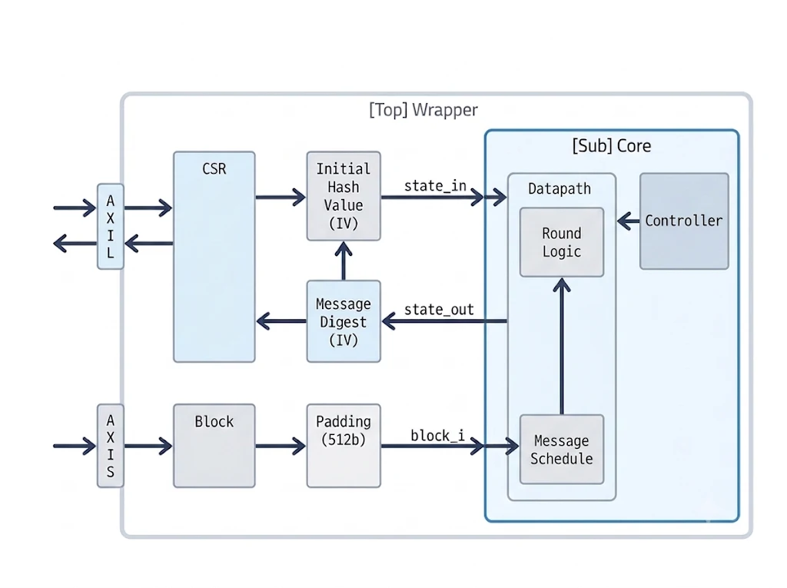
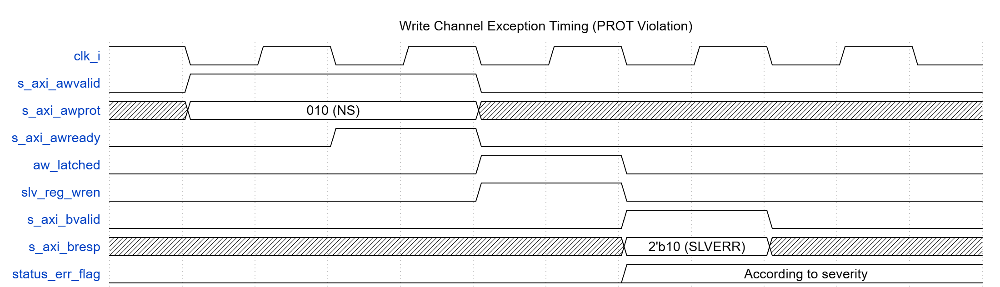
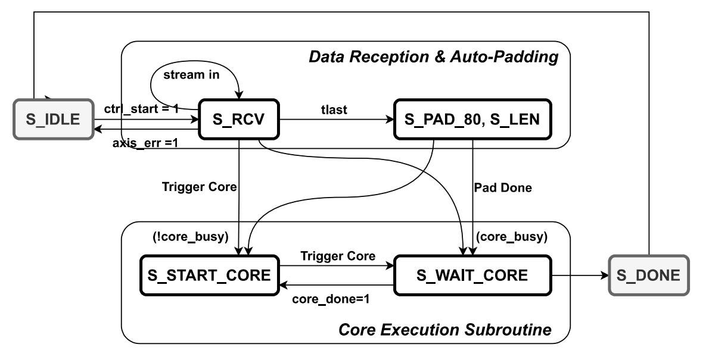
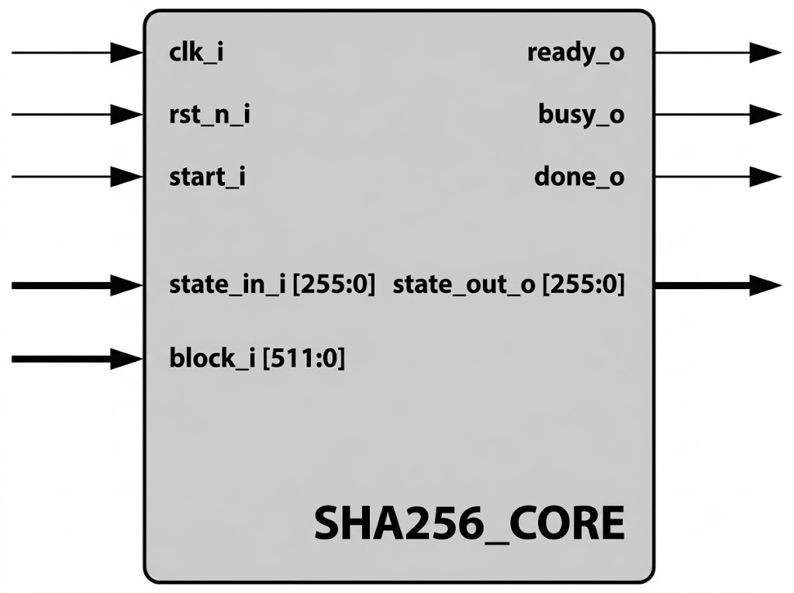
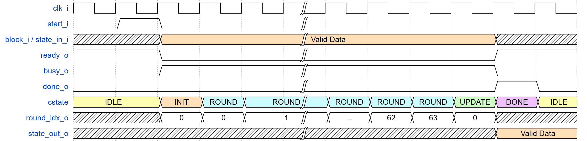

<!-- p1: 표지, Micro Architecture Specification -->
# Micro Architecture Specification
## SHA256 IP Core for AXI4-Lite & AXI4-Stream Interface

<!-- p2: Introduction and Features -->
# 1. Introduction and Features
## 1.1 Introduction
본 IP는 NIST FIPS 180-4 표준을 준수하여 임의 길이의 메시지에서 256bit 해시값을 산출하는 SHA-256 하드웨어 가속기입니다. $1\text{ Byte}$($8\text{ bits}$)부터 최대 $2^{64}-1\text{ bits}$ 길이의 입력 메시지를 지원합니다. 구조는 시스템 인터페이스와 데이터 패딩을 담당하는 Wrapper와 해시 연산을 수행하는 Core로 분리되어 있습니다. Wrapper는 AXI4-Lite를 통해 제어 레지스터 설정 및 상태 모니터링을 수행하고, AXI4-Stream을 통해 데이터 입력을 처리하며, tkeep 신호를 통해 byte 단위로 메시지를 구성합니다. Wrapper는 엄격한 보호 회로와 보안 설계를 적용하고, Core는 이를 배제하고 경량설계를 진행하였습니다. 인터페이스와 보호 회로를 Wrapper에 독립적으로 구성했기 때문에, 요구사항에 맞춰 Wrapper만 교체하면 자원 사용량을 줄이거나 다른 시스템 환경에 맞게 IP를 재설계할 수 있습니다. 순수 연산을 담당하는 Core 역시 HMAC과 같은 다른 암호화 IP 설계에 단독으로 적용하여 활용할 수 있습니다.

## 1.2 Features

**Overall**

* **Standard:** FIPS 180-4 규격 호환
* **Architecture:** 단일 클록 도메인 기반의 Wrapper와 Core 분리 구조

**AXI4 Wrapper**

* **Data Input:** 32-bit AXI4-Stream를 통한 byte 단위 Message 입력 지원
* **Control/Status:** 32-bit AXI4-Lite 적용
* **Hardware Padding:** Auto Padding 및 Byte Swapping 지원
* **Chaining Loop:** 초기화 벡터 및 이전 해시 결과 자동 피드백 지원
* **Security:** AXI PROT 신호 기반 비인가 접근 차단 및 연산 중 CSR 변경 시도 차단
* **Exception Handling:** 잘못된 주소 접근에 대한 SLVERR/DECERR 반환, 비정상 AXI4-Stream TKEEP 패턴 하드웨어 차단 및 Soft Reset 지원

**SHA-256 Core**

* **Processing Unit:** 512bit 블록 단위 고정 지연 압축 엔진
* **Performance:** 블록당 67 사이클 소요
* **Flexibility:** 중간 해시값을 외부에 보관하는 단일 블록 압축 엔진 구조로 단독 재사용 지원

**Verification & Implementation**

* **Verification:** UVM 환경 구축 및 Sign-off 완료
* **Implementation:** Xilinx Zybo Z7-20 FPGA 타겟 합성 및 하드웨어 동작 검증 완료


<!-- p3: Terminology and Symbol Conventions -->

# 2. Terminology and Symbol Conventions

본 사양서에서 사용되는 주요 용어 및 기호는 NIST FIPS 180-4 표준(Section 2)의 정의를 따릅니다.

## 2.1 Terms Defined


| Term | Definition |
| --- | --- |
| **Message** | 해시 알고리즘의 입력으로 제공되는 임의 길이의 데이터 bit열입니다. |
| **Message Digest** | 해시 알고리즘을 거쳐 생성된 고정된 길이의 최종 출력값입니다. SHA-256의 경우 항상 256bit(8word)의 digest를 생성합니다. |
| **Word** | 32bit(4byte) 길이의 데이터 단위입니다. SHA-256 내부의 논리 연산 및 가산기는 모두 32bit word 단위로 동작합니다. |
| **Block** | 해시 연산을 수행하기 위해 메시지를 일정한 크기로 나눈 단위입니다. SHA-256에서는 1개 블록이 512bit(16word)로 구성됩니다. |
| **Bit Padding** | 원본 메시지 길이가 블록 크기(512bit)의 정수배가 되도록 끝에 특정 bit(`1`, `0`들, 그리고 메시지 길이)를 추가하는 전처리 과정입니다. |
| **Initial Hash Value (IV)** | 첫 번째 메시지 블록 연산을 시작하기 전, 내부 256bit 상태 레지스터에 로드되는 규격화된 초기 상수입니다. |
| **Message Schedule** | 16word(512bit)의 입력 블록을 바탕으로, 64번의 라운드 연산에 각각 투입될 64개의 확장된 word($W_0 \sim W_{63}$)를 생성하는 알고리즘 및 하드웨어 블록을 의미합니다. |

## 2.2 Symbols and Operations

| Symbol (FIPS 180-4) | Description | SystemVerilog Equivalent |
| --- | --- | --- |
| $+$ | Addition modulo $2^{32}$ | `A + B` (Carry ignored) |
| $\oplus$ | Bitwise exclusive-OR (XOR) | `A ^ B` |
| $\wedge$ | Bitwise AND | `A & B` |
| $\neg$ | Bitwise complement (NOT) | `~A` |
| $ROTR^n(x)$ | Circular right shift (rotate) of 32-bit word $x$ by $n$ bits | `{x[n-1:0], x[31:n]}` |
| $SHR^n(x)$ | Logical right shift of 32-bit word $x$ by $n$ bits | `x >> n` |
| $x \vert \vert y$ | Concatenation of two bit strings $x$ and $y$ | `{x, y}` |

# 3. References

[1] [NIST FIPS 180-4: Secure Hash Standard (SHS)](https://nvlpubs.nist.gov/nistpubs/FIPS/NIST.FIPS.180-4.pdf), National Institute of Standards and Technology.

[2] [AMBA AXI and ACE Protocol Specification (ARM IHI 0022)](https://support.arm.com/documentation/ihi0022/latest), ARM Limited.

[3] [NIST Cryptographic Algorithm Validation Program (CAVP) - Secure Hashing (SHAVS)](https://csrc.nist.gov/projects/cryptographic-algorithm-validation-program/secure-hashing#shavs), National Institute of Standards and Technology.

[4] [AMBA 4 AXI4, AXI4-Lite, and AXI4-Stream Protocol Assertions User Guide (ARM DUI 0534)](https://support.arm.com/documentation/dui0534/b), ARM Limited.

# 4. Architectural Specification

## 4.1 Symbol and Pin Description

### 4.1.1 System Block Diagram
전체 시스템의 아키텍처는 다음과 같습니다.




시스템 인터페이스는 제어(AXI4-Lite)와 데이터(AXI4-Stream) 채널로 분리되어 Wrapper로 주입됩니다. Wrapper는 패딩된 512bit 블록(`block_i`)과 256bit 초기 해시값(`state_in_i`)을 생성하여 Core로 전달합니다. Core 엔진은 외부 버스 프로토콜과 독립적으로 동작하며, 연산이 완료된 256bit 해시 결과(`state_out_o`)를 Wrapper의 메시지 digest 레지스터로 반환하여 다음 블록의 Initial Hash Value(IV)로 자동 체이닝되도록 설계되었습니다.


### 4.1.2 Pin Description
모든 신호는 단일 클럭 도메인(`clk_i`)에 동기화되어 동작합니다. AXI 신호는 AMBA AXI4 표준을 준수합니다.

| Signal Name | Direction | Width | Description |
| --- | --- | --- | --- |
| **System** |  |  |  |
| `clk_i` | Input | 1 | System main clock |
| `rst_n_i` | Input | 1 | Asynchronous system reset (Active-Low) |
| **AXI4-Lite (Write Channel)** |  |  |  |
| `s_axi_awaddr` | Input | 8 | Write address (up to `0xFF` offset) |
| `s_axi_awprot` | Input | 3 | Write protection type (Section 4.3) |
| `s_axi_awvalid` | Input | 1 | Write address valid |
| `s_axi_awready` | Output | 1 | Write address ready |
| `s_axi_wdata` | Input | 32 | Write data |
| `s_axi_wstrb` | Input | 4 | Write byte strobe (Byte Enable) |
| `s_axi_wvalid` | Input | 1 | Write data valid |
| `s_axi_wready` | Output | 1 | Write data ready |
| `s_axi_bresp` | Output | 2 | Write response. Returns `OKAY (0b00)`, `SLVERR (0b10)`, or `DECERR (0b11)` (Section 4.3) |
| `s_axi_bvalid` | Output | 1 | Write response valid |
| `s_axi_bready` | Input | 1 | Write response ready |
| **AXI4-Lite (Read Channel)** |  |  |  |
| `s_axi_araddr` | Input | 8 | Read address (up to `0xFF` offset) |
| `s_axi_arprot` | Input | 3 | Read protection type (Section 4.3) |
| `s_axi_arvalid` | Input | 1 | Read address valid |
| `s_axi_arready` | Output | 1 | Read address ready |
| `s_axi_rdata` | Output | 32 | Read data |
| `s_axi_rresp` | Output | 2 | Read response. Returns `OKAY (0b00)`, `SLVERR (0b10)`, or `DECERR (0b11)` (Section 4.3) |
| `s_axi_rvalid` | Output | 1 | Read data valid |
| `s_axi_rready` | Input | 1 | Read data ready |
| **AXI4-Stream (Message Input)** |  |  |  |
| `s_axis_tdata` | Input | 32 | Streaming message data |
| `s_axis_tkeep` | Input | 4 | Byte qualifier (Must be continuous from LSB). Used for internal MSG_LEN calculation |
| `s_axis_tlast` | Input | 1 | End of message stream indicator |
| `s_axis_tvalid` | Input | 1 | Stream data valid |
| `s_axis_tready` | Output | 1 | Stream data ready (Active only in `S_RCV` state) |
| **Interrupt** |  |  |  |
| `irq_o` | Output | 1 | Transaction completion or abort interrupt (Active-High) |

---

## 4.2 CSR Map (Control and Status Registers)

### 4.2.1 Memory Map Overview

모든 레지스터는 32bit word 정렬 주소 접근만 허용합니다. 비정렬 주소 접근, 미할당 주소 영역 접근 및 PROT 방화벽 차단 시 `SLVERR` 또는 `DECERR` 에러가 반환됩니다 (상세 예외 조건 4.3절 참조).

| Offset | Register Name | Access | Reset Value | Description |
| --- | --- | --- | --- | --- |
| `0x00` | `ID` | RO | `0x41749591` | Hardware identifier and version information |
| `0x04` | `CTRL` | R/W (Mixed) | `0x00000000` | Module enable, transaction start, and soft reset control |
| `0x08` | `STATUS` | RO | `0x00000000` | Core execution status, error, and completion flag monitoring |
| `0x0C` | `INTCLEAR` | WO (W1C) | `0x00000000` | Status flags and interrupt clear |
| `0x10` | `MSG_LEN_LO` | RO | `0x00000000` | Received stream message bit length (Lower 32 bits) |
| `0x14` | `MSG_LEN_HI` | RO | `0x00000000` | Received stream message bit length (Upper 32 bits) |
| `0x20` ~ `0x3C` | `DIGEST_0~7` | RO | `0x00000000` | 256-bit (32-bit x 8) final hash computation result |
| `0x80` ~ `0x9C` | `STATE_IN_0~7` | R/W | (SHA-256 IV) | Initial computation constants (Initialization Vector) |


### 4.2.2 Register Descriptions

**(1) ID (Offset `0x00`)**
하드웨어 고유 식별자 및 버전 정보를 담고 있는 읽기 전용 레지스터입니다.


| Bits | Name | Access | Reset | Description |
| --- | --- | --- | --- | --- |
| 31:0 | `ID_VAL` | RO | `0x41749591` | ID |

**(2) CTRL (Offset `0x04`)**
IP의 동작을 제어합니다. `STATUS.BUSY == 1`인 트랜잭션 진행 상태에서는 `SOFT_RESET`을 제외한 모든 쓰기 시도가 하드웨어적으로 차단되며 `SLVERR`를 반환합니다.


| Bits | Name | Access | Reset | Description |
| --- | --- | --- | --- | --- |
| 31:4 | `RESERVED` | RO | `0x0` | Reserved. Read as zero. |
| 3 | `SOFT_RESET` | W1P | `0x0` | Force core and wrapper to idle state and restore standard IV (except for `EN` and `IRQ_EN`). Self-clearing (Read as zero). |
| 2 | `START` | W1P | `0x0` | Trigger hash transaction when `EN == 1`. Self-clearing (Read as zero). |
| 1 | `IRQ_EN` | R/W | `0x0` | Enable interrupt (`irq_o`). |
| 0 | `EN` | R/W | `0x0` | Enable AXI-Stream data reception. |

**(3) STATUS (Offset `0x08`)**
내부 연산 상태 및 예외 발생 여부를 모니터링합니다.


| Bits | Name | Access | Reset | Description |
| --- | --- | --- | --- | --- |
| 31:3 | `RESERVED` | RO | `0x0` | Reserved. Read as zero. |
| 2 | `ERR_PRT` | RO | `0x0` | AXI4-Stream TKEEP protocol violation detected. |
| 1 | `DONE` | RO | `0x0` | Hash computation completed. Valid data in `DIGEST`. |
| 0 | `BUSY` | RO | `0x0` | Transaction active or core engine running. |

**(4) INTCLEAR (Offset `0x0C`)**
`STATUS` 레지스터의 상태 플래그 및 외부 인터럽트를 해제하는 쓰기 전용(Write-Only) 레지스터입니다. Read 시도 시 `DECERR`가 발생합니다.


| Bits | Name | Access | Reset | Description |
| --- | --- | --- | --- | --- |
| 31:3 | `RESERVED` | WO | `0x0` | Reserved. |
| 2 | `CLR_ERR` | W1C | `0x0` | Clear `STATUS.ERR_PRT` flag and deassert interrupt. |
| 1 | `CLR_DONE` | W1C | `0x0` | Clear `STATUS.DONE` flag and deassert interrupt. |
| 0 | `RESERVED` | WO | `0x0` | Reserved. |

**(5) MSG_LEN_LO / HI (Offset `0x10`, `0x14`)**
수신된 전체 AXI-Stream 메시지의 누적 비트(Bit) 수를 나타냅니다. (64bit 표현)


| Offset | Bits | Name | Access | Reset | Description |
| --- | --- | --- | --- | --- | --- |
| `0x10` | 31:0 | `LEN_LO` | RO | `0x0` | Total message bit length (Lower 32 bits). |
| `0x14` | 31:0 | `LEN_HI` | RO | `0x0` | Total message bit length (Upper 32 bits). |

**(6) DIGEST_0 ~ 7 (Offset `0x20` ~ `0x3C`)**
256bit의 최종 해시 결과가 32bit 단위로 저장되는 읽기 전용 영역입니다.


| Offset | Bits | Name | Access | Reset | Description |
| --- | --- | --- | --- | --- | --- |
| `0x20`~`0x3C` | 31:0 | `HASH_W` | RO | `0x0` | 256-bit hash digest chunk (Assigned sequentially). Cleared to `0x0` by hardware reset, `SOFT_RESET`, and `TKEEP` protocol violation. |

**(7) STATE_IN_0 ~ 7 (Offset `0x80` ~ `0x9C`)**
첫 번째 블록 연산에 투입되는 256bit Initial Hash Value(IV)입니다. 시스템 리셋 또는 `SOFT_RESET` 시 FIPS 180-4 규격의 SHA-256 표준 IV 상수들로 자동 초기화됩니다. Chaining 기능을 사용할 때만 펌웨어가 중간 해시 결과값으로 덮어씁니다.


| Offset | Bits | Name | Access | Reset | Description |
| --- | --- | --- | --- | --- | --- |
| `0x80` | 31:0 | `IV_W0` | R/W | `0x6A09E667` | Initialization vector 0. |
| `0x84` | 31:0 | `IV_W1` | R/W | `0xBB67AE85` | Initialization vector 1. |
| `0x88` | 31:0 | `IV_W2` | R/W | `0x3C6EF372` | Initialization vector 2. |
| `0x8C` | 31:0 | `IV_W3` | R/W | `0xA54FF53A` | Initialization vector 3. |
| `0x90` | 31:0 | `IV_W4` | R/W | `0x510E527F` | Initialization vector 4. |
| `0x94` | 31:0 | `IV_W5` | R/W | `0x9B05688C` | Initialization vector 5. |
| `0x98` | 31:0 | `IV_W6` | R/W | `0x1F83D9AB` | Initialization vector 6. |
| `0x9C` | 31:0 | `IV_W7` | R/W | `0x5BE0CD19` | Initialization vector 7. |


## 4.3 Security and Exception Handling

본 IP는 잘못된 AXI 트랜잭션이나 비인가 접근으로부터 시스템을 보호하기 위해 엄격한 예외 처리 및 방화벽 로직을 포함합니다. AXI4-Lite 제어 버스에서 잘못된 입력이 감지될 경우 해당 입력만 차단하고 에러 응답(`SLVERR`/`DECERR`)을 반환하며 진행 중인 내부 FSM 및 연산 상태는 그대로 유지합니다. 반면 AXI4-Stream 데이터 버스에서 `TKEEP` 프로토콜 위반이 감지될 경우 내부 버퍼를 `0x00`으로 초기화하고 `S_IDLE` 상태로 복귀합니다.

| Response | R/W | Condition |
| :--- | :---: | :--- |
| **`OKAY` (`2'b00`)** | `R/W` | Valid 32-bit aligned secure access (`AxPROT[1] == 0`, `AxADDR[1:0] == 2'b00`), including `CTRL.SOFT_RESET` write during `BUSY` |
| **`SLVERR` (`2'b10`)** | `Write` | • Non-secure access (`awprot[1] == 1`) or unaligned address<br>• Write to `CTRL` (except `SOFT_RESET`) or `STATE_IN_0~7` while `STATUS.BUSY == 1`<br>• Write to Read-Only (`RO`) registers (`ID`, `STATUS`, `MSG_LEN`, `DIGEST`) |
| **`SLVERR` (`2'b10`)** | `Read` | • Non-secure access (`arprot[1] == 1`) or unaligned address |
| **`DECERR` (`2'b11`)** | `Write` | • Secure aligned access to unmapped address space (`0x18~0x1C`, `0x40~0x7C`, `0xA0~0xFC`) |
| **`DECERR` (`2'b11`)** | `Read` | • Secure aligned read from Write-Only (`WO`) register (`INTCLEAR`)<br>• Secure aligned access to unmapped address space |

* **Hardware Action (응답 코드별 하드웨어 동작):**
  * **`OKAY` (`2'b00`):** 요청된 레지스터 읽기 및 쓰기 동작을 정상 수행합니다. (`STATUS.BUSY == 1` 상태에서도 유효 레지스터 Read, `INTCLEAR` Write 및 데드락 복구용 `CTRL.SOFT_RESET` Write는 정상 허용됩니다.)
  * **`SLVERR` (`2'b10`):** 비인가 접근(4.3.1절), 비정렬 주소 접근(4.3.3절), 연산 중 상태 충돌(4.3.2절), 읽기 전용 레지스터 쓰기 시도(4.3.3절) 시 반환됩니다. Write 요청은 무시되어 기존 레지스터 값을 보존하며, Read 요청 시에는 데이터 버스에 `0x00000000`을 마스킹하여 반환합니다.
  * **`DECERR` (`2'b11`):** 정렬된 보안 접근 중 쓰기 전용 레지스터(`INTCLEAR`) 읽기 시도 및 미할당 주소 접근(4.3.3절) 시 반환됩니다. Write 요청은 무시되며, Read 요청 시에는 데이터 버스에 `0x00000000`을 반환합니다.

### 4.3.1 PROT Firewall (Non-secure Access Blocking)

AXI4-Lite의 보호 제어 신호(`s_axi_awprot`, `s_axi_arprot`) 중 Bit 1을 검사하여 Non-secure 권한의 접근을 최우선으로 차단합니다.

| `AxPROT[2:0]` | Access State | Hardware Action |
| :--- | :--- | :--- |
| `3'bX0X` | Secure (Valid) | 정상 접근 허용 |
| `3'bX1X` | Non-secure (Invalid) | 주소와 무관하게 접근 차단 및 `SLVERR (2'b10)` 반환 (Write 무시 / Read `0x00000000` 마스킹) |

### 4.3.2 Atomicity Violation (Status Collision Protection)

IP가 동작 중인 상태(`STATUS.BUSY == 1`)에서는 주요 CSR에 대한 쓰기 접근을 차단합니다.

* **STATE_IN Register(`STATE_IN_0~7`):** Busy 상태에서 이 영역에 Write를 시도하면 요청을 무시하고 `SLVERR (2'b10)`를 반환합니다.
* **Control Register(`CTRL`):** Busy 상태에서 `SOFT_RESET` 인가 없이 Write를 시도할 경우 기존 설정값과의 동일 여부와 무관하게 차단되며 `SLVERR (2'b10)`를 반환합니다.
* **Hang Recovery:** 단, Deadlock 복구를 위해 `CTRL.SOFT_RESET == 1` 쓰기 시도는 허용되며 `OKAY (2'b00)`를 반환합니다. 이때 함께 인가된 `CTRL` 내 다른 비트 입력은 무시됩니다.

### 4.3.3 Address Decode Error

정의되지 않은 범위나 비정렬 주소, 또는 잘못된 권한의 주소로 트랜잭션이 주입될 경우의 처리 방식입니다.

* **비정렬 주소 접근 (SLVERR):** 4바이트 워드 경계에 정렬되지 않은 주소(`s_axi_awaddr[1:0] != 2'b00` 또는 `s_axi_araddr[1:0] != 2'b00`)로 Read 또는 Write 접근을 시도하면 요청을 차단(Write 무시 / Read `0x00000000` 마스킹)하고 `SLVERR (2'b10)` 에러 응답을 반환합니다.
* **Read-Only 주소에 Write 시도 (SLVERR):** `ID`, `STATUS`, `MSG_LEN`, `DIGEST` 등의 읽기 전용 오프셋 영역에 Write를 시도하면 요청을 무시하고 `SLVERR (2'b10)` 에러 응답을 반환합니다.
* **Write-Only 주소에 Read 시도 (DECERR):** 쓰기 전용인 `INTCLEAR` 레지스터(Offset `0x0C`)에 Read를 시도할 경우, 데이터 버스에 `0x00000000`을 싣고 `DECERR (2'b11)` 버스 에러를 반환합니다.
* **미할당 주소 접근 (DECERR):** 디코더에 매핑되지 않은 주소 영역(`0x18~0x1F`, `0x40~0x7F`, `0xA0~0xFF`)에 Read 또는 Write 접근을 시도할 경우, 펌웨어의 Silent Failure를 방지하기 위해 즉각 `DECERR (2'b11)` 응답을 반환합니다.

### 4.3.4 AXI4-Stream TKEEP Protocol Violation

스트림 데이터 수신(`S_RCV`) 중 허용되지 않은 `s_axis_tkeep` 패턴이 주입될 경우, 하드웨어 보호 로직(`axis_tkeep_err`)이 동작합니다.

* **패킷 중간 부분 스트로브 차단 (`s_axis_tlast == 0`):** 마지막 Beat가 아님에도 `s_axis_tkeep != 4'b1111`(부분 byte 또는 Null Beat)이 인가되면 프로토콜 위반으로 판정합니다.
* **마지막 Beat 비연속 및 Null 스트로브 차단 (`s_axis_tlast == 1`):** 패킷의 마지막 전송에서 LSB부터 연속으로 채워진 패턴(`4'b0001`, `4'b0011`, `4'b0111`, `4'b1111`) 외의 값이 인가되면 프로토콜 위반으로 판정합니다.
* **차단 및 복구 동작:** 위반 감지 시 해당 데이터의 버퍼 적재를 차단하고 내부 512bit 버퍼(`block_b`, `core_block_reg`) 및 해시 출력 레지스터(`DIGEST_0~7`)를 `0x00`으로 소거하며, 병렬 연산 중인 하위 코어를 함께 리셋(`core_rst_n`)한 뒤 `STATUS.ERR_PRT` 플래그를 `1`로 설정하여 에러 인터럽트를 발생시키고, `S_IDLE` 상태(`STATUS.BUSY = 0`)로 복귀합니다.

### 4.3.5 Error Response Timing (Waveform)

다음은 `PROT` 방화벽 로직에 의해 Non-secure Write 접근이 감지되었을 때 에러 응답(`SLVERR`)이 반환되는 하드웨어 타이밍 다이어그램입니다. AXI 핸드셰이크가 완료(`aw_latched`, `w_latched`)된 직후 1사이클 만에 에러 응답이 발생합니다.



## 4.4 Data Flow and Padding Mechanism

Wrapper 내부의 FSM은 AXI4-Stream 데이터를 수신하여 512bit 블록으로 조립하고, FIPS 180-4 규격에 따른 패딩 및 Core 구동을 처리합니다.
본 Wrapper의 FSM은 총 7개의 State로 구성되며, Phase에 따라 다음과 같이 분류됩니다.

| Phase | State Name | Description |
| --- | --- | --- |
| **Idle** | `S_IDLE` | Idle state. Waits for the `CTRL.START` signal (with `CTRL.EN == 1`) and initializes variables for a new transaction. |
| **Reception** | `S_RCV` | Receives the stream message from the AXI4-Stream bus and loads it into the 512-bit buffer. |
| **Padding** | `S_PAD_80` | Appends a `0x80` byte immediately after the last valid data byte upon completion of data reception. |
|  | `S_PAD_LEN` | Inserts the accumulated bit length of the total message (`msg_len`) into the lower 64 bits of the 512-bit buffer. |
| **Execution**<br>*(Subroutine)* | `S_START_CORE` | Latches the 512-bit block into the Core input register, generates a single-cycle `core_start` pulse, and transitions to `ret_state` (or `S_WAIT_CORE` if `ret_state == S_DONE`). |
|  | `S_WAIT_CORE` | Waits for the Core's compression operation to complete (`core_done`), then transitions to `S_START_CORE` (if `block_pending == 1`) or `ret_state`. |
| **Completion** | `S_DONE` | Transaction completion state. Asserts the completion interrupt and returns to `S_IDLE`. |

아래는 설계된 전체 FSM의 State Diagram입니다.


### 4.4.1 Phase_Recv: Data Reception (`S_RCV`)

모듈이 활성화된 상태(`CTRL.EN == 1`)에서 트랜잭션이 시작(`CTRL.START == 1`)되면 1 사이클 후 `S_RCV`로 전환되어 AXI4-Stream 데이터를 수신합니다 (`CTRL.EN == 0` 상태에서의 `START` 인가는 무시됩니다).

* **유효 바이트 적재 및 길이 누적:** 매 핸드셰이크마다 `s_axis_tkeep`의 유효 바이트 수(`1~4B`)를 산출하여 내부 버퍼(`block_b`)에 적재하고, 블록 내 바이트 카운터(`byte_cnt`)와 전체 메시지 비트 길이(`msg_len`)를 누적합니다 (`TKEEP` 위반 시 동작은 4.3.4절 참조).
* **상태 전이 조건:**
  * **64B 블록 완성 (`byte_cnt + valid_bytes == 64`):** 512-bit 블록이 가득 차면 코어 연산(`Phase_Exec`)을 트리거합니다. 이때 현재 Beat가 패킷의 끝(`s_axis_tlast == 1`)이면 코어 기동 후 복귀할 다음 상태를 `S_PAD_80`으로, 아직 패킷이 끝나지 않았으면(`s_axis_tlast == 0`) 후속 블록을 계속 받기 위해 `S_RCV`로 예약(`ret_state`)합니다.
  * **패킷 조기 종료 (`byte_cnt + valid_bytes < 64 && s_axis_tlast == 1`):** 블록이 가득 차지 않은 상태에서 마지막 Beat가 수신되면 패딩을 수행하기 위해 `S_PAD_80`으로 전이합니다.
* **소요 클록:** 32-bit(4B) 데이터가 매 클록 연속 주입될 경우 1개 블록(64B) 적재에 최소 16 사이클이 소요되며, 다중 블록 스트리밍 시에는 이전 블록의 코어 연산(67 사이클) 구간과 병렬(Overlap)로 수행됩니다.


### 4.4.2 Phase_Pad: Hardware Auto-Padding (`S_PAD_80`, `S_PAD_LEN`)

마지막 스트림 데이터(`s_axis_tlast == 1`) 수신 후 진입하여 FIPS 180-4 규격 패딩을 하드웨어로 자동 수행합니다 (7.1절 참조).

* **`S_PAD_80` (1 사이클 소요):** 마지막 유효 데이터 직후 바이트(`block_b[byte_cnt]`)에 `0x80`을 삽입하고 `byte_cnt`를 1 증가시킵니다. 만약 `0x80` 삽입 후 `byte_cnt`가 56을 초과하여 현재 블록 내에 64-bit 길이 정보를 기록할 공간(8B)이 부족하면, 복귀 상태를 `S_PAD_LEN`으로 예약하고 현재 블록에 대한 코어 연산(`Phase_Exec`)을 먼저 트리거합니다. 패딩 공간이 충분한 경우(`byte_cnt <= 56`) 즉시 `S_PAD_LEN`으로 전이합니다.
* **`S_PAD_LEN` (1 사이클 소요):** 블록의 마지막 64-bit 공간(`block_b[56:63]`)에 누적된 총 비트 길이(`msg_len`)를 Big-Endian 순서로 기록합니다. 패딩 블록 조립이 완료되었으므로 복귀 상태를 `S_DONE`으로 예약하고 최종 코어 연산(`Phase_Exec`)을 트리거합니다.
* **Padding Boundary Conditions:**

| 원본 메시지 길이 | 패딩 블록 처리 예상 동작 (Expected FSM Behavior) |
| --- | --- |
| **55 bytes** | 단일 블록 내에 `0x80`과 64bit Length를 모두 수용 가능하므로, 1개의 블록 연산만 수행합니다. |
| **56 bytes** | `0x80` 삽입 후 Length 공간이 부족하므로, 현재 블록 연산 후 Length만 포함된 두 번째 패딩 블록을 추가로 생성합니다. |
| **64 bytes** | 블록이 정확히 가득 찼으므로 원본 데이터 블록 연산 후, `0x80`과 Length가 포함된 두 번째 패딩 블록을 추가로 생성합니다. |

### 4.4.3 Phase_Exec: Core Execution Subroutine (`S_START_CORE`, `S_WAIT_CORE`)

버퍼가 가득 차거나 패딩이 완료되어 Core 연산이 필요한 경우에 호출되는 State입니다.

* **`S_START_CORE` (1 사이클 소요):** 조립된 512bit 블록을 코어 입력 홀드 레지스터(`core_block_reg`)에 래치함과 동시에, 조합 논리 출력으로 내부 Core에 `core_start` 펄스를 1 사이클 동안 발생시켜 해시 연산을 시작합니다. 동시에 다음 블록을 곧바로 적재할 수 있도록 수신 버퍼(`block_b`)와 `byte_cnt`를 초기화합니다. 마지막 블록 연산(`ret_state == S_DONE`)인 경우 `S_WAIT_CORE`로 전이합니다. 추가 수신이나 패딩이 남아 있는 경우(`S_RCV`, `S_PAD_80`, `S_PAD_LEN`) 코어 연산 완료를 기다리지 않고 `ret_state`로 복귀하여 다음 블록 처리를 병렬로 수행합니다.
* **`S_WAIT_CORE` (단일 블록 기준 67 사이클 / 병렬 수신 시 잔여 사이클 대기):** 이전 블록의 코어 연산이 진행 중일 때 다음 블록 조립이 먼저 완료된 경우(`block_pending == 1`) 또는 마지막 블록 연산인 경우(`ret_state == S_DONE`) 진입하여 코어 압축 연산이 끝날 때까지 대기합니다. Core로부터 `core_done` 응답이 도착하면 현재 FSM 상태(`S_RCV`, `S_PAD_*`, `S_WAIT_CORE`)에 관계없이 256bit 연산 결과를 내부 래치(`core_state_out_reg`)에 저장하고 `first_block`을 `0`으로 갱신하며, `S_WAIT_CORE` 대기 중이던 경우에는 대기 블록 유무(`block_pending == 1`)에 따라 `S_START_CORE`로 전이하거나 `ret_state`(`S_DONE`)로 분기합니다.

### 4.4.4 Completion and Endianness Conversion

* **Completion and Interrupt (`S_DONE`):** `ret_state`가 `S_DONE`일 때 도달하며 1 사이클이 소요됩니다. `STATUS.DONE = 1`로 설정하여 외부 인터럽트를 발생시키고 `S_IDLE`로 복귀합니다.
* **Auto-Chaining:** 첫 연산 시에는 `STATE_IN` 레지스터 값을 IV로 사용하며, 이어지는 다음 블록 연산부터는 이전 블록의 해시 결과를 다음 연산의 입력으로 자동 피드백(Chaining)됩니다.
* **Endian Conversion:** Wrapper의 AXI 인터페이스는 Little-Endian으로 동작하는 반면, Core 엔진은 SHA-256 규격에 따라 Big-Endian 포맷을 요구하므로, 수신 버퍼(`block_b`)에서 `block_b_endian`를 통해 바이트 순서가 변환됩니다. 코어 입력은 `core_block_reg`에 홀드하여, 코어가 연산을 수행하는 동안 후속 블록 수신 버퍼(`block_b`)와 분리하여 관리합니다.


# 5. Hardware Specification (Core Architecture)

본 장에서는 512bit 단위의 압축 연산을 수행하는 `sha256_core` 엔진의 내부 아키텍처를 기술합니다. *(참고: 512bit 블록의 생성 및 패딩 과정은 4.4절을, 상세 알고리즘 수식은 Appendix를 참조하십시오.)*

## 5.1 Core Architecture Overview & I/O Interface

`sha256_core`는 AXI 버스 인터페이스 및 패딩 로직과 완전히 분리되어, chaining 동작과 무관하게 단일 블록 압축 연산만을 수행하는 순수 연산 엔진입니다. Core는 512bit 입력 블록과 256bit 초기 상태를 받아, 256bit 해시 결과를 반환합니다. 

아래는 코어 모듈의 입출력 신호 다이어그램입니다.



* **제어 신호:** `start_i` 펄스를 통해 연산을 시작하며, 내부 상태는 `ready_o`, `busy_o`, `done_o` 를 통해 상위 모듈로 반환합니다.
* **데이터 패스:** 외부로부터 512bit 메시지 블록(`block_i`)과 256bit 초기 해시값(`state_in_i`)을 인가받아, 256bit의 새로운 해시 결과(`state_out_o`)를 반환합니다. 코어는 `start_i` 인가 다음 클록인 `INIT` 상태에 `block_i`와 `state_in_i`를 내부 레지스터로 로드하며, 래퍼는 코어 연산 구간 동안 해당 입력을 유지하고 이전 블록의 해시 결과(`state_out_o`)를 다음 블록의 `state_in_i`로 피드백합니다.

이때 연속된 메시지를 처리하는 Chaining 동작은 외부 Wrapper가 `state_in_i` 값을 갱신하여 인가함으로써 이루어집니다. 따라서 Core 자체는 현재 처리 중인 데이터가 첫 번째 블록인지, 체이닝 중인 중간 블록인지 인지하지 못한 채 주어진 입력에 대한 단일 압축 연산만 수행합니다.

## 5.2 Controller FSM and Timing

아래는 코어의 트랜잭션 시작과 종료 시점의 타이밍 다이어그램입니다.


**동작 사이클 분석 (총 67 사이클)**

* **IDLE:** `ready_o`가 High 상태이며, `start_i` 펄스가 인가되면 다음 클럭에 `INIT` 상태로 전이합니다.
* **INIT (1 사이클):** 상태 전이와 동시에 조합 논리 출력에 의해 `ready_o`가 Low로, `busy_o`가 High로 변경됩니다. `load_block_o` 및 `init_o` 신호를 발생시켜 외부 입력 데이터(`block_i`, `state_in_i`)를 내부 레지스터(`w_mem`, `a_r~h_r`)에 래치합니다.
* **ROUND (64 사이클):** `round_idx_r` 카운터를 `0`부터 `63`까지 순차 증가시키며 `round_en_o` 신호를 High로 유지합니다. 매 클럭 메시지 스케줄러를 시프트 갱신하며 총 64번의 압축 라운드를 수행합니다.
* **UPDATE (1 사이클):** 64라운드 연산 결과(`a_r~h_r`)를 초기 해시값(`state_in_i`)과 더하여 최종 해시 출력을 갱신하기 위해 `update_o` 신호를 발생시킵니다.
* **DONE (1 사이클):** 연산 완료를 알리는 `done_o` 펄스를 1 사이클 동안 출력합니다. 동시에 `ready_o`를 High로, `busy_o`를 Low로 복구하고 다음 클럭에 `IDLE` 상태로 복귀합니다.

## 5.3 Datapath and Pipeline Optimization

SHA-256 알고리즘의 전체 연산 흐름은 크게 세 가지 논리적 단계로 나뉘어 실행됩니다.

```text
1. 스케줄링 단계   : 16-word 입력을 64-word로 확장
2. 압축 연산 단계 : 64라운드의 핵심 해시 연산 수행
3. 해시 업데이트   : 이전 상태값과의 덧셈을 통한 최종 결과 갱신

```

`sha256_datapath`는 내부 레지스터와 출력을 저장하고, 컨트롤러(`sha256_controller`)의 상태 제어 신호와 라운드 인덱스(`round_idx_i`)를 인가받아 위 세 단계의 연산을 수행합니다. 내부 구조는 16-word 시프트 레지스터(`w_mem`)를 기반으로 매 라운드 메시지 확장 워드($W_t$)를 생성하는 `sha256_message_schedule`, 패키지(`sha256_pkg`)의 라운드 상수($K_t$)와 확장 워드($W_t$) 및 작업 레지스터(`a_r`~`h_r`)를 입력받아 조합 논리 압축 연산을 수행하는 `sha256_round_logic`, 그리고 64라운드 완료 후 초기 해시 상태(`state_in_i`)에 최종 작업 레지스터 값을 누적하여 256bit 다이제스트(`state_out_o`)를 출력하는 상태 갱신 레지스터로 구성됩니다.


## 5.4 Algorithm to RTL Mapping

Core는 패딩 처리가 완료되었다는 가정하에, 512bit 블록(`block_i`)과 초기 해시값(`state_in_i`)을 인가받아 순수 압축 연산만을 수행합니다. 비트 논리 함수 및 상수 테이블은 `sha256_pkg.sv` 패키지로 통합 관리하며, RTL 파일과 SHA-256 알고리즘 수식(Appendix 참조) 간의 매핑 구조는 다음과 같습니다.

| FIPS 180-4 Function | Equation Reference | RTL Module / Package Name |
| --- | --- | --- |
| **Choose** | Eq. 1 | `sha256_pkg.sv` (`ch()`) |
| **Majority** | Eq. 2 | `sha256_pkg.sv` (`maj()`) |
| **Upper Sigma 0** ($\Sigma_0$) | Eq. 3 | `sha256_pkg.sv` (`ep0()`) |
| **Upper Sigma 1** ($\Sigma_1$) | Eq. 4 | `sha256_pkg.sv` (`ep1()`) |
| **Lower Sigma 0** ($\sigma_0$) | Eq. 5 | `sha256_pkg.sv` (`sig0()`) |
| **Lower Sigma 1** ($\sigma_1$) | Eq. 6 | `sha256_pkg.sv` (`sig1()`) |
| **Round Constant & IV** | $K_t$, $H^{(0)}$ | `sha256_pkg.sv` (`K_ROM`, `SHA256_IV`) |
| **Message Schedule** | $W_t$ Generation (Sec. 7.2) | `sha256_message_schedule.sv` |
| **Round Compression** | $a \sim h$ Update (Sec. 7.3) | `sha256_round_logic.sv` |
| **State Register & Hash Update** | $H^{(i)}$ Update (Sec. 7.4) | `sha256_datapath.sv` |
| **Core FSM & Round Counter** | Control & Timing (Sec. 5.2) | `sha256_controller.sv` |


# 6. Technology Specification (Implementation & PPA)

본 장은 Xilinx FPGA 환경을 타겟으로 한 하드웨어 합성(Synthesis) 및 구현(Implementation) 결과를 바탕으로, IP의 자원 소모량(Area)과 성능(Performance) 지표를 기술합니다.

## 6.1 Target Device Environment

* **Target Device:** Xilinx Zynq-7000 SoC (`xc7z020-clg400-1` / Zybo Z7-20)
* **EDA Tool:** Xilinx Vivado v2025.2 & Vitis v2025.2
* **Verification Environment:** Zynq PS(Cortex-A9) 영역 및 AXI DMA와 연동한 SoC 통합 베어메탈 펌웨어 테스트 완료 (`SHA256_FPGA_Verification_Report.pdf` 참조)

## 6.2 Resource Utilization (Area)

표기되지 않은 자원은 소모하지 않았습니다.

| Module Name | Slices | Slice LUTs | Slice Registers (FF) | F7 Muxes |
| --- | --- | --- | --- | --- |
| **`sha256_core` (Core Only)** | 518 | 1,611 | 1,041 | 0 |
| **`sha256_axi_wrapper` (Total)** | 937 | 2,820 | 2,766 | 19 |

* **자원 소모 분석:** `sha256_axi_wrapper`의 자원 소모가 Core보다 큰 이유는 외부 AXI-Stream의 512bit 수신 버퍼(`block_b`), 코어 연산 중 병렬 수신을 위한 512bit 입력 홀드 레지스터(`core_block_reg`), 256-bit IV/Digest 레지스터 뱅크(`state_in_reg`, `core_state_out_reg`), 그리고 패딩 제어 상태 머신(FSM)이 포함되어 있기 때문입니다. 또한, AXI4-Lite의 비인가 접근을 차단하고 상태 충돌을 방지하는 다수의 예외 처리 보호 로직(PROT Firewall)이 LUT 사용량 증가의 주된 원인으로 작용했습니다.

## 6.3 Performance and Power (PPA)

* **Operating Frequency ($F_{max}$):** $100\text{ MHz}$ (Timing Constraint MET, WNS: $+1.411\text{ ns}$, $F_{max} \approx 116.43\text{ MHz}$)
* **Throughput (데이터 처리량):**
  * **Core Peak Throughput (코어 단독 이론 한계):** $100\text{ MHz}$ 구동 시 단일 블록($512\text{ bits}$) 압축에 고정 $67\text{ cycles}$가 소요되므로 코어 단독 최대 처리량은 $764.18\text{ Mbps}$입니다. $$\text{Throughput}_{\text{core}} = \frac{100\text{ MHz} \times 512\text{ bits}}{67\text{ cycles}} = 764.18\text{ Mbps}$$
  * **Wrapper Streaming Theoretical Throughput (IP 레벨 스트리밍 이론 한계):** 멀티 블록 연속 처리 시 첫 번째 블록 이후의 AXI4-Stream 데이터 적재(`S_RCV`, $16\text{ cycles}$)는 이전 블록의 코어 압축 연산($67\text{ cycles}$) 구간 내부에 Overlap되므로, 블록당 FSM 상태 전이(`1 사이클`)와 코어 압축 대기(`67 사이클`)를 합쳐 최소 `68 사이클`이 소요됩니다. 이에 따른 IP 레벨 최대 유효 처리량은 $752.94\text{ Mbps}$입니다. $$\text{Throughput}_{\text{wrapper}} = \frac{100\text{ MHz} \times 512\text{ bits}}{(1 + 67)\text{ cycles}} = 752.94\text{ Mbps}$$
  * **Measured SoC Effective Throughput (Zynq-7000 실측 처리량):** Zybo Z7-20 보드에서 AXI DMA 및 GIC 인터럽트를 연동하여 NIST CAVP 표준 벡터를 측정한 결과, 대용량 데이터셋(`SHA256LongMsg.rsp`, 총 $1,680,128\text{ bits}$) 기준 $605.23\text{ Mbps}$의 실효 처리량을 달성했습니다. 이는 IP 스트리밍 이론 한계치($752.94\text{ Mbps}$)의 $80.4\%$에 해당하며, 동일 보드의 ARM Cortex-A9 PS 단독 연산($29.78\text{ Mbps}$) 대비 $20.31\times$의 하드웨어 가속 성능을 제공합니다. (상세 벤치마크 분석은 `SHA256_FPGA_Verification_Report.pdf` 4장 참조)

| Metric Category | Condition / Dataset | Execution Time | Throughput | Speed-up (vs. PS) |
| :--- | :--- | :---: | :---: | :---: |
| **Core Peak (Theoretical)** | $67\text{ cycles / block}$ @ $100\text{ MHz}$ | $0.67\text{ }\mu\text{s / block}$ | **$764.18\text{ Mbps}$** | - |
| **Wrapper Peak (Theoretical)** | $68\text{ cycles / block}$ @ $100\text{ MHz}$ | $0.68\text{ }\mu\text{s / block}$ | **$752.94\text{ Mbps}$** | - |
| **SoC Measured (ShortMsg)** | NIST `SHA256ShortMsg` ($16,640\text{ bits}$, 64 Vecs*) | $254\text{ }\mu\text{s}$ (PL) vs. $1,189\text{ }\mu\text{s}$ (PS) | **$65.51\text{ Mbps}$** | **$4.66\times$** |
| **SoC Measured (LongMsg)** | NIST `SHA256LongMsg` ($1,680,128\text{ bits}$, 64 Vecs) | $2,776\text{ }\mu\text{s}$ (PL) vs. $56,403\text{ }\mu\text{s}$ (PS) | **$605.23\text{ Mbps}$** | **$20.31\times$** |

*\*참고: `SHA256ShortMsg.rsp` 원본 65개 벡터 중 IP의 미지원 항목인 `Len = 0` 벡터 1개를 제외하고 유효 스트리밍 벡터 64종(`8`~`512 bits`)을 기준으로 계측함.*

* **Power Consumption:** $100\text{ MHz}$ 구동 기준, FPGA 내부 PL 영역에서 발생하는 IP 및 인터커넥트의 동적 소모 전력(Dynamic Power)은 약 **$0.039\text{ W}$** (Clocks $0.015\text{ W}$, Signals $0.012\text{ W}$, Logic $0.012\text{ W}$) 수준입니다. (참고: 전체 시스템 동적 전력 $1.443\text{ W}$ 중 $1.404\text{ W}$는 PS7 영역 소모분이며, 정적 전력 $0.138\text{ W}$를 포함한 전체 On-Chip 전력은 $1.581\text{ W}$임)

## 6.4 Timing Analysis and Datapath Optimization

Vivado 구현(Routed) 타이밍 분석 결과, $100\text{ MHz}$ 클록 제약(목표 주기 $10.0\text{ ns}$)에서 WNS는 $+1.411\text{ ns}$($F_{max} \approx 116.43\text{ MHz}$), WHS는 $+0.029\text{ ns}$로 모든 타이밍 제약을 충족했습니다. 이는 `sha256_round_logic.sv` 에 구현된 7.3절의 `Compression Function`을 Adder Tree 구조로 분할하여 Critical Path 지연을 단축한 결과입니다.

# 7. Appendix: SHA-256 Core Algorithm

**Functions**

**[Eq.1]** $$Ch(x, y, z) = (x \land y) \oplus (\neg x \land z)$$
**[Eq.2]** $$Maj(x, y, z) = (x \land y) \oplus (x \land z) \oplus (y \land z)$$
**[Eq.3]** $$\Sigma_0(x) = ROTR^2(x) \oplus ROTR^{13}(x) \oplus ROTR^{22}(x)$$
**[Eq.4]** $$\Sigma_1(x) = ROTR^6(x) \oplus ROTR^{11}(x) \oplus ROTR^{25}(x)$$
**[Eq.5]** $$\sigma_0(x) = ROTR^7(x) \oplus ROTR^{18}(x) \oplus SHR^3(x)$$
**[Eq.6]** $$\sigma_1(x) = ROTR^{17}(x) \oplus ROTR^{19}(x) \oplus SHR^{10}(x)$$

## 7.1 Message Padding
원본 데이터의 전체 길이를 512비트 블록 단위의 배수로 맞추기 위해 특정 비트와 길이 정보를 추가하는 SHA-256 초기 연산입니다.
- 비트 '1' 추가: 원본 메시지 데이터의 맨 끝에 '1' 비트를 1개 추가합니다.
- 메시지 길이 기록: 마지막 남은 64비트 공간에 패딩 전 원본 메시지의 비트 길이를 저장합니다. 이 정보는 블록의 경계 조건에 따라 분리되어 저장되지 않고, 단일 블록의 마지막에 저장되어야 합니다. 메시지 비트와 길이 정보 사이의 빈 공간은 '0'으로 채워집니다.

## 7.2 Message Schedule ($W_t$)

Let $M$ be a 512-bit input block, partitioned into sixteen 32-bit words: $M_0, M_1, \dots, M_{15}$.
For $0 \le t \le 15$:

$$W_t = M_t$$
For $16 \le t \le 63$:

$$W_t = \sigma_1(W_{t-2}) + W_{t-7} + \sigma_0(W_{t-15}) + W_{t-16}$$


## 7.3 Compression Function

Initialize working variables with intermediate hash value $H^{(i-1)}$:

$$a = H^{(i-1)}_0, \quad b = H^{(i-1)}_1, \quad c = H^{(i-1)}_2, \quad d = H^{(i-1)}_3$$
$$e = H^{(i-1)}_4, \quad f = H^{(i-1)}_5, \quad g = H^{(i-1)}_6, \quad h = H^{(i-1)}_7$$
For $0 \le t \le 63$ (where $K_t$ is the 32-bit round constant):

$$T_1 = h + \Sigma_1(e) + Ch(e, f, g) + K_t + W_t$$
$$T_2 = \Sigma_0(a) + Maj(a, b, c)$$
$$h = g$$
$$g = f$$
$$f = e$$
$$e = d + T_1$$
$$d = c$$
$$c = b$$
$$b = a$$
$$a = T_1 + T_2$$


## 7.4 Intermediate Hash Update

Update hash values for the next block:

$$H^{(i)}_0 = H^{(i-1)}_0 + a$$
$$H^{(i)}_1 = H^{(i-1)}_1 + b$$
$$H^{(i)}_2 = H^{(i-1)}_2 + c$$
$$H^{(i)}_3 = H^{(i-1)}_3 + d$$
$$H^{(i)}_4 = H^{(i-1)}_4 + e$$
$$H^{(i)}_5 = H^{(i-1)}_5 + f$$
$$H^{(i)}_6 = H^{(i-1)}_6 + g$$
$$H^{(i)}_7 = H^{(i-1)}_7 + h$$
