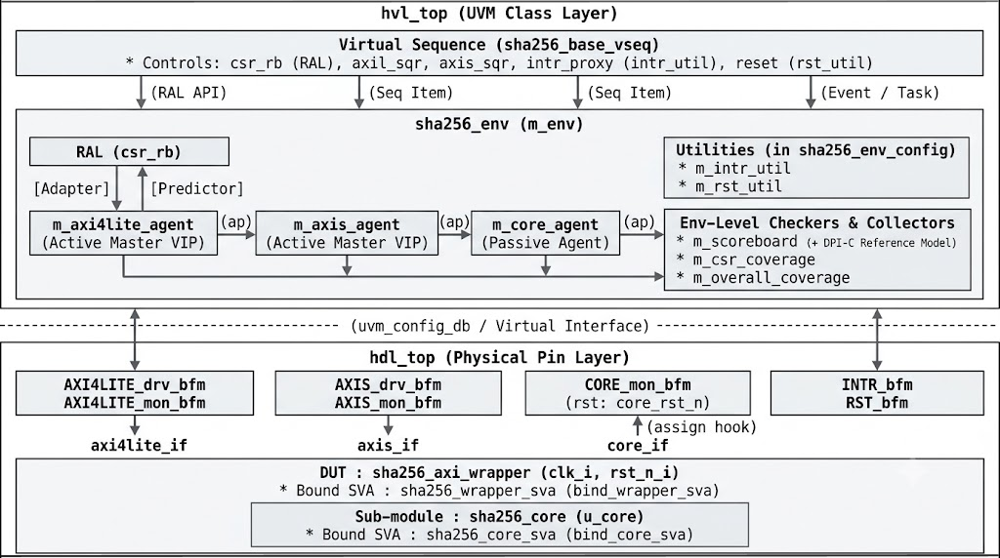
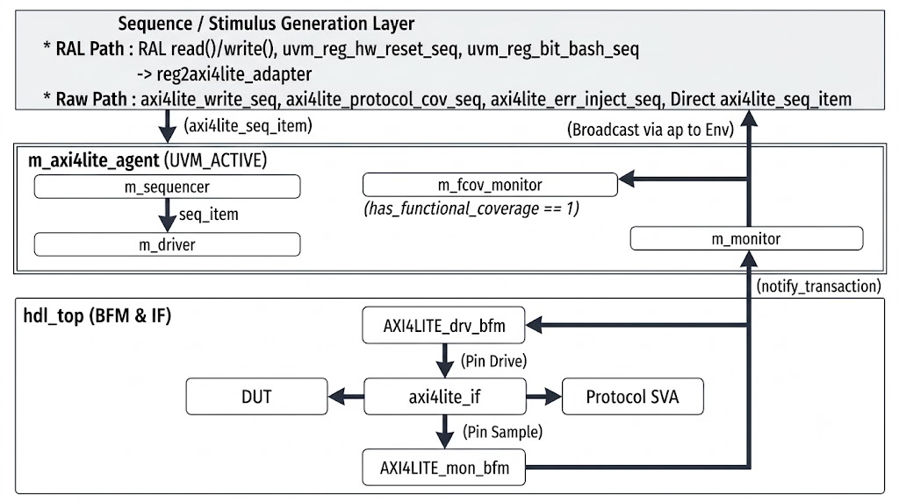
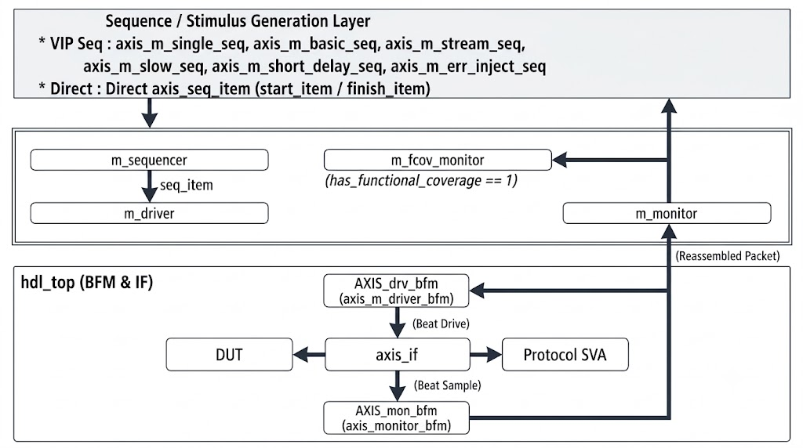
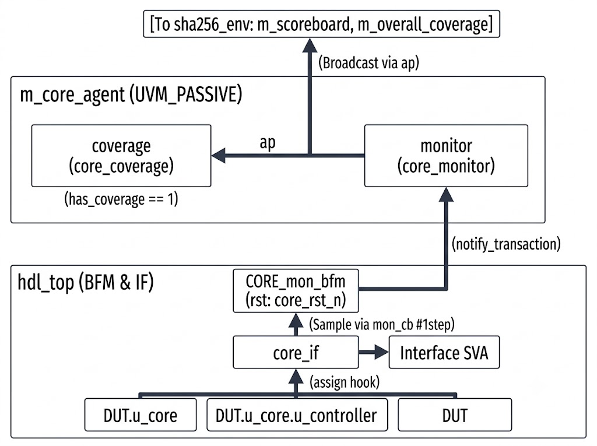
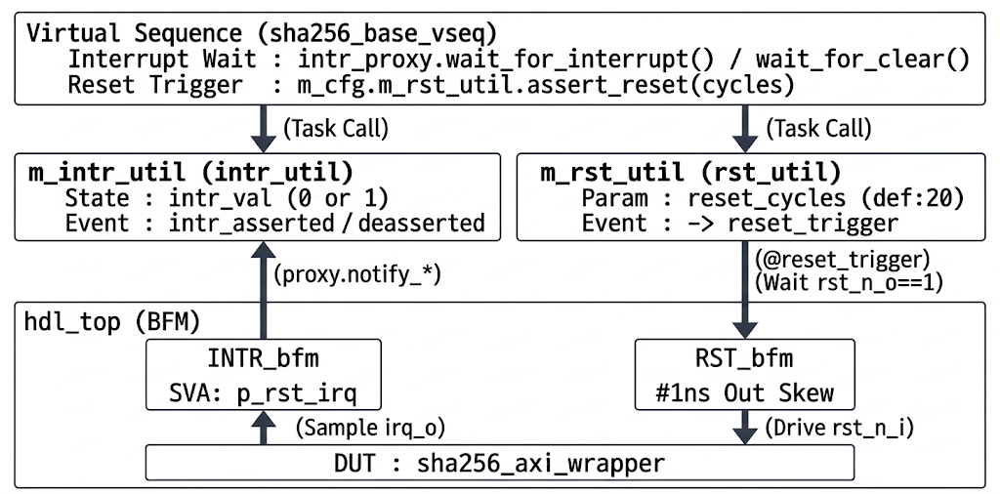

# Verification Specification
# UVM 1.2 Block-Level Verification Environment for SHA-256 IP Core
#### Youngjin Kim, 2026-09-01

### Table of Contents

- **1. Introduction & Verification Strategy**
  - 1.1 Purpose & Scope
  - 1.2 Verification Methodology
  - 1.3 Verification Categories (5 Domains)
  - 1.4 Sign-off Criteria
  - 1.5 Directory Structure
- **2. UVM Testbench Architecture**
  - 2.1 Dual-Top Architecture & White-Box Signal Binding (`hdl_top` & `hvl_top`)
  - 2.2 Environment Topology & Configuration (`sha256_env` & `sha256_env_config`)
  - 2.3 End-to-End TLM Connection & Transaction Flow
- **3. Verification Components (VIPs & Utilities)**
  - 3.1 AXI4-Lite Master VIP (`axi4lite_agent`)
  - 3.2 AXI4-Stream Master VIP (`axis_agent`)
  - 3.3 SHA-256 Core Passive Agent (`core_agent`)
  - 3.4 Auxiliary Utilities (`intr_util` & `rst_util`)
- **4. Register Model (RAL) & Scoreboard Checking Mechanism**
  - 4.1 PeakRDL Automation & Bus Adaptation
  - 4.2 Explicit Prediction & Cross-Component RAL Sharing
  - 4.3 Scoreboard & DPI-C Reference Model Architecture
- **5. Assertion (SVA) & Functional Coverage Architecture**
  - 5.1 Assertion (SVA) Hierarchy & Dynamic Control
  - 5.2 Functional Coverage Collector Architecture
- **6. Test Suite & Virtual Sequence Architecture**
  - 6.1 Base Test & Virtual Sequence Infrastructure
  - 6.2 Test-Specific Configuration Overrides & Scenarios

# 1. Introduction & Verification Strategy

## 1.1 Purpose & Scope
본 문서는 NIST FIPS 180-4 표준 기반 SHA-256 하드웨어 가속기(`sha256_axi_wrapper` 및 `sha256_core`)의 블록 레벨(Block-level) 검증 사양서입니다.

* **Target DUT:** AXI4-Lite 제어 인터페이스, AXI4-Stream 데이터 인터페이스, 하드웨어 패딩 FSM을 포함하는 `sha256_axi_wrapper`와 68사이클 고정 지연 압축 연산을 수행하는 `sha256_core`를 대상으로 합니다. (하드웨어 사양은 `Micro_Architecture_Specification.md` 참조)
* **Verification Scope:** RTL 시뮬레이션 환경에서 버스 프로토콜 준수 여부, CSR 접근 제어 및 보호 로직, 하드웨어 자동 패딩, 해시 연산 결과의 정합성을 검증합니다. Zynq PS 및 AXI DMA를 연동한 펌웨어 통합 테스트는 FPGA 환경에서 별도 수행하므로 본 문서의 범위에서 제외합니다.


## 1.2 Verification Methodology
본 검증 환경은 UVM 1.2를 기반으로 구축되었으며, 적용된 검증 기법은 다음과 같습니다.

1. **Dual-Top Architecture (UVM 1.2):** Siemens Verification Academy의 가이드라인을 확장 적용하여, 핀 레벨 신호를 구동 및 샘플링하는 HDL 계층(`hdl_top`, BFM)과 트랜잭션 객체를 처리하는 HVL 계층(`hvl_top`, UVM Class)을 분리하여 구성합니다.
2. **PeakRDL 기반 RAL (Register Abstraction Layer):** PeakRDL은 표준 레지스터 기술 언어인 SystemRDL(`sha256_csr.rdl`)을 파싱하여 UVM 레지스터 모델 코드(`sha256_reg_pkg.sv`)를 자동 생성하는 오픈소스 툴체인입니다. 생성된 RAL을 통해 물리 주소 대신 레지스터 및 필드 단위로 추상화된 접근 제어를 수행하며, 버스 모니터와 연결된 Explicit Predictor(`uvm_reg_predictor`)를 통해 DUT 레지스터의 미러 값을 추적합니다.
3. **DPI-C Reference Model 연동:** C++로 구현된 SHA-256 알고리즘 함수(`c_sha256_digest`)를 DPI-C 인터페이스를 통해 `sha256_scoreboard`에 연동합니다. 시뮬레이션 중 수집된 입력 트랜잭션을 C Reference 모델을 호출하여 기댓값을 산출하고, 이를 DUT의 해시 연산 결과와 대조하여 데이터 무결성을 자동 검증합니다.
4. **ABV (Assertion-Based Verification):** 인터페이스 내부의 ARM 표준 프로토콜 SVA(`axi4lite_if`, `axis_if`)와 DUT 내부 신호에 `bind`된 White-box SVA(`sha256_wrapper_sva`, `sha256_core_sva`)를 통해 Test plan의 SVA 항목을 검증합니다.
5. **Verification Process:** 검증 완료 지표를 SVA, Coverage(Functional 및 Code Coverage), Test Result(Scoreboard 및 Sequence)로 분류하여 관리합니다. Test Result에 명시한 Sequence 항목에 대해 1차 테스트를 구성하고, 커버리지 리포트(`xcrg`) 분석을 통해 식별된 미달성 Functional Coverage Bin과 Code Coverage(Branch, Condition, Toggle)에 대해 CDV(Coverage-Driven Verification)를 진행합니다. 이후 남은 도달 불가한 항목에 대해 Waiver 처리를 통해 검증을 완료합니다.
6. **Simulation Toolchain & `xsim` Compatibility Design:** 본 검증 환경은 **Xilinx Vivado Simulator (`xsim v2025.2`)**를 타겟 시뮬레이터로 사용하며, DPI-C 컴파일러(`xsc`), 커버리지 병합 리포터(`xcrg`), 오픈소스 레지스터 생성기(`PeakRDL`)를 표준 툴체인으로 연동합니다. 단 `xsim`의 SystemVerilog 파서 및 커버리지 엔진의 미지원 기능을 우회하기 위해, ① 런타임 `option.weight` 제어 대신 명시적 `ignore_bins` 및 조건부 Coverpoint를 사용하고, ② 복잡한 중첩 인라인 제약(`randomize() with { if ... }`) 대신 기본 제약과 사후 절차적 보정을 결합하여 시뮬레이터 안정성을 보장합니다.

## 1.3 Verification Categories (5 Domains)

검증 누락과 중복을 방지하기 위해 블록 레벨 UVM 검증 범위를 4개의 독립 컴포넌트 도메인(`AXI4-Lite`, `AXI4-Stream`, `Core`, `CSR`)과 1개의 복합 통합 도메인(`Overall`)으로 분할하여 테스트 플랜(`Verification_Plan.xlsx`)을 구성합니다. 단, UVM VIP 제약이나 RTL 시뮬레이션 시간 제약으로 인해 블록 레벨 UVM 환경에서 Waiver 처리된 항목들을 최종 Sign-off하기 위한 핀 레벨 정적 테스트벤치(`[DIR-01]~[DIR-03]`) 및 FPGA 시스템 레벨 검증 항목(`[FPGA-01]~[FPGA-09]`)은 `Verification_Plan.xlsx`의 `direct` 시트에서 별도로 관리합니다.

| Category | Target Scope | Checking & Coverage Mechanism |
| :--- | :--- | :--- |
| **1. AXI4-Lite** | `s_axi_*` Bus | `axi4lite_if` (SVA), `axi4lite_coverage_monitor` |
| **2. AXI4-Stream** | `s_axis_*` Bus | `axis_if` (SVA), `axis_coverage`, `axis_monitor` (EOS Check) |
| **3. Core** | `sha256_core` | `core_monitor`, `core_if` & `sha256_core_sva`, `core_coverage`, `Scoreboard` |
| **4. CSR** | Wrapper CSRs | RAL Explicit Predictor & Built-in Seq, `sha256_csr_vseq` (Self-Check),<br>`sha256_wrapper_sva` & `intr_bfm`, `sha256_csr_coverage` |
| **5. Overall** | Top-Level E2E | Scoreboard (DPI-C), `sha256_overall_vseq` (Self-Check),<br>`sha256_wrapper_sva`, `sha256_overall_coverage` |

**Primary Verification Focus (도메인별 핵심 검증 범위):**

* **1. AXI4-Lite (`s_axi_*` Bus):** AXI4-Lite VIP(`axi4lite_agent`)에 정의된 프로토콜 규약 준수 여부를 독립 검증. 채널별(AW/W/B/AR/R) 핸드셰이크 딜레이 교차(`CROSS_AW_W_DELAY`), `WSTRB` 조합, `AxPROT` 8종 조합, 비정렬 주소 및 잘못된 스트로브 에러 주입을 확인.
* **2. AXI4-Stream (`s_axis_*` Bus):** AXI4-Stream VIP(`axis_agent`)에 정의된 프로토콜 규약 준수 여부를 독립 검증. `tvalid`/`tready` 핸드셰이크 딜레이(코어 연산 Back-pressure 포함), 단일/버스트 패킷 경계, 유효 `tkeep` 패턴, 32-bit 데이터 패턴(All-0/1, Toggle) 및 전송 중 리셋 처리를 확인.
* **3. Core (`sha256_core`):** 비정상 입력에 대한 보호 로직은 상위 Wrapper가 담당한다는 설계 분담 하에, 패딩이 완료된 유효 512-bit 블록 입력을 전제로 코어 단독 동작을 검증. 입출력 제어 핸드셰이크, 컨트롤러 FSM 상태 전이 및 68사이클 고정 레이턴시, 512-bit 데이터패스 스트레스 패턴(All-0/1, Walking-1/0) 및 블록 체이닝, 전 사이클(`0~68`)·전 라운드(`0~63`) 비동기 리셋 타격 및 복구를 확인.
* **4. CSR (Wrapper CSRs):** 코어 해시 연산 결과와 분리하여 Wrapper 내부의 CSR 제어 및 예외 보호 로직을 단독 검증. 레지스터 리셋 초기값(표준 IV 포함), 접근 속성(RO/RW/WO/W1C/W1P) 및 펄스 자동 소멸, 미할당 주소/권한 위반 에러 응답(`SLVERR`/`DECERR`), 연산 중 상태 충돌 방지(`STATUS.BUSY == 1`), 비보안 접근 차단(PROT Firewall), 연산 완료 시 `STATUS.DONE` 하드웨어 갱신을 확인.
* **5. Overall (Top-Level E2E):** 앞선 4개 도메인의 독립 검증을 바탕으로, 스트림 수신부터 해시 산출까지 컴포넌트 간 상호작용으로 발생하는 복합 시나리오를 통합 검증. 하드웨어 자동 패딩(55/56/64B 경계 조건 및 `MSG_LEN_LO/HI` 비트 길이 누적), Little-to-Big Endian 변환, 블록 모드×바이트 정렬 교차(`cr_block_align`), Auto/Manual Chaining(Custom IV), 제어 비트 비활성화(`EN=0`, `IRQ_EN=0`), 비정상 `TKEEP` 하드웨어 차단(`ERR_PRT`), 데이터 기아(Starvation) 및 코어 Busy 중 `SOFT_RESET` 복구를 확인.

## 1.4 Sign-off Criteria

본 IP의 Sign-off 기준은 다음과 같습니다.

* **Test Result (UVM Log & Scoreboard/RAL Check):** 전체 6종 테스트 스위트(`sanity`, `axil`, `axis`, `core`, `csr`, `overall`) 실행 시 UVM 시뮬레이션 로그 상 `UVM_WARNING`, `UVM_ERROR`, `UVM_FATAL` 발생 0건 달성. 모든 해시 연산 트랜잭션에 대한 `sha256_scoreboard`(DPI-C Reference Model) 비교 일치, RAL 내장 시퀀스(`uvm_reg_hw_reset_seq`, `uvm_reg_bit_bash_seq`) 및 예외 응답 코드 자체 검증 통과를 UVM 로그 리포트로 확인.
* **Assertion (SVA Status):** 시뮬레이션 전 구간에서 인터페이스 내장 프로토콜 SVA 및 내부 White-box SVA 위반(`Assertion failed`) 발생 0건 달성. (의도적인 프로토콜 에러 주입 시나리오에서는 `disable iff` 동적 마스킹을 통한 오발화 방지를 포함함.)
* **Coverage (Functional & Code Coverage):**
  * **Functional Coverage (100%):** 5대 검증 도메인에 정의된 모든 활성 Covergroup 및 Cross Coverage 병합(`xcrg`) 기준 100% 달성. (DUT 구조적 제약으로 도달 불가능한 조합은 `ignore_bins` 및 Waiver로 모수에서 제외함.)
  * **Code Coverage (Condition 100% & Uncovered Waiver Verification):** RTL 설계 모듈(`design/`) 대상 Condition 커버리지 100% 달성 및 도달 가능한(Reachable) 유효 Branch·Toggle 전수 검증. 합성 안전성 확보용 FSM `default` 분기, 아키텍처 제약 비트(`msg_len`), 시뮬레이터(`xsim`)의 배열/포트 전용 리프 모듈 계측 한계로 인한 미달성 항목은 Waiver 사유서에 서술함.

## 1.5 Directory Structure

전체 프로젝트 디렉토리는 RTL 설계(`design/`), 문서(`docs/`), UVM 및 정적 검증 환경(`dv/`), FPGA 구현(`fpga/`), 그리고 SystemRDL 레지스터 명세(`rdl/`)로 분리되어 관리됩니다.

```text
uvm_sha256/
├── design/                        # 검증 대상 RTL 설계 소스
│   ├── sha256_axi_wrapper.sv      # Top Wrapper (AXI4-Lite CSR, AXI4-Stream 수신, 하드웨어 패딩 FSM)
│   └── sha256_core/               # SHA-256 68사이클 압축 연산 코어 및 서브모듈
├── docs/                          # 하드웨어 및 검증 문서
│   ├── MAS/                       # Micro Architecture Specification 및 다이어그램/파형
│   ├── Verif_Spec/                # Verification Specification
│   ├── Verification_Plan/         # 5대 도메인 통합 Test Plan 및 Waiver 사유서
│   ├── Verif_report/              # UVM Block-Level Verification Sign-off Report
│   ├── FPGA_report/               # Zynq-7000 FPGA Verification & PPA Analysis Report
│   ├── Coverage_rpt/              # Functional/Code Coverage Report (xcrg)
│   └── vip/                       # VIP 전용 개발 명세서 및 User Guide (axil_vip, axis_vip)
├── dv/                            # 블록 레벨 검증 환경 (UVM 1.2 & Directed Static TB)
│   ├── agents/                    # 재사용 가능한 인터페이스별 UVM VIP 및 Passive Agent
│   │   ├── axi4lite_agent/        # AXI4-Lite Master VIP
│   │   ├── axis_agent/            # AXI4-Stream VIP
│   │   └── core_agent/            # SHA-256 Core 내부 신호 관찰용 Passive Agent 및 Coverage
│   ├── bl_tb/                     # SHA-256 UVM 블록 레벨 통합 테스트벤치
│   │   ├── env/                   # Top Env, Env Config, Scoreboard, Overall Coverage
│   │   ├── ref_model/             # DPI-C 연동 C++ SHA-256 Golden Ref-Model
│   │   ├── register_model/        # PeakRDL 생성 RAL 패키지 및 CSR Coverage
│   │   ├── sequences/             # Virtual Sequence Library
│   │   ├── sim/                   # 시뮬레이션 및 커버리지 병합 실행용 Makefile
│   │   ├── tb/                    # Dual-Top 모듈 (hdl_top, hvl_top) 및 White-box SVA (Wrapper/Core)
│   │   └── test/                  # UVM Test 클래스 패키지
│   ├── static_tb/                 # VIP/DMA 제약 보완용 핀 레벨 정적 테스트벤치
│   │   ├── sim/                   # 시뮬레이션용 Makefile
│   │   └── tb_sha256_tkeep.sv     # TKEEP=4'b0000 (Null Beat) 및 27종 비정상 TKEEP 전수 검증 TB
│   └── utils/                     # 비동기 제어 유틸리티 (interrupt/, reset/ BFM 및 Util 클래스)
├── fpga/                          # Zybo Z7-20 FPGA 합성 스크립트, 전처리 스크립트(scripts/) 및 PS 펌웨어(firmware/)
└── rdl/                           # PeakRDL 기반 RAL 자동 생성용 SystemRDL 소스 (sha256_csr.rdl)
```

# 2. UVM Testbench Architecture

## 2.1 Dual-Top Architecture & White-Box Signal Binding (`hdl_top` & `hvl_top`)
본 테스트벤치는 시뮬레이션 계층을 물리적 핀 신호 제어 영역(`hdl_top`)과 트랜잭션 추상화 계층(`hvl_top`)으로 분리한 Dual-Top 구조를 채택합니다.

* **`hvl_top` (`tb/hvl_top.sv`):** 신호 타이밍이 배제된 트랜잭션 추상화 계층(Transaction-level Abstraction)을 담당합니다. `uvm_pkg` 및 `sha256_test_pkg`를 임포트하고 `run_test()`를 호출하여 객체 지향 기반의 UVM 테스트, 환경(`sha256_env`), 시퀀스를 구동합니다.
* **`hdl_top` (`tb/hdl_top.sv`):** 사이클 단위의 물리 신호 계층을 담당합니다. 100MHz 시스템 클록(`clk_i`, 주기 10ns)을 생성하고 DUT(`sha256_axi_wrapper`), 물리 계층 인터페이스(`axi4lite_if`, `axis_if`, `core_if`), 그리고 각 프로토콜 및 유틸리티 BFM을 인스턴스합니다.

### 2.1.1 Physical Interface & BFM Instantiation
`hdl_top`에 배치된 인터페이스와 BFM 모듈의 인스턴스 매핑 및 DUT 핀 연결 특성은 다음과 같습니다.

| 논리 경로 | Interface 인스턴스 | BFM 인스턴스 |
| :--- | :--- | :--- |
| **AXI4-Lite** | `AXI4LITE` (`axi4lite_if`) | `AXI4LITE_drv_bfm`, `AXI4LITE_mon_bfm` |
| **AXI4-Stream** | `AXIS` (`axis_if`) | `AXIS_drv_bfm`, `AXIS_mon_bfm` |
| **Core (Passive)** | `CORE` (`core_if`) | `CORE_mon_bfm` |
| **Interrupt** | - | `INTR_bfm` (`intr_bfm`) |
| **Reset** | - | `RST_bfm` (`rst_bfm`) |

**Interface & BFM Connection Details (연결 특성 및 역할):**

* **AXI4-Lite (`AXI4LITE`, `AXI4LITE_drv_bfm`, `AXI4LITE_mon_bfm`):** DUT의 8-bit 주소(`awaddr[7:0]`, `araddr[7:0]`) 및 32-bit 데이터 버스를 연결하며, 64-bit 고정 폭 VIP 이식을 위해 상위 읽기 데이터를 제로 패딩(`assign AXI4LITE.rdata[63:32] = 32'd0`)합니다.
* **AXI4-Stream (`AXIS`, `AXIS_drv_bfm`, `AXIS_mon_bfm`):** 1024-bit 고정 폭 인터페이스 중 하위 32-bit 데이터(`tdata[31:0]`) 및 4-bit 스트로브(`tkeep[3:0]`)를 DUT에 연결합니다.
* **Core Passive (`CORE`, `CORE_mon_bfm`):** DUT 내부 압축 연산 모듈(`u_core`) 관찰 전용이며, Soft Reset 발생 시 모니터 상태를 동기화하기 위해 시스템 Reset 대신 `DUT.core_rst_n`을 연결합니다.
* **Interrupt (`INTR_bfm`):** DUT의 완료 인터럽트 출력 핀(`irq_o`)을 감지합니다.
* **Reset (`RST_bfm`):** 시스템 비동기 리셋(`rst_n_i`) 구동을 담당합니다.

### 2.1.2 White-Box Signal Hooking & SVA Binding
외부 핀으로 노출되지 않는 내부 상태 머신(FSM)과 파이프라인 동작을 검증하기 위해 `hdl_top`에서 두 가지 White-box 접근 방식을 사용합니다.

1. **Core Interface Hooking (`assign`):** `DUT.u_core`의 입출력(`start_i`, `ready_o`, `busy_o`, `done_o`, `block_i`, `state_in_i`, `state_out_o`), 내부 컨트롤러(`u_controller`)의 제어 신호(`init_o`, `pre_round_o`, `load_block_o`, `round_en_o`, `update_o`, `round_idx_o`), 그리고 Wrapper의 `first_block` 신호를 `CORE` 인터페이스에 직접 `assign`하여 `CORE_mon_bfm`이 샘플링하도록 구성합니다.
2. **SVA Module Binding (`bind`):** RTL 원본 코드를 수정하지 않고 SystemVerilog `bind` 구문을 사용하여 `DUT`에 `sha256_wrapper_sva`(`bind_wrapper_sva`)를, `DUT.u_core`에 `sha256_core_sva`(`bind_core_sva`)를 각각 결합합니다.


### 2.1.3 Top-Level Architecture Diagram
전체 검증 환경의 `hvl_top`(트랜잭션 추상화 계층)과 `hdl_top`(물리 신호 계층) 간의 구조 및 인터페이스는 다음과 같습니다. (각 Agent의 내부 세부 구조는 3장에서 별도로 기술합니다.)




## 2.2 Environment Topology & Configuration (`sha256_env` & `sha256_env_config`)

### 2.2.1 Component Hierarchy
최상위 검증 환경인 `sha256_env`는 3개의 Agent, RAL Predictor/Adapter, Scoreboard, 그리고 2개의 DUT 레벨 Coverage 컴포넌트로 구성됩니다.

```text
uvm_test_top (sha256_test_base 파생 클래스)
└─ m_env : sha256_env
   ├─ m_axi4lite_agent : axi4lite_agent
   │  ├─ m_driver       : axi4lite_driver           (active == UVM_ACTIVE)
   │  ├─ m_sequencer    : axi4lite_sequencer        (active == UVM_ACTIVE)
   │  ├─ m_monitor      : axi4lite_monitor
   │  └─ m_fcov_monitor : axi4lite_coverage_monitor (has_functional_coverage == 1)
   ├─ m_axis_agent : axis_agent
   │  ├─ m_driver       : axis_m_driver             (is_active == UVM_ACTIVE && is_master == 1)
   │  ├─ m_sequencer    : uvm_sequencer#(axis_seq_item)
   │  ├─ m_monitor      : axis_monitor
   │  └─ m_fcov_monitor : axis_coverage             (has_functional_coverage == 1)
   ├─ m_core_agent : core_agent
   │  ├─ monitor        : core_monitor
   │  └─ coverage       : core_coverage             (has_coverage == 1)
   ├─ m_reg2axi4lite           : reg2axi4lite_adapter
   ├─ m_axi4lite2reg_predictor : uvm_reg_predictor#(axi4lite_seq_item)
   ├─ m_scoreboard             : sha256_scoreboard       (has_scoreboard == 1)
   ├─ m_csr_coverage           : sha256_csr_coverage     (has_functional_coverage == 1)
   └─ m_overall_coverage       : sha256_overall_coverage (has_functional_coverage == 1)

```

### 2.2.2 Configuration Delivery Flow

BFM 핸들 및 환경 설정 객체(`sha256_env_config`)는 초기화 단계에서 다음 3단계를 거쳐 하위 컴포넌트에 전달됩니다.

1. **HDL Interface Registration (`hdl_top::initial`):**
   * 8개 Virtual Interface(`*_if.sv`, `*_bfm.sv`)를 `uvm_config_db`(`"uvm_test_top"` 범위)에 등록합니다.
2. **Top Config Assembly & Distribution (`sha256_test_base::build_phase`):**
   * RAL 블록(`csr_rb`)을 생성하고 `build()` 및 `lock_model()`을 수행합니다.
   * `uvm_config_db`에서 BFM 핸들을 조회하여 각 Agent Config 및 Utility에 바인딩합니다.
   * Agent 기본 파라미터를 설정합니다 (`AXIL`: 32-bit, Active / `AXIS`: Master, Active).
   * 통합 설정 객체(`m_env_cfg`)에 하위 Config/RAL/Utility 핸들을 수납하고 `uvm_config_db`(`"*"` 범위)에 등록합니다.
3. **Sub-Component Config Deployment (`sha256_env::build_phase`):**
   * `sha256_env_config::get_config()`를 호출하여 `m_cfg`를 로드합니다.
   * 각 Agent Config를 하위 경로(`"m_axi4lite_agent*"` 등)로 재배포한 후 Agent, Scoreboard, Coverage 컴포넌트를 생성합니다.

### 2.2.3 Environment Control Parameters (`sha256_env_config`)
`sha256_env_config`는 하위 Agent 설정 객체와 RAL/Utility 핸들 외에 최상위 환경 레벨 컴포넌트의 동작을 제어하는 3개의 스위치 변수를 포함합니다.

* **`has_scoreboard` (기본값 `1`):** `1`일 때 `sha256_scoreboard`를 생성하고 Agent Monitor와의 TLM FIFO 연결을 수행합니다.
* **`has_functional_coverage` (기본값 `1`):** `1`일 때 환경(Env) 레벨 커버리지 컴포넌트인 `sha256_csr_coverage`와 `sha256_overall_coverage`를 생성하고 TLM 연결을 활성화합니다. (단, 각 Agent 내부에 존재하는 3개의 프로토콜/코어 커버리지인 `axi4lite_coverage_monitor`, `axis_coverage`, `core_coverage`는 본 변수와 연동되지 않으며, 각 Agent Config 객체의 플래그를 통해 개별 제어됩니다.)
* **`enable_sb_check` (기본값 `1`):** Scoreboard가 생성된 상태에서 AXI4-Stream 입력 바이트 적재(`process_axis_data`) 및 AXI4-Lite `DIGEST_0~7` Read에 따른 해시 채점 로직(`process_axil_data`)의 실행 여부를 동적으로 제어합니다. 에러를 주입하는 `csr`, `axil`, `axis` 테스트와 `overall` 테스트의 수동 체이닝(`do_oa_manual_chain`) 및 비정상 `TKEEP` 주입(`do_oa_tkeep_err`) 구간에서는 `0`으로 설정하여 오채점을 방지합니다.


## 2.3 End-to-End TLM Connection & Transaction Flow
`sha256_env::connect_phase`에서는 각 Agent Monitor의 Analysis Port(`ap`)를 하위 검증 컴포넌트들로 Broadcast합니다.

| Source Analysis Port | Target Analysis Export / FIFO | Transaction Processing Role |
| :--- | :--- | :--- |
| **`m_axi4lite_agent.ap`** | `m_axi4lite2reg_predictor.bus_in` | RAL Mirror 명시적 갱신 |
| **`m_axi4lite_agent.ap`** | `m_scoreboard.axil_fifo.analysis_export` | `DIGEST_0~7` 읽기 데이터 수집 및 채점 트리거 |
| **`m_axi4lite_agent.ap`** | `m_csr_coverage.analysis_export` | CSR 접근 및 에러 상태 커버리지 샘플링 |
| **`m_axi4lite_agent.ap`** | `m_overall_coverage.axil_fifo.analysis_export` | Soft Reset 제어 이벤트 샘플링 |
| **`m_axis_agent.ap`** | `m_scoreboard.axis_fifo.analysis_export` | `tkeep` 기반 유효 메시지 바이트 추출 및 큐 적재 |
| **`m_axis_agent.ap`** | `m_overall_coverage.axis_fifo.analysis_export` | 입력 페이로드 길이 및 블록/정렬 교차 커버리지 샘플링 |
| **`m_core_agent.monitor.ap`** | `m_scoreboard.core_fifo.analysis_export` | 코어 연산 중단(`is_aborted`) 시 잔류 `msg_queue` 플러시 및 Latency 로깅 |
| **`m_core_agent.monitor.ap`** | `m_overall_coverage.core_fifo.analysis_export` | Soft Reset 인가 시 코어 연산 중단 여부(`rst_while_busy`) 판별용 상태 추적 |

* **RAL Sequencer 연결:** `m_cfg.csr_rb.default_map`은 `set_sequencer()`를 통해 `m_axi4lite_agent.m_sequencer` 및 `m_reg2axi4lite` 어댑터와 연결되어, RAL API(`read`/`write`) 호출이 AXI4-Lite 버스 트랜잭션으로 구동됩니다.
* **RAL 핸들 공유:** `m_cfg.csr_rb` 객체 핸들은 `m_scoreboard`, `m_csr_coverage`, `m_overall_coverage`에 직접 할당되어, 물리 주소에 대한 레지스터 역참조(`get_reg_by_offset`) 및 레지스터 미러 값 조회에 사용됩니다.


# 3. Verification Components (VIPs & Utilities)

## 3.1 AXI4-Lite Master VIP (`axi4lite_agent`)
`axi4lite_agent`는 AMBA AXI4-Lite 프로토콜 사양을 준수하는 Active Master VIP입니다. UVM 클래스 계층과 물리 핀 제어 계층(BFM)을 분리한 Dual-Top 구조로 동작하며, RAL Adapter를 통한 추상화 레지스터 접근과 Raw Sequence/Item을 통한 프로토콜 레벨 직접 구동을 동시에 지원합니다. (VIP 전체 개발 명세는 별첨 `axil_vip_architecture.md` 및 `axil_user_guide.md` 참조)




### 3.1.1 Static Width Allocation & 32-bit Dynamic Masking
VIP 내부 데이터 구조는 최대 지원 폭인 64-bit를 기준으로 정적 할당되어 있으며 런타임 설정(32-bit / 64-bit)에 따라 마스킹됩니다.
* **Sequence Item 및 인터페이스 고정 할당:** `axi4lite_seq_item`의 `addr`, `wdata`, `rdata` 변수와 `axi4lite_if`의 물리적 데이터 신호 폭은 64-bit(`logic [63:0]`)로 고정되어 있습니다.
* **HDL 물리 핀 매핑 (`hdl_top`):** SHA-256 DUT의 포트 규격에 맞춰 주소는 하위 8-bit(`awaddr[7:0]`, `araddr[7:0]`), 데이터는 하위 32-bit(`wdata[31:0]`, `rdata[31:0]`), 스트로브는 하위 4-bit(`wstrb[3:0]`)만 연결합니다. 미사용 상위 읽기 데이터 버스는 `assign AXI4LITE.rdata[63:32] = 32'd0`으로 고정합니다.
* **Monitor 논리 마스킹 (`m_monitor`):** `DATA_WIDTH = 32` 설정 시, `axi4lite_monitor`의 `notify_transaction` 함수에서 수집된 `wdata` 및 `rdata`의 상위 32비트를 `64'h0000_0000_FFFF_FFFF`로 마스킹한 후 Analysis Port(`ap`)로 Broadcast합니다.

### 3.1.2 BFM Operation (`AXI4LITE_drv_bfm` & `AXI4LITE_mon_bfm`)
물리 계층의 채널 구동 및 샘플링은 `AXI4LITE_drv_bfm`과 `AXI4LITE_mon_bfm`에서 병렬 태스크로 처리됩니다.

* **병렬 채널 구동 및 샘플링:** `AXI4LITE_drv_bfm`은 Write 트랜잭션 시 `fork-join` 블록을 통해 주소(AW) 채널과 데이터(W) 채널을 독립적으로 병렬 구동합니다. `AXI4LITE_mon_bfm` 역시 `monitor_write`와 `monitor_read` 태스크를 `fork-join`으로 병렬 실행하여 버스 트래픽을 상시 샘플링합니다.
* **핸드셰이크 지연 구동:** 트랜잭션 아이템에 설정된 채널별 지연 변수(`aw_delay`, `w_delay`, `b_delay`, `ar_delay`, `r_delay`)만큼 클록 사이클을 대기한 후 Valid 또는 Ready 신호를 인가합니다.
* **Ready Timeout 감시:** `ignore_ready_timeout == 0` 상태에서 슬레이브의 Ready 응답이 100 사이클 이내에 도달하지 않으면 Driver BFM에서 Timeout 에러(`UVM_ERROR`)를 발생시킵니다.

### 3.1.3 `axi4lite_seq_item` Data Structure
시퀀서, 드라이버, 모니터 간에 전달되는 `axi4lite_seq_item`의 주요 필드 정의와 하위 검증 컴포넌트 활용처는 다음과 같습니다.

| Field Name | Type | Description |
| :--- | :--- | :--- |
| `dir` | `dir_e`<br>(`READ`, `WRITE`) | 트랜잭션 접근 방향 지정 |
| `addr` | `logic [63:0]` | 접근 대상 물리 주소 (32-bit 모드에서는 하위 비트 사용) |
| `wdata` / `rdata` | `logic [63:0]` | 쓰기 및 읽기 데이터 (32-bit 모드 시 모니터에서 상위 32비트 `0` 마스킹) |
| `wstrb` | `logic [7:0]` | Write 바이트 스트로브 (32-bit 모드에서는 하위 4비트 `wstrb[3:0]` 유효) |
| `prot` | `logic [2:0]` | AXI 보호 속성(`AxPROT`) |
| `resp` | `logic [1:0]` | 슬레이브 응답 코드(`OKAY=2'b00`, `SLVERR=2'b10`, `DECERR=2'b11`) |
| `aw_delay`, `w_delay`,<br>`b_delay`, `ar_delay`,<br>`r_delay` | `int` | Write(AW/W/B) 및 Read(AR/R) 각 채널의 핸드셰이크 인가 지연 사이클(`0~20` cycles) |
| `force_unaligned_addr`,<br>`force_invalid_wstrb`,<br>`ignore_ready_timeout` | `bit` | Error Injection Flag (기본값 `0`) |

**Downstream Component Usage (하위 컴포넌트 활용처):**

* **`dir`:** RAL Adapter, Scoreboard 및 CSR/Protocol Coverage에서 읽기/쓰기 분기 판별에 사용합니다.
* **`addr`:** RAL 역참조(`get_reg_by_offset`) 및 주소 정렬 커버리지 수집에 사용합니다.
* **`wdata` / `rdata`:** Scoreboard의 `DIGEST_0~7` 결과 수집 및 Soft Reset 판별에 사용합니다.
* **`wstrb`:** 부분 쓰기 및 Null Strobe 커버리지 수집에 사용합니다.
* **`prot`:** `prot[1]`(Secure `0` / Non-secure `1`)을 통해 DUT의 PROT 방화벽 동작 및 보안 커버리지 검증에 사용합니다.
* **`resp`:** RAL Predictor의 미러 갱신 여부 결정 및 에러 응답 검증에 사용합니다.
* **`aw/w/b/ar/r_delay`:** 채널 간 도착 타이밍 교차 커버리지(`CROSS_AW_W_DELAY`) 달성에 사용합니다.
* **`force_unaligned_addr`, `force_invalid_wstrb`, `ignore_ready_timeout`:** 비정렬 주소 강제 인가, 비정상 스트로브 인가, Ready 타임아웃 허용에 사용합니다.

### 3.1.4 Agent Configuration & Sequence Library
`axi4lite_agent_config`의 설정 파라미터와 `axi4lite_agent_pkg`에서 제공하는 시퀀스 구성을 요약하면 다음과 같습니다. (각 테스트 클래스별 Parameter Override 및 상위 검증 시나리오 매핑은 6.2절 참조)

**1. Agent Configuration Parameters (`axi4lite_agent_config`)**

| Parameter Name | Type (Default) | Description |
| :--- | :--- | :--- |
| `active` | `uvm_active_passive_enum`<br>(`UVM_ACTIVE`) | Master Driver 및 Sequencer 생성 여부 제어 (`UVM_ACTIVE` / `UVM_PASSIVE`) |
| `ADDR_WIDTH` /<br>`DATA_WIDTH` | `int`<br>(`32` / `32`) | 논리 주소 및 데이터 버스 폭 설정 (`DATA_WIDTH`는 32 또는 64만 지원하며 이외 값 설정 시 `UVM_FATAL` 발생) |
| `has_functional_coverage` | `bit` (`1`) | `axi4lite_coverage_monitor` 생성 및 프로토콜 커버리지 수집 활성화 |
| `enable_random_delay` | `bit` (`0`) | RAL Adapter 변환 시 채널별 핸드셰이크 딜레이 제어 (`0`: 0-cycle 고정, `1`: 0~20 사이클 무작위 지연) |
| `disable_alignment_sva`,<br>`disable_timeout_sva` | `bit`<br>(`0` / `0`) | 상시 감시(`0`)를 기본으로 하되, 프로토콜 에러 주입 구간에서만 `axi4lite_if` 내장 Alignment 및 Timeout SVA 검사를 `disable iff`로 동적 마스킹(`1`) |

**2. AXI4-Lite Stimulus & Sequence API**

| Stimulus Type | Sequence / Method | Primary Control Knobs / API |
| :--- | :--- | :--- |
| **RAL Adaptation** | `reg2axi4lite_adapter` | `read()`, `write()`, Built-in RAL Sequences |
| **Direct Item** | `axi4lite_seq_item` | `addr`, `dir`, `wdata`, `wstrb`, `prot`, `force_*` |
| **Base Sequence** | `axi4lite_write_seq` | `addr`, `wdata`, `wstrb`, `prot` |
| **Coverage / Error Seq** | `axi4lite_protocol_cov_seq`<br>`axi4lite_err_inject_seq` | `aw/w_delay`, `wstrb`, `force_unaligned_addr`,<br>`force_invalid_wstrb` |

**Protocol-Level Behavior (시퀀스 및 구동 방식별 동작):**

* **RAL Adaptation (`reg2axi4lite_adapter`):** `uvm_reg_bus_op`을 단일 Beat AXI4-Lite R/W 트랜잭션(`prot = 3'b000`)으로 변환하여 구동합니다.
* **Direct Item (`axi4lite_seq_item`):** 시퀀서(`axil_sqr`)를 통해 주소(`addr`), 방향(`dir`), 스트로브(`wstrb`), 보호 속성(`prot`), 에러 주입 플래그를 직접 지정하여 단일 트랜잭션을 인가합니다.
* **Base Sequence (`axi4lite_write_seq`):** RAL 경로를 거치지 않고 지정된 물리 주소(`addr`)와 데이터(`wdata`), 스트로브(`wstrb`), 보호 속성(`prot`)으로 즉시 Write 트랜잭션을 구동합니다.
* **Coverage / Error Seq (`axi4lite_protocol_cov_seq`, `axi4lite_err_inject_seq`):** AW/W 채널 딜레이 교차 및 부분 스트로브 조합을 생성하는 커버리지 시퀀스와 비정렬 주소(`force_unaligned_addr`) 및 잘못된 스트로브(`force_invalid_wstrb`)를 무작위 인가하는 에러 주입 시퀀스를 구동합니다.


## 3.2 AXI4-Stream Master VIP (`axis_agent`)

`axis_agent`는 런타임 설정(`is_master`)에 따라 Master와 Slave 토폴로지를 동적으로 전환할 수 있는 VIP입니다. 본 SHA-256 검증 환경에서는 DUT의 수신 인터페이스(`s_axis_*`)로 메시지 페이로드를 전송하기 위해 Active Master 모드(`is_active = UVM_ACTIVE`, `is_master = 1`)로 고정하여 운용합니다. (전체 개발 명세는 별첨 `axis_vip_architecture.md` 및 `axis_user_guide.md` 참조)



### 3.2.1 Over-Provisioning Interface & 32-bit Logical Masking
파라미터 변경이나 인터페이스 코드 수정 없이 다양한 데이터 폭에 대응하기 위해, 물리 계층은 최대 폭으로 고정(Over-provisioning)하고 트랜잭션 생성 단계에서 논리적 마스킹을 수행합니다.

* **1024-bit Over-Provisioning (`axis_if`):** 인터페이스의 물리 신호는 `TDATA` 1024-bit, `TKEEP`/`TSTRB` 128-bit, `TUSER` 1024-bit, `TID`/`TDEST` 32-bit로 할당되어 있으며, 내부적으로 구동 및 샘플링 타이밍 동기화를 위한 전용 Clocking Block(`dr_m_cb`, `dr_s_cb`, `mon_cb`)을 포함합니다.
* **32-bit Dynamic Masking (`active_data_width = 32`):** `axis_seq_item`이 무작위화될 때 `post_randomize()` 함수가 호출되어 `active_data_width`(32-bit)를 초과하는 상위 992비트 데이터와 상위 124비트 `tkeep`/`tstrb`를 자동으로 `0`으로 마스킹합니다.
* **HDL 물리 핀 매핑 (`hdl_top`):** SHA-256 DUT에는 마스킹된 하위 유효 신호인 `tdata[31:0]`, `tkeep[3:0]`, `tlast`, `tvalid`, `tready`만 연결하며, DUT에서 사용하지 않는 라우팅 및 사이드밴드 신호(`TSTRB`, `TUSER`, `TID`, `TDEST`)는 연결하지 않습니다.

### 3.2.2 BFM Packet Driving & Reassembly Flow (`AXIS_drv_bfm` & `AXIS_mon_bfm`)
AXI4-Stream의 스트리밍 특성을 반영하여 시퀀스 아이템은 패킷(Packet) 단위로 처리되며, 물리 계층 BFM에서 Beat 단위 분해 및 재조립을 수행합니다.

* **Master Driver BFM 구동 및 타임아웃 감시 (`AXIS_drv_bfm`):**
  * 상위 드라이버로부터 전달받은 패킷을 `tid` 기준 연관 배열(`active_pkt_q`)에 등록하고, 설정된 중재 방식(`arb_mode`)과 `valid_delay_q` 지연 값에 따라 각 Beat를 순차 인가합니다.
  * 구동 중 `s_axis_tready === 1'bx`가 감지되거나, 단일 Beat 대기(`drive_bus`) 및 패킷 완료 대기(`wait_pkt_done`)가 `timeout_cycles`(기본 1000 사이클)를 초과하면 즉시 `UVM_ERROR`를 발생시키고 해당 패킷 큐를 비워 시뮬레이션 교착(Hang)을 방지합니다.
* **Monitor BFM 패킷 재조립 및 강제 플러시 (`AXIS_mon_bfm`):**
  * **패킷 재조립(Reassembly):** 매 클록 핸드셰이크(`tvalid && tready`) 발생 시 Beat 데이터를 샘플링하여 누적하고, 핸드셰이크 이전의 `tvalid` 대기 사이클(`ipg_cnt`)과 `tready` 대기 사이클(`r_delay_cnt`)을 기록합니다. `tlast == 1`인 Beat가 샘플링되면 `status = OK`로 설정하여 복제본(Clone)을 상위 `axis_monitor.ap`로 전달합니다.
  * **리셋 및 예외 플러시 (`flush` & `INCOMPLETE` 태깅):** 스트림 전송 도중 하드웨어 리셋(`aresetn == 0`)이 감지되거나 Virtual Sequence에서 `m_axis_agent.reset_agent()`를 호출하면, 내부 `flush()` 태스크가 실행되어 미완성 패킷을 `status = INCOMPLETE`로 태깅해 즉시 브로드캐스트하고 큐를 초기화합니다. 이를 수신한 `sha256_scoreboard`는 내부 데이터 큐(`msg_queue`)를 즉시 비워 후속 트랜잭션의 채점 오염을 방지합니다.

### 3.2.3 `axis_seq_item` Data Structure
패킷 단위로 정의된 `axis_seq_item`의 주요 동적 큐/제어 변수 정의와 하위 검증 컴포넌트 활용처는 다음과 같습니다.

| Field Name | Type | Description |
| :--- | :--- | :--- |
| `tdata_q[$]` | `logic [1023:0]` | 패킷 내 각 Beat의 페이로드 데이터 동적 큐 (기본 크기 제약 `1~64` Beats, 32-bit 모드 시 하위 `[31:0]` 유효) |
| `tkeep_q[$]` /<br>`tstrb_q[$]` | `logic [127:0]` | 각 Beat의 바이트 유효(Qualifier) 및 스트로브 큐 (32-bit 모드 시 하위 `[3:0]` 유효) |
| `tuser_q[$]` /<br>`tid` / `tdest` | `logic [1023:0]` /<br>`logic [31:0]` | 사이드밴드 및 라우팅 식별자 (DUT 미사용 핀) |
| `valid_delay_q[$]` | `int` | 각 Beat의 `tvalid` 인가 전 대기 사이클 (기본 제약 `0~10` cycles) |
| `ready_delay_q[$]` | `int` | Monitor BFM이 각 Beat 핸드셰이크 시 샘플링한 슬레이브 `tready` 대기(Back-pressure) 사이클 기록 큐 |
| `status` | `status_e`<br>(`OK`, `INCOMPLETE`,<br>`PROTOCOL_ERR`) | 패킷 전송 완료 상태 플래그 |
| `drop_tlast`,<br>`force_tkeep_error` | `bit` | Stream Error Injection 제어 변수 (기본값 `0`) |

**Downstream Component Usage (하위 컴포넌트 활용처):**

* **`tdata_q[$]`:** Scoreboard 메시지 추출 및 데이터 패턴 커버리지 수집에 사용합니다.
* **`tkeep_q[$]` / `tstrb_q[$]`:** Scoreboard 유효 바이트 필터링 및 `Overall` 페이로드 길이/정렬 산출에 사용합니다.
* **`valid_delay_q[$]`:** 마스터 전송 타이밍 스트레스 및 핸드셰이크 커버리지 달성에 사용합니다.
* **`ready_delay_q[$]`:** `axis_coverage`의 Back-pressure 커버리지 수집에 사용합니다.
* **`status`:** 리셋/타임아웃으로 중단된 패킷(`INCOMPLETE`)을 Scoreboard에서 식별하여 `msg_queue`를 flush하는 데 사용합니다.
* **`drop_tlast`, `force_tkeep_error`:** 마지막 Beat의 `tlast` 누락(Starvation 유도) 및 비정상 `tkeep` 패턴 강제 인가에 사용합니다.

### 3.2.4 Agent Configuration & Sequence Library
`axis_agent_config`의 설정 파라미터와 `axis_agent_pkg`에서 제공하는 마스터 시퀀스 라이브러리는 다음과 같습니다. (상위 테스트별 시퀀스 활용 시나리오는 6.2절 참조)

**1. Agent Configuration Parameters (`axis_agent_config`)**

| Parameter Name | Type (Default) | Description |
| :--- | :--- | :--- |
| `is_active` /<br>`is_master` | `uvm_active_passive_enum` / `bit`<br>(`UVM_ACTIVE` / `1`) | Active Master 모드(`axis_m_driver` 및 `AXIS_drv_bfm`) 활성화 |
| `active_data_width` | `int` (`32`) | 1024-bit 물리 인터페이스 중 유효하게 사용할 데이터 비트 폭 설정 (하위 32-bit 및 `tkeep[3:0]` 마스킹) |
| `arb_mode` | `axis_arb_mode_e`<br>(`ARB_RR`) | 다중 `tid` 패킷 큐(`active_pkt_q`) 구동 시의 중재 방식 설정 (`ARB_RR` / `ARB_RANDOM`) |
| `timeout_cycles` | `int` (`1000`) | `tvalid` 인가 후 슬레이브의 `tready` 응답 최대 대기 허용 사이클 설정 (`axis_if`의 `MAXWAITS = 1000`과 동기화) |
| `has_functional_coverage` | `bit` (`1`) | `axis_coverage` 생성 및 스트림 프로토콜 커버리지 수집 활성화 |

**2. AXI4-Stream Master Sequence Library**

| Sequence / Item | Control Knobs |
| :--- | :--- |
| `axis_seq_item` (Direct) | `tdata_q`, `tkeep_q`, `valid_delay_q` |
| `axis_m_single_seq` | `pkt_len` |
| `axis_m_basic_seq` | `pkt_len` (`2~64`) |
| `axis_m_stream_seq` | `payload_data[]` (`byte`) |
| `axis_m_short_delay_seq`,<br>`axis_m_slow_seq` | `num_trans`, `pkt_len_min/max`, `delay_min/max` |
| `axis_m_err_inject_seq` | `pkt_len`, `do_tlast_drop`, `do_tkeep_err` |

**Protocol-Level Behavior (시퀀스별 스트림 구동 동작):**

* **`axis_seq_item` (Direct):** 큐 기반의 단일 패킷 아이템을 직접 구성하여 시퀀서(`axis_sqr`)로 전송합니다.
* **`axis_m_single_seq`:** `valid_delay = 0` 조건으로 지정된 Beat 수(`pkt_len`)의 단일 패킷을 지연 없이 고속 전송합니다.
* **`axis_m_basic_seq`:** 다중 Beat(Burst) 패킷을 기본 딜레이 제약(`0~10` 사이클) 하에서 무작위 생성하여 전송합니다.
* **`axis_m_stream_seq`:** 임의 바이트 길이를 갖는 `payload_data` 동적 배열을 입력받아 32-bit(4바이트) Beat 단위로 자동 분할하고, 마지막 Beat의 잔여 바이트 수(1~4B)에 맞춰 유효 연속 `tkeep`(`4'b0001`~`4'b1111`)과 `tlast=1`을 자동 생성하여 전송합니다.
* **`axis_m_short_delay_seq`, `axis_m_slow_seq`:** 다중 패킷(`num_trans`)의 Beat 간 `tvalid` 인가 지연(`valid_delay_q`)을 단기(`1~5` 사이클) 또는 장기(`10~100` 사이클) 범위로 강제하여 전송합니다.
* **`axis_m_err_inject_seq`:** 마지막 Beat의 `tlast` 신호를 누락(`drop_tlast = 1`)시키거나 비정상 `tkeep` 패턴(비연속 Sparse 또는 패킷 중간 Partial 스트로브를 `active_byte_mask` 내에서 무작위 생성)을 강제 주입합니다. 단, VIP 기본 제약으로 제외된 `tkeep == 4'b0000`(Null Beat) 및 27종 비정상 패턴 전수 스윕은 정적 테스트벤치(`dv/static_tb/tb_sha256_tkeep.sv`)에서 보완 검증합니다.

## 3.3 SHA-256 Core Passive Agent (`core_agent`)
`core_agent`는 Wrapper 내부에 인스턴스된 연산 코어(`DUT.u_core`)의 입출력 데이터와 컨트롤러 상태 신호를 관찰하는 White-box Passive Agent(`is_active = UVM_PASSIVE`)입니다. 외부 핀을 구동하지 않으므로 Sequencer와 Driver를 포함하지 않으며, `core_monitor`와 `core_coverage`로만 구성됩니다. (코어 하드웨어 아키텍처 및 68사이클 FSM 사양은 `Micro_Architecture_Specification.md` 5장 참조)



### 3.3.1 Internal Signal Probing & Reset Domain Mapping (`core_if`)

`hdl_top`에서는 계층적 참조(Hierarchical Reference)를 통해 3개 영역의 내부 신호를 `core_if`에 `assign`으로 바인딩합니다. 모든 신호는 `core_if` 내부의 Clocking Block(`mon_cb`)을 통해 클록 상승 엣지 직전(`default input #1step`)의 안정화된 값으로 샘플링됩니다.

| Source Hierarchy | Probed Signals | Width |
| :--- | :--- | :--- |
| **`DUT.u_core`**<br>(Core Native I/O) | `start_i`, `ready_o`, `busy_o`, `done_o`<br>`block_i`<br>`state_in_i`, `state_out_o` | 1, 1, 1, 1<br>512<br>256, 256 |
| **`DUT.u_core.u_controller`**<br>(Controller FSM) | `init_o`, `pre_round_o`, `load_block_o`,<br>`round_en_o`, `update_o`, `round_idx_o` | 1, 1, 1,<br>1, 1, 6 |
| **`DUT`**<br>(Wrapper Context) | `first_block` | 1 |

**Probed Signal Verification Purpose & Reset Domain Mapping:**

* **`DUT.u_core` (Core Native I/O):** 코어 연산 시작(`start_i && ready_o`) 및 완료(`done_o`) 시점을 감지하고, 패딩 및 Big-Endian 변환이 완료된 512-bit 입력 블록과 256-bit 입출력 해시값을 추출합니다.
* **`DUT.u_core.u_controller` (Controller FSM):** 코어 컨트롤러의 주요 파이프라인 제어 신호를 관측하고, 연산 중 리셋 발생 시 중단된 라운드 인덱스(`0~63`)를 추적합니다.
* **`DUT` (Wrapper Context):** 코어 자체는 체이닝 여부를 인지하지 못하므로, Wrapper의 `first_block` 플래그를 함께 관측하여 현재 블록이 단일/첫 블록(`1`)인지 체이닝 블록(`0`)인지 판별합니다.
* **Reset Domain 분리 연결 (`rst_n_i` vs `DUT.core_rst_n`):** `core_if`는 시스템 비동기 리셋(`rst_n_i`)을 입력받아 리셋 구간의 신호 안정성 SVA를 검사합니다. 반면 트랜잭션을 재조립하는 `CORE_mon_bfm`의 리셋 포트(`rst_n_i`)에는 시스템 리셋과 CSR Soft Reset(`ctrl_soft_reset`)이 결합된 내부 리셋 신호인 `DUT.core_rst_n`을 연결합니다. 이를 통해 펌웨어의 `SOFT_RESET` 인가로 인해 코어 연산이 강제 중단되는 예외 상황도 포함하여 감지합니다.

### 3.3.2 Split-Phase Transaction Sampling (`core_monitor_bfm` & `core_seq_item`)

`CORE_mon_bfm`은 코어의 입력 시점과 완료 시점이 시간적으로 분리된(Split-Phase) 특성을 처리하기 위해, 내부 핸드오프 큐(`active_q[$]`)를 공유하는 두 개의 병렬 태스크(`monitor_write`, `monitor_read`)를 구동합니다.

1. **Input Phase Capture (`monitor_write`):**
   * **Trigger & Capture:** 클록킹 블록(`@(mon_cb)`) 기준 리셋이 해제된 상태에서 `start_i && ready_o` 핸드셰이크가 감지되면 `core_seq_item` 객체를 생성합니다.
   * **Queue Hand-off:** 해당 사이클의 입력 데이터(`block_i`, `state_in_i`, `first_block`)를 샘플링하여 `active_q[$]`에 푸시(`push_back`)합니다.
2. **Output & Exception Capture (`monitor_read`):**
   * `active_q[$]`에 아이템이 적재되면 이를 팝(`pop_front`)한 뒤, `fork-join_any` 블록을 통해 정상 완료 대기 스레드(`wait_done`)와 리셋 감지 스레드(`wait_async_reset`)를 동시에 실행합니다.
   * **정상 완료 경로 (`wait_done`, `is_aborted == 0`):** `done_o == 1`이 될 때까지 매 클록 `cycle_cnt`를 증가시키고 `round_idx_o`를 추적합니다. 완료 시점에 누적된 `latency`와 최종 해시 출력(`state_out_o`)을 아이템에 기록합니다.
   * **리셋 중단 경로 (`wait_async_reset`, `is_aborted == 1`):** 연산 도중 `DUT.core_rst_n == 0`(비동기 하드웨어 리셋 또는 Soft Reset)이 감지되면 즉시 스레드를 종료하고, 중단 시점의 경과 사이클(`aborted_cycle`)과 라운드 번호(`aborted_round`)를 기록합니다.
   * **Broadcast & Post-Reset Flush:** 두 스레드 중 하나가 완료되면 `disable fork`로 잔여 스레드를 정리하고 `core_monitor.ap`로 아이템을 브로드캐스트합니다. 만약 리셋 중단(`is_aborted == 1`)이 발생한 경우에는 리셋이 해제(`rst_n_i == 1`)될 때까지 대기한 뒤 잔여 `active_q[$]`를 모두 비워(`delete()`) 모니터 상태를 초기화합니다.


### 3.3.3 `core_seq_item` Data Structure

`core_monitor.ap`를 통해 브로드캐스트되는 `core_seq_item`의 필드 정의와 하위 검증 컴포넌트 활용처는 다음과 같습니다.

| Field Name | Type | Description |
| :--- | :--- | :--- |
| `block_i` | `logic [511:0]` | 코어로 인가된 512-bit 메시지 블록 |
| `state_in_i` | `logic [255:0]` | 코어 연산 시작 시점의 256-bit 초기 해시 상태값(IV 또는 이전 블록 다이제스트) 캡처 |
| `state_out_o` | `logic [255:0]` | 정상 완료(`done_o == 1`) 시점의 256-bit 해시 결과값 캡처 |
| `first_block` | `logic` | Wrapper에서 전달된 첫 블록 여부 플래그 |
| `latency` | `int` | `start_i` 인가 후 `done_o` 출력까지 소요된 클록 사이클 수 |
| `is_aborted` | `bit` | 연산 중 리셋(비동기 또는 Soft Reset)에 의한 중단 여부 플래그 (`0`: 정상 완료, `1`: 중단) |
| `aborted_cycle` | `int` | 리셋 중단 시 `start_i` 이후 경과한 클록 사이클 수(`0~68`) |
| `aborted_round` | `logic [5:0]` | 리셋 중단 시점의 코어 라운드 인덱스(`0~63`) |

**Downstream Component Usage (하위 컴포넌트 활용처):**

* **`block_i`:** `core_coverage`(`cg_dp`)에서 All-0, All-1, Walking-1/0 데이터 패턴 도달 여부 샘플링에 사용합니다.
* **`first_block`:** `core_coverage`(`cg_dp`)에서 단일 블록(`1`) 및 연속 체이닝 블록(`0`) 구분에 사용합니다.
* **`latency`:** `sha256_scoreboard`에서 코어 연산 완료 로깅에 사용합니다.
* **`is_aborted`:** Scoreboard에서 비정상 중단 트랜잭션 필터링(`msg_queue` 폐기) 및 `core_coverage`(`cg_rst`) 샘플링에 사용합니다.
* **`aborted_cycle` / `aborted_round`:** `core_coverage`(`cg_rst.cp_aborted_cycle` 및 `cp_aborted_round`)에서 전 구간 리셋 복구 커버리지 측정에 사용합니다.

## 3.4 Auxiliary Utilities (`intr_util` & `rst_util`)

완료 인터럽트(`irq_o`) 감지와 비동기 하드웨어 리셋(`rst_n_i`) 구동은 프로토콜 트랜잭션에 해당하지 않으므로, 별도의 UVM Agent를 구성하는 대신 `uvm_object` 기반의 유틸리티 클래스(`intr_util`, `rst_util`)와 전용 BFM(`intr_bfm`, `rst_bfm`)을 1:1로 매핑하여 제어합니다. `sha256_test_base::build_phase`에서 각 유틸리티 객체를 생성하고 `set_bfm()` 함수를 호출하면, 유틸리티의 `m_bfm` 핸들과 BFM 내부의 `proxy` 핸들이 양방향 바인딩됩니다.



검증 환경에서 사용하는 두 유틸리티 클래스의 제공 API 요약은 다음과 같습니다.

| Utility Class | Method Name | Type | Description |
| --- | --- | --- | --- |
| **`intr_util`** | `set_bfm(virtual intr_bfm bfm)` | Function | `m_bfm` 및 `bfm.proxy` 양방향 핸들 바인딩 (`sha256_test_base`에서 호출) |
| **`intr_util`** | `wait_for_interrupt()` | Task | `irq_o`가 High(`1`)가 될 때까지 호출 시퀀스를 블로킹 |
| **`intr_util`** | `wait_for_clear()` | Task | `INTCLEAR` 쓰기 등을 통해 `irq_o`가 Low(`0`)로 해제될 때까지 블로킹 |
| **`intr_util`** | `get_irq_level()` | Function | 블로킹 없이 현재 저장된 인터럽트 상태(`intr_val`) 반환 |
| **`rst_util`** | `set_bfm(virtual rst_bfm bfm)` | Function | `m_bfm` 및 `bfm.proxy` 양방향 핸들 바인딩 (`sha256_test_base`에서 호출) |
| **`rst_util`** | `assert_reset(int cycles = 20)` | Task | 지정된 클록 사이클 동안 Active-Low 하드웨어 리셋(`rst_n_i = 0`)을 인가하고 리셋 해제 시점까지 동기화 대기 |

### 3.4.1 Interrupt Synchronization (`intr_util` & `intr_bfm`)

`intr_util`과 `INTR_bfm`은 하드웨어 인터럽트 핀(`irq_o`)의 레벨 변화를 감지하여 Virtual Sequence의 실행 타이밍을 동기화합니다.

* **클록 동기식 엣지 검출 (`INTR_bfm`):** 리셋이 해제(`rst_n_i == 1`)된 상태에서 매 클록 상승 엣지(`@(posedge clk_i)`)마다 현재 `irq_o` 핀의 값과 `proxy.get_irq_level()`(이전 상태값 `intr_val`)을 비교합니다.
* **Rising Edge (`0 -> 1`):** `proxy.notify_interrupt()`를 호출하여 `intr_val = 1`로 갱신하고 `intr_asserted` 이벤트를 발생시킵니다.
* **Falling Edge (`1 -> 0`):** `proxy.notify_interrupt_cleared()`를 호출하여 `intr_val = 0`으로 갱신하고 `intr_deasserted` 이벤트를 발생시킵니다.


* **Event Race Condition 방지 (`intr_util`):** 시퀀스가 대기 태스크를 호출하기 이전에 이미 인터럽트가 발생했을 경우 Deadlock에 빠지는 것을 방지하기 위해, 이벤트 대기 전 상태 플래그(`intr_val`)를 먼저 확인합니다. `wait_for_interrupt()`는 `intr_val == 0`일 때만 `@intr_asserted`를 대기하며, 이미 `1`인 경우 즉시 반환됩니다. `wait_for_clear()` 역시 `intr_val == 1`일 때만 `@intr_deasserted`를 대기합니다.
* **내장 SVA (`p_rst_irq`):** `INTR_bfm` 내부에는 시스템 리셋 인가 시 인터럽트 출력이 즉시 비활성화되는지 SVA를 통해 검증합니다.

### 3.4.2 Dynamic Reset Control (`rst_util` & `rst_bfm`)

`rst_util`과 `RST_bfm`은 시뮬레이션 초기 리셋(Power-on Reset)과 테스트 시나리오 도중의 동적 하드웨어 리셋 인가를 전담합니다.

* **Power-on Reset 구동:** 시뮬레이션 시작 시 `RST_bfm`의 `initial` 블록이 `rst_n_o = 1'b0`을 인가하고 20 클록 사이클 대기 후 `1'b1`로 해제합니다.
* **Output Skew 적용을 통한 클록 엣지 충돌 회피:** Virtual Sequence가 클록 상승 엣지에서 `assert_reset(cycles)`를 호출하여 `reset_trigger` 이벤트를 발생시키면, `RST_bfm`은 클록 엣지에서의 신호 경합(Race condition)을 방지하기 위해 **`#1ns`의 Output Skew**를 지연시킨 후 `rst_n_o = 1'b0`을 구동합니다. 지정된 `reset_cycles`(20사이클) 동안 대기한 뒤, 동일하게 `#1ns` 지연 후 `rst_n_o = 1'b1`로 복구합니다.
* **시퀀스 복귀 동기화:** `rst_util::assert_reset()`은 이벤트를 트리거한 직후 반환되지 않고, `while (m_bfm.rst_n_o == 1'b0) @(posedge m_bfm.clk_i);` 루프를 통해 물리적 리셋이 완전히 해제된 직후의 클록 상승 엣지까지 대기한 뒤 시퀀스 제어권을 반환합니다.


# 4. Register Model (RAL) & Scoreboard Checking Mechanism

## 4.1 PeakRDL Automation & Bus Adaptation

### 4.1.1 PeakRDL-Based RAL Code Generation (`sha256_csr.rdl` -> `sha256_reg_pkg.sv`)
UVM 환경에서 레지스터를 검증하려면 DUT의 모든 CSR을 대응하는 SystemVerilog 클래스(`uvm_reg`, `uvm_reg_block`)로 모델링해야 합니다. 본 프로젝트는 오픈소스 레지스터 자동화 툴인 **PeakRDL**을 사용했습니다.

* **SystemRDL 스펙 정의 (`sha256_csr.rdl`):** 하드웨어 설계 사양서(MAS 4.2절)에 정의된 메모리 맵을 표준 레지스터 기술 언어인 SystemRDL 포맷으로 작성합니다. 각 레지스터의 속성, 권한, 초기화 값 등등 CSR의 모든 내용을 정의합니다.
* **UVM RAL 패키지 자동 생성 (`sha256_reg_pkg.sv`):** PeakRDL 컴파일러가 `.rdl` 파일을 파싱하여 UVM 표준 규격의 `sha256_csr` 블록 클래스를 생성합니다. 테스트 시퀀스는 이 객체를 통해 물리 주소(`0x04` 등)를 직접 다루지 않고, `csr_rb.CTRL.write()`와 같이 직관적인 레지스터 이름으로 읽기/쓰기 동작을 수행합니다.

### 4.1.2 RAL Bus Adapter (`reg2axi4lite_adapter.svh`)
RAL 모델이 생성한 추상화된 레지스터 읽기/쓰기 명령(`uvm_reg_bus_op`)을 실제 물리 버스에 인가하려면 AXI4-Lite VIP의 트랜잭션 아이템(`axi4lite_seq_item`)으로 변환해 주는 어댑터가 필요합니다. `reg2axi4lite_adapter`는 다음 두 함수를 통해 양방향 변환을 수행합니다.

* **`reg2bus()` (RAL 명령 $\rightarrow$ AXI4-Lite 트랜잭션 변환):**
  * RAL의 접근 방향(Read/Write), 주소, 쓰기 데이터, 바이트 스트로브(`byte_en`)를 `axi4lite_seq_item`의 대응 변수에 매핑합니다. 표준 RAL 접근은 정상 보안 권한을 전제하므로 `prot = 3'b000`(Secure)으로 고정합니다.
  * `axi4lite_agent_config.enable_random_delay` 설정값에 따라, `0`이면 모든 채널의 핸드셰이크 딜레이를 0 사이클로 고정하고, `1`이면 아이템 랜덤화를 호출하여 0~20 사이클의 무작위 버스 지연을 인가합니다.
* **`bus2reg()` (AXI4-Lite 트랜잭션 $\rightarrow$ RAL 결과 변환):**
  * 버스에서 완료된 트랜잭션의 주소와 읽은 데이터(`rdata`)를 RAL 구조체로 전달합니다.
  * **버스 에러 상태 번역:** AXI 응답(`resp`)이 정상(`OKAY`)일 때는 `UVM_IS_OK`를 반환하지만, 하드웨어 방화벽이나 주소 디코드 에러로 인해 `SLVERR`(`2'b10`) 또는 `DECERR`(`2'b11`)가 발생한 경우 `UVM_NOT_OK`로 변환하여 상위 Predictor에 에러 발생 사실을 알립니다.


## 4.2 Explicit Prediction & Cross-Component RAL Sharing

### 4.2.1 Explicit Prediction Loop & Mirror Protection
본 테스트벤치는 드라이버 구동 시점에 미러 값을 항상 갱신하는 Implicit Prediction을 비활성화(`set_auto_predict(0)`)하고, 모니터가 관찰한 실제 버스 트랜잭션을 `uvm_reg_predictor`에 통과시켜 미러 값을 갱신하는 **Explicit Prediction** 방식을 사용합니다.

1. **Stimulus Generation (`Virtual Sequence` $\rightarrow$ `csr_rb` / `axil_sqr`):** 시퀀스에서 RAL API(`read()` / `write()`, 내장 시퀀스)를 호출하거나 Raw Sequence Item을 시퀀서로 직접 인가합니다.
2. **Forward Adaptation (`csr_rb` $\rightarrow$ `reg2axi4lite_adapter::reg2bus`):** RAL 접근인 경우 어댑터가 `uvm_reg_bus_op`을 `axi4lite_seq_item`으로 변환하여 `m_axi4lite_agent.m_sequencer`로 전달합니다.
3. **Physical Bus Drive & Sample (`m_driver` $\rightarrow$ `DUT` $\rightarrow$ `m_monitor`):** Driver BFM이 DUT의 AXI4-Lite 핀을 구동하고, Monitor BFM이 완료된 트랜잭션과 슬레이브 응답(`OKAY`, `SLVERR`, `DECERR`)을 샘플링하여 `m_monitor.ap`로 브로드캐스트합니다.
4. **Reverse Adaptation & Mirror Update (`m_monitor.ap` $\rightarrow$ `m_axi4lite2reg_predictor` $\rightarrow$ `csr_rb`):** Predictor가 수신된 버스 아이템을 `bus2reg()`로 역변환하며, 응답 상태가 정상(`status == UVM_IS_OK`)인 경우에만 `csr_rb`의 미러 데이터베이스(Mirrored Value DB)를 갱신합니다.

* **하드웨어 방화벽에 의한 에러 응답 처리:** DUT는 비보안 접근(`PROT`), 연산 중(`STATUS.BUSY == 1`) 제어/상태 레지스터 변경 시도, RO 레지스터 쓰기 시도 시 내부 레지스터 변경을 차단하고 `SLVERR`를 반환합니다. Explicit Prediction 구조에서는 `SLVERR` 발생 시 Adapter의 `bus2reg()`가 `UVM_NOT_OK`를 전달하므로 Predictor가 해당 트랜잭션을 폐기합니다. 이를 통해 비정상 쓰기 차단 시 RAL 미러 값 역시 변경되지 않고 실제 하드웨어 레지스터 값과 정합성을 유지합니다.
* **Raw Sequence 구동 시의 미러 동기화:** RAL API를 거치지 않고 `axi4lite_write_seq` 또는 `axi4lite_seq_item`을 시퀀서에 직접 인가하는 시나리오에서도, 모니터(`m_axi4lite_agent.ap`)가 캡처한 트랜잭션이 Predictor로 유입되어 RAL 미러 값이 누락 없이 갱신됩니다.

### 4.2.2 Cross-Component Handle Sharing & Address Reverse Lookup

`sha256_env::connect_phase`에서 RAL 블록 핸들(`csr_rb`)은 `m_scoreboard`, `m_csr_coverage`, `m_overall_coverage`에 공유되어 물리 주소 하드코딩을 배제한 검증 로직에 활용됩니다.

* **RAL Handle Sharing (`default_map.get_reg_by_offset(addr)`):** 모니터에서 수신한 트랜잭션의 물리 주소를 `uvm_reg` 객체로 변환합니다.
* **미러 상태 조회 및 에러 오염 방어 (`get_mirrored_value()` & `last_valid_busy`):** `sha256_csr_coverage`는 정상 응답(`resp == 2'b00`)을 받은 트랜잭션에서 `csr_rb.STATUS.BUSY` 필드의 미러 값을 읽어 `last_valid_busy`에 로드하고 `STATUS.DONE` 필드의 전이를 샘플링합니다. 이를 통해 Non-secure(`prot[1] == 1`) `STATUS` 읽기 시 하드웨어가 반환하는 마스킹 데이터(`rdata = 0x0000_0000`)와 `SLVERR` 응답으로 인해 Predictor가 미러 값을 `0`으로 덮어쓰더라도, 직전 정상 Busy 상태를 보존하여 `cr_busy_prot` 교차 커버리지(`<status, read, busy, slverr>`)를 왜곡 없이 샘플링합니다.


## 4.3 Scoreboard & DPI-C Reference Model Architecture

### 4.3.1 End-to-End Checking Pipeline

`sha256_scoreboard`는 입출력 버스 트랜잭션(`axis_fifo`, `axil_fifo`)만으로 해시 무결성을 대조하는 Black-box 채점 방식을 기본으로 하되, 리셋 예외 동기화를 위해 내부 코어 모니터(`core_fifo`)의 연산 중단 상태를 보조 참조하는 **Grey-box 구조**로 동작합니다.

| Scoreboard Sub-Block / FIFO | Connected Source / Target | Primary Pipeline Role |
| :--- | :--- | :--- |
| **`axis_fifo`**<br>(`process_axis_data`) | From `m_axis_agent.ap` | 유효 메시지 바이트 추출 및 내부 `msg_queue[$]` 적재 (비정상 패킷 수신 시 큐 플러시) |
| **`axil_fifo`**<br>(`process_axil_data`) | From `m_axi4lite_agent.ap`<br>(Uses `csr_rb` handle) | `DIGEST_0~7` 읽기 데이터(`actual_hash[0..7]`) 수집 및 8워드 완료 시 `compare_hash()` 트리거 |
| **`core_fifo`**<br>(`process_core_data`) | From `m_core_agent.monitor.ap` | 코어 연산 중 리셋 중단(`is_aborted == 1`) 감지 시 잔류 `msg_queue[$]` 즉시 폐기 및 Latency 로깅 |
| **`compare_hash()`** | Calls `c_sha256_digest()`<br>(`sha256_ref_model.cpp`) | `msg_queue[$]`를 동적 배열로 변환하여 DPI-C 기댓값(`expected_hash[0..7]`) 산출 및 최종 대조 |

### 4.3.2 Parallel FIFO Processing Loops (`sha256_scoreboard.svh`)

`sha256_scoreboard::run_phase`는 `fork-join`을 통해 3개의 FIFO 처리 루프를 병렬로 구동합니다.

1. **AXI4-Stream 입력 수집 루프 (`process_axis_data`):**
   * **활성화 필터 및 비정상 패킷 Flush (`oa_recovery`):** `m_cfg.enable_sb_check == 1`일 때만 동작하며, 수신된 패킷의 상태가 `axis_seq_item::OK`가 아닌 경우(`INCOMPLETE` 등) `msg_queue`를 즉시 비우고(`delete()`) 반환합니다.
   * **유효 바이트 추출:** 정상 패킷의 모든 Beat(`tdata_q[i]`)를 순회하며, Little-Endian 버스 규격에 맞춰 LSB(`b = 0`)부터 MSB(`b = 3`)까지 `tkeep_q[i]` 비트가 `1`인 바이트만 추출하여 `msg_queue[$]`에 순서대로 적재합니다.
2. **AXI4-Lite 출력 수집 및 채점 트리거 루프 (`process_axil_data`):**
   * **트랜잭션 필터링:** `m_cfg.enable_sb_check == 1` 상태에서 응답이 정상(`OKAY`/`EXOKAY`)인 `READ` 트랜잭션만 통과시킵니다.
   * **다이제스트 수집 및 비교 트리거:** RAL 역참조(`get_reg_by_offset`)를 통해 읽힌 레지스터가 `DIGEST_0` ~ `DIGEST_7`로 확인되면 해당 인덱스(`0~7`)의 `actual_hash[reg_idx]`에 읽기 데이터(`rdata[31:0]`)를 저장합니다. 8개 워드가 모두 수집되면(`digest_words_collected == 8`) `compare_hash()`를 호출하여 채점을 수행한 뒤, 카운터와 `msg_queue`를 초기화합니다.
3. **Core 연산 중단 동기화 및 로깅 루프 (`process_core_data`):**
   * AXI4-Stream 패킷이 정상적으로 `msg_queue`에 적재된 이후, 코어가 68사이클 압축 연산을 수행하는 도중(`S_WAIT_CORE`) 하드웨어 비동기 리셋(`do_core_rst_recovery`)이나 Soft Reset(`do_oa_busy_recov`)이 인가되면 `core_monitor`가 `is_aborted == 1`인 아이템을 브로드캐스트합니다.
   * `process_core_data()`는 `enable_sb_check` 설정과 무관하게 상시 동작하며, `item.is_aborted == 1`을 감지하면 즉시 `msg_queue.delete()`를 호출하여 미완성 연산의 입력 바이트를 폐기합니다. 정상 완료(`!item.is_aborted`) 시에는 코어 연산 소요 클록(`latency`)을 로깅합니다.

### 4.3.3 DPI-C Reference Model Interface (`sha256_ref_model.cpp`)

`compare_hash()`에서 호출되는 `c_sha256_digest` 함수는 Wrapper의 패딩/엔디언 변환과 Core의 64라운드 압축 연산을 통합 모델링한 C++ Golden Reference입니다.

* **DPI-C 함수 인터페이스 연동:** Scoreboard는 누적된 `msg_queue[$]`를 동적 바이트 배열(`byte msg_array[]`)과 바이트 길이(`int len`)로 변환하여 `c_sha256_digest(msg_array, len, expected_hash)` 함수를 호출합니다.
* **End-to-End 기댓값 산출 및 대조:** C++ 모델은 FIPS 180-4 표준 IV를 기준으로 소프트웨어 패딩(`0x80` 및 64-bit 비트 길이 추가), Big-Endian 워드 변환, 64라운드 압축 연산을 일괄 수행하여 8개의 32-bit 기댓값 배열(`expected_hash[0..7]`)을 반환합니다. Scoreboard는 메시지 길이에 따라 Test Plan ID(`55/56/64B`는 `oa_pad_edge`, 이외 길이는 `oa_byte_swap / Datapath`)를 분류하고, `expected_hash[0..7]`와 `actual_hash[0..7]`의 일치 여부를 최종 판정합니다.


# 5. Assertion (SVA) & Functional Coverage Architecture

본 장에서는 SystemVerilog Assertion(SVA)의 배치 구조와 Functional Coverage 수집기의 샘플링 아키텍처를 기술합니다. (개별 SVA Property 및 Covergroup/Bin의 전체 매핑 리스트는 `Verification_Plan.xlsx` 참조)

## 5.1 Assertion (SVA) Hierarchy & Dynamic Control

### 5.1.1 Interface vs. White-Box SVA Binding

SVA는 물리 계층 인터페이스 내장형(Black-box)과 `bind` 구문 기반의 내부 모듈 결합형(White-box)으로 분리되어 동작합니다.

| SVA Module / Interface | Target Instance (`hdl_top`) | Binding Method | Target Domain |
| :--- | :--- | :--- | :---: |
| **`axi4lite_if`** | `AXI4LITE` | Interface Built-in | `AXI4-Lite` |
| **`axis_if`** | `AXIS` | Interface Built-in | `AXI4-Stream` |
| **`core_if`** / **`intr_bfm`** | `CORE` / `INTR_bfm` | Interface Built-in | `Core`, `CSR` |
| **`sha256_core_sva`** | `DUT.u_core` (`sha256_core`) | `bind` (`bind_core_sva`) | `Core` |
| **`sha256_wrapper_sva`** | `DUT` (`sha256_axi_wrapper`) | `bind` (`bind_wrapper_sva`) | `CSR`, `Overall` |

각 SVA 모듈 및 인터페이스의 검증 범위(Primary Verification Scope)는 다음과 같습니다. (`Verification_Plan.xlsx` 참조)

* **`axi4lite_if` (`AXI4-Lite` Domain):** ARM *AMBA 4 AXI4, AXI4-Lite, and AXI4-Stream Protocol Assertions User Guide*에 정의된 AXI4-Lite 표준 SVA를 감시합니다.
* **`axis_if` (`AXI4-Stream` Domain):** 상기 ARM 공식 가이드에 정의된 AXI4-Stream 표준 SVA를 감시합니다.
* **`core_if` & `intr_bfm` (`Core` & `CSR` Domains):** 비동기 하드웨어 리셋(`!rst_n_i`) 인가 시 코어 출력(`core_if`)과 인터럽트(`intr_bfm`)의 즉시 초기화 여부, 연속 리셋 구간(`!rst_n_i ##1 !rst_n_i`)의 출력 유지(`$stable`), 그리고 코어 제어 신호의 Unknown 방지를 검증합니다.
* **`sha256_core_sva` (`Core` Domain):** 코어 입출력 핸드셰이크(`start_i && ready_o`), `ready_o`/`busy_o` 상호 배타성(Mutex), Busy 구간 입력 안정성, 68사이클 고정 레이턴시, 내부 컨트롤러 파이프라인 시퀀스(`init_o` $\rightarrow$ `pre_round_o` $\rightarrow$ `round_en_o[*64]` $\rightarrow$ `update_o` $\rightarrow$ `done_o`) 및 라운드 카운터 단조 증가를 검증합니다.
* **`sha256_wrapper_sva` (`CSR` & `Overall` Domains):**
  * **CSR:** W1P/W1C 제어 펄스(`ctrl_start_pulse`, `ctrl_soft_reset`, `clear_done_pulse`)의 1사이클 자동 소멸 및 연산 완료 시 `STATUS.DONE` 갱신을 검증합니다.
  * **Overall:** `S_IDLE` 상태 시 내부 버퍼(`block_b[0]`, `block_b[63]`) 0 유지, 마지막 코어 연산 시작부터 `status_done`까지의 고정 지연(71사이클), 인터럽트 발생/해제(`p_lifecycle_irq_*`) 및 Soft Reset 시 내부 FSM·플래그·카운터 즉시 초기화(`p_oa_recovery`)를 검증합니다.

### 5.1.2 Dynamic SVA Masking (`disable iff`)

네거티브 테스트 수행 시 정상 프로토콜 감시용 SVA가 오발화하는 것을 방지하기 위해 두 가지 런타임 마스킹을 적용합니다.

* **Soft Reset Abort Synchronization:** Wrapper의 완료 지연(`p_oa_latency`) 멀티사이클 SVA는 시스템 리셋과 소프트 리셋을 처리하기 위해 `disable iff (!rst_n_i || ctrl_soft_reset)` 조건을 적용합니다. 이를 통해 DUT 내부 Core의 Busy 중 Soft Reset 강제 복구 시나리오(`do_oa_busy_recov`)에서도 진행 중인 시퀀스 평가를 즉시 중단하고 정확히 동기화합니다.
* **Scoped SVA Masking for Error Injection:** `axi4lite_if` 내부의 주소 정렬(`p_addr_alignment_32`) 및 타임아웃(`p_*_timeout`) 프로퍼티는 기본값 `0`(상시 감시)으로 운용됩니다. 의도적으로 비정렬 주소나 타임아웃 예외를 주입하는 `sha256_axil_vseq`(`axi4lite_err_inject_seq` 구간) 및 `sha256_csr_vseq`(`0x02` 비정렬 주소 토글 구간)에서만 실행 직전에 `vif.disable_alignment_sva` / `vif.disable_timeout_sva`를 `1`로 설정하여 마스킹하고, 주입 직후 `0`으로 즉시 복원합니다.


## 5.2 Functional Coverage Collector Architecture

### 5.2.1 5-Domain Coverage Distribution

전체 Functional Coverage는 프로토콜과 하드웨어 계층에 따라 3개의 Agent 내부 수집기와 2개의 Env 레벨 수집기로 분산 배치됩니다. (각 Covergroup 내 세부 Coverpoint 및 Cross Bin 정의는 `Verification_Plan.xlsx` 참조)

| Coverage Component | Hierarchy Level | Base Class & Input Path | Target Domain |
| :--- | :--- | :--- | :---: |
| **`axi4lite_coverage_monitor`** | `m_axi4lite_agent` | `uvm_subscriber`<br>(from `m_monitor.ap`) | `AXI4-Lite` |
| **`axis_coverage`** | `m_axis_agent` | `uvm_subscriber`<br>(from `m_monitor.ap`) | `AXI4-Stream` |
| **`core_coverage`** | `m_core_agent` | `uvm_subscriber`<br>(from `monitor.ap`) | `Core` |
| **`sha256_csr_coverage`** | `sha256_env` | `uvm_subscriber`<br>(from `m_axi4lite_agent.ap`) | `CSR` |
| **`sha256_overall_coverage`** | `sha256_env` | `uvm_component`<br>(`axil_fifo`, `axis_fifo`,<br>`core_fifo`) | `Overall` |

각 Coverage 컴포넌트의 대상 Covergroup 및 핵심 수집 범위(Target Covergroups & Primary Focus)는 다음과 같습니다.

* **`axi4lite_coverage_monitor` (`AXI4-Lite` Domain):** `cg_axi4lite_32b_normal`, `cg_axi4lite_32b_error`를 통해 채널 딜레이 교차, `WSTRB`, `AxPROT`, 에러 응답/비정렬 주소 교차를 수집합니다.
* **`axis_coverage` (`AXI4-Stream` Domain):** Static / Dynamic Covergroups를 통해 `tvalid`/`tready` 지연, 패킷 경계 Back-Pressure, `tkeep` 스트로브, 데이터 패턴을 수집합니다.
* **`core_coverage` (`Core` Domain):** `cg_dp`, `cg_rst`를 통해 512-bit 데이터패스 스트레스 패턴, 블록 체이닝, 리셋 중단 사이클/라운드를 수집합니다.
* **`sha256_csr_coverage` (`CSR` Domain):** `cg_csr_protocol`, `cg_hw_update`를 통해 레지스터별 접근/보안 권한, Busy 상태 충돌, WO/미할당 에러, `DONE` 전이를 수집합니다.
* **`sha256_overall_coverage` (`Overall` Domain):** `cg_payload`, `cg_exception`을 통해 패딩 경계 길이, 블록 모드×바이트 정렬 교차, 코어 상태별 Soft Reset을 수집합니다.

### 5.2.2 Context-Aware Preprocessing & Sampling Logic

각 Coverage 컴포넌트는 샘플링시 다음과 같은 전처리 로직을 수행합니다.

1. **RAL 역참조 및 미러 상태 캐싱 결합 (`sha256_csr_coverage`):**
   * 수신된 `axi4lite_seq_item.addr`을 `csr_rb.default_map.get_reg_by_offset()`으로 역참조하여 물리 주소를 `CSR_CTRL`, `CSR_STATUS`, `CSR_INTCLEAR`, `CSR_DIGEST`, `CSR_OTHER` 열거형(`csr_reg_e`)으로 추상화합니다.
   * 동시에 정상 응답(`resp == 2'b00`) 시점의 `csr_rb.STATUS.BUSY.get_mirrored_value()`를 `last_valid_busy`에 캐싱하여 `cg_csr_protocol.sample(decoded_reg, t, current_busy)`에 전달합니다. 이를 통해 Non-secure 읽기 에러(`SLVERR`)에 의한 미러 오염 없이 문맥 의존적 Cross Coverage(`cr_busy_prot`)를 측정합니다.
2. **비트 연산 기반 패턴 판별 (`core_coverage`):**
   * 512-bit 입력 블록(`block_i`)에 대해 비트 연산 헬퍼 함수인 `check_walking_1` 및 `check_walking_0`을 수행하여 1-bit Hot/Cold 패턴 여부를 Bit 플래그로 변환한 뒤 `cg_dp`를 샘플링합니다.
3. **페이로드 정렬 교차 및 3-FIFO 연동 Soft Reset 문맥 추출 (`sha256_overall_coverage`):**
   * **Thread 1 (`axil_fifo`):** 정상 응답(`resp == 2'b00`)을 받은 `WRITE` 트랜잭션 중 RAL 역참조 결과가 `csr_rb.CTRL`이고 `SOFT_RESET` 비트가 `1`로 인가된 경우, Thread 3이 기록한 `core_aborted_by_rst` 플래그를 참조하여 `cg_exception.sample(is_busy)`를 호출한 뒤 플래그를 초기화합니다. 이를 통해 물리 계층 인터페이스(`core_vif`) 참조 없이 TLM 트랜잭션만으로 코어 연산 중 리셋(`rst_while_busy`)과 스트림 수신 대기 중 리셋(`rst_while_idle`)을 정확히 구분합니다.
   * **Thread 2 (`axis_fifo`):** 정상 패킷(`status == OK`)의 모든 Beat에 대해 `tkeep_q[i][b]`가 `1`인 바이트 수를 합산(`pkt_len`)한 뒤, 다중 블록 여부(`pkt_len > 64`) 및 마지막 Beat의 4바이트 워드 정렬 여부(`(pkt_len % 4) == 0`)를 산출하여 `cg_payload.sample()`을 호출합니다.
   * **Thread 3 (`core_fifo`):** `core_monitor`로부터 전달되는 `core_seq_item`을 수신하여 코어 연산이 리셋에 의해 강제 중단되었는지 여부(`core_aborted_by_rst = core_item.is_aborted`)를 실시간으로 기록합니다.
4. **도달 불가능 조합의 명시적 배제 (`ignore_bins`):**
   * Vivado Simulator(xsim)의 동적 가중치 제어 제약을 고려하여, 하드웨어 구조상 발생할 수 없는 조합(예: AXI4-Lite Slave의 0-cycle 응답, AXI4-Stream DUT의 1~20클록 단기 Back-Pressure 및 0-Byte 전송, 매핑된 정상 레지스터 접근 시 `DECERR` 발생 등)은 Coverpoint 및 Cross 블록 내부에 `ignore_bins` 또는 조건부 평가식으로 명시하여 커버리지에서 Waiver합니다.


# 6. Test Suite & Virtual Sequence Architecture

## 6.1 Base Test & Virtual Sequence Infrastructure

모든 테스트는 기반 클래스인 `sha256_test_base`를 상속받아 공통 검증 환경을 구축하며, 실제 Stimulus 시나리오는 `sha256_base_vseq`에서 파생된 Virtual Sequence를 `vseq.start(null)`로 구동하여 조율합니다. (`m_core_agent`는 Sequencer가 없는 Passive Agent이므로 제어 대상에서 제외됩니다.)

* **Base Test Infrastructure (`sha256_test_base`):**
  * **`build_phase()`:** RAL 모델(`csr_rb`) 생성 및 잠금(`lock_model`), 각 Agent Config 기본값 설정, `uvm_config_db` 기반 BFM 핸들 조회 및 배포, 보조 유틸리티(`m_intr_util`, `m_rst_util`) 바인딩을 수행한 뒤 최상위 환경(`m_env`)을 생성합니다.
  * **`report_phase()`:** `uvm_report_server`를 통해 시뮬레이션 전 구간의 `UVM_ERROR` 및 `UVM_FATAL` 발생 건수를 조회하고, 둘 다 `0`일 때만 `[TEST_RESULT]` 태그로 최종 통과 배너(`=== SHA256 UVM TEST PASSED ===`)를 출력합니다.
* **Derived Test Execution (`sha256_*_test::run_phase`):**
  * 각 파생 테스트는 `build_phase()`에서 `super.build_phase()` 호출 후 목적에 맞게 Config 파라미터를 오버라이드합니다.
  * `run_phase()`에서는 도메인별 파생 Virtual Sequence(`vseq`)를 생성하고, 아래 표의 `sha256_base_vseq` 핸들을 환경 내 실제 컴포넌트와 연결한 뒤 `vseq.start(null)`을 호출합니다.

| `sha256_base_vseq` Handle | Connected Environment Target | Architectural Role |
| :--- | :--- | :--- |
| **`vseq.m_cfg`** | `m_env_cfg` | RAL 블록(`csr_rb`) 및 인터럽트/리셋 유틸리티(`m_intr_util`, `m_rst_util`) 참조 |
| **`vseq.axil_sqr`** | `m_env.m_axi4lite_agent.m_sequencer` | AXI4-Lite 제어 채널 Raw Sequence 및 아이템 구동 경로 |
| **`vseq.axis_sqr`** | `m_env.m_axis_agent.m_sequencer` | AXI4-Stream 데이터 패킷 시퀀스 구동 경로 |
| **`vseq.m_axis_agent`** | `m_env.m_axis_agent` | 스트림 전송 중단/리셋 시나리오(`axil`, `axis`, `overall`)에서 `reset_agent()` 호출 |

* **Event-Driven Synchronization:** Virtual Sequence는 `intr_proxy.wait_for_interrupt()` 및 `wait_for_clear()`를 통해 완료 인터럽트(`irq_o`) 엣지를 이벤트 기반으로 대기합니다. 단, 초기 환경 정상 구축 검증(`sanity`), 인터럽트 마스킹 검증(`IRQ_EN=0`, `do_oa_disable`), 스트리밍 중 스트레스 인가(`do_oa_stress`) 구간에서만 목적에 맞춰 상태 폴링을 수행합니다.
* **Drain Time Management:** 시퀀스 종료 직후 마지막 트랜잭션의 모니터 샘플링 및 Scoreboard 채점이 완료될 수 있도록, 각 테스트의 `run_phase`는 `vseq.start(null)` 이후 명시적 지연(`#1us` 또는 `#5us`)을 두거나 `phase.phase_done.set_drain_time(this, 1us)`을 설정한 뒤 Objection을 해제합니다.

## 6.2 Test-Specific Configuration Overrides & Scenarios

검증 목적에 따라 6종의 테스트 클래스는 `build_phase`에서 환경 파라미터를 선택적으로 오버라이드합니다.

| Test Class<br>(Virtual Sequence) | `enable_random_delay`<br>(RAL Delay) | `enable_sb_check`<br>(Scoreboard) | Sim Timeout /<br>Drain Time |
| :--- | :--- | :--- | :--- |
| **`sha256_sanity_test`**<br>(`sha256_sanity_vseq`) | `0` (0-cycle) | `1` (On) | Default /<br>`#1us` |
| **`sha256_axil_test`**<br>(`sha256_axil_vseq`) | `1` (0~20 cycles) | `0` (Off) | `50ms` /<br>`#1us` |
| **`sha256_axis_test`**<br>(`sha256_axis_vseq`) | `1` (0~20 cycles) | `0` (Off) | `100ms` /<br>`set_drain_time(1us)` |
| **`sha256_core_test`**<br>(`sha256_core_vseq`) | `1` (0~20 cycles) | `1` (On) | `50ms` /<br>`#5us` |
| **`sha256_csr_test`**<br>(`sha256_csr_vseq`) | `1` (0~20 cycles) | `0` (Off) | Default /<br>`#1us` |
| **`sha256_overall_test`**<br>(`sha256_overall_vseq`) | `1` (0~20 cycles) | `1` (On)* | `50ms` /<br>`#5us` |

*(`sha256_overall_test`는 Custom IV 수동 체이닝 및 비정상 `TKEEP` 에러 주입 구간에서만 `enable_sb_check = 0`으로 일시 비활성화 후 복원합니다.)*

각 테스트 클래스 및 Virtual Sequence가 수행하는 핵심 검증 시나리오(Primary Verification Scenarios)는 다음과 같습니다.

* **`sha256_sanity_test` (`sha256_sanity_vseq`):** 초기 환경 정상 구축 검증 및 기본 연결 무결성을 확인합니다. `ID` 레지스터(`0x41749591`) 읽기 후 Direct `axis_seq_item`으로 `"abc"`(3B) 단일 패킷을 주입하고, `STATUS.DONE` 폴링 대기, `DIGEST_0~7` 읽기 및 `INTCLEAR` 해제까지의 기본 E2E 해시 연산을 검증합니다.
* **`sha256_axil_test` (`sha256_axil_vseq`):** `axi4lite_protocol_cov_seq`를 구동하여 AW/W/B/AR/R 채널 딜레이 교차, `AxPROT`, `WSTRB` 조합 커버리지를 달성합니다. 이어서 `axi4lite_err_inject_seq`(`num_rand_err_trans = 50`) 구간 전후로 동적 SVA 마스킹을 제어하며 비정렬 주소 및 잘못된 스트로브 에러를 주입합니다.
* **`sha256_axis_test` (`sha256_axis_vseq`):** `fork-join_any`를 통해 Data Plane(5개 Phase: `single_seq` 10회, `basic_seq` 10회, `stream_seq` 55B Partial 및 `32'h5555_5555` Toggle, `slow_seq` 10회, `short_delay_seq` 9회)과 Control Plane(`forever` 기반 CSR 시작 및 인터럽트 클리어 루프)을 병렬 구동하여 스트림 프로토콜 커버리지 100%를 달성합니다.
* **`sha256_core_test` (`sha256_core_vseq`):** 512-bit 코어 데이터패스 4대 스트레스 패턴(All-0, All-1, Walking-1, Walking-0)을 주입하여 DPI-C 해시 정합성을 채점합니다(`do_core_dp_stress`). 이후 코어 연산 구간(0~68 사이클, 0~63 라운드) 전 타이밍에 걸쳐 순차적으로 비동기 하드웨어 리셋(`assert_reset`)을 타격하고 Post-Reset 정상 해시 복구를 검증합니다(`do_core_rst_recovery`).
* **`sha256_csr_test` (`sha256_csr_vseq`):** `uvm_reg_hw_reset_seq` 및 `uvm_reg_bit_bash_seq` 기반 CSR 초기값/속성 검증과 W1P/W1C 펄스 자동 소거를 확인합니다(`do_pulse_clear`). 이후 미할당 주소(`DECERR`) 및 RO/WO 권한 위반(`do_addr_err_sweep`), Busy 중 쓰기 충돌(`do_busy_sweep`), Non-secure(`prot[1]=1`) 방화벽 차단(`do_secure_prot`)에 대한 응답 코드를 자체 검증합니다.
* **`sha256_overall_test` (`sha256_overall_vseq`):** 단일/다중 블록 × 정렬/비정렬(`cr_block_align`) 가변 길이 해시(`do_oa_e2e_hash`), 패딩 경계 조건(55, 56, 64B) 및 `MSG_LEN_LO/HI` 비트 길이 누적 확인(`do_oa_pad_edge`), `STATE_IN_0~7` Custom IV 수동 체이닝 및 표준 IV 복원(`do_oa_manual_chain`), 20회 연속 Back-to-Back(`do_oa_b2b_trans`), 스트리밍 중 버스 폴링 간섭(`do_oa_stress`), 제어 비활성화(`EN=0`, `IRQ_EN=0`, `do_oa_disable`), 그리고 3대 예외 복구 시나리오(비정상 `TKEEP` 하드웨어 차단 `do_oa_tkeep_err`, `TLAST` 누락 Stravation 복구 `do_oa_timeout_recov`, 코어 Busy 중 강제 복구 `do_oa_busy_recov`)를 전수 검증합니다.
